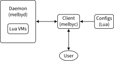

:PROPERTIES:
:ID:       db4f2717-87ac-47b7-9299-11004e8dfa63
:END:
#+title: Developer Manual
#+lilac_maxHeadingLevel: 7

* Overview of this manual

This manual covers several topics:

  - The build system for Literate Programming (LP), which explains how LP is
    used in this project.

  - The build system for packaging Melby, which explains how Melby can be
    packaged up using the Nix Package Manager. This is useful for developing
    Melby locally (setting up a development environment).

  - The daemon and client programs that make up the Melby implementation.

Before we get into the details, let's take a quick look at the tech stack used
and the architectural overview of how the different pieces fit together.

** Tech stack

We use several programming languages: Elixir, Lua, and Rust.

  - *Elixir*: Elixir is the main language used in this project because of it
    leverages the famed Erlang runtime, known for its world-class reliability.
    Elixir is used for programming the base system, as well as testing all of
    the components together.

  - *Lua*: Lua is used as our configuration language, because of its power
    (especially by integrating with [[https://github.com/rvirding/luerl][Luerl]], which allows us to interop with
    Elixir) and flexibility.

  - *Rust*: Rust is used in some places where static typing and performance might
    come in handy. Typically it's used for smaller, pure (lacking side effects)
    functions as NIFs (Native Inline Functions) inside Elixir. It is also used
    for the Melby client binary ~melbyc~.

We also use [[https://en.wikipedia.org/wiki/Literate_programming][Literate Programming]] (LP). To this end, we use Org files
(=*.org=) as the source of truth, and [[https://github.com/listx/lilac][Lilac]] to process them. LaTeX + Noweb is
another possibility, but it was not chosen because Org looks reasonable in
plaintext. These files are /tangled/ into the above languages for the
application binaries. These same Org files are /woven/ to produce HTML files for
documentation (what you are probably reading now). We use several languages for
weaving:

  - *TikZ*: [[https://en.wikipedia.org/wiki/PGF/TikZ][PGF/TikZ]] is used for writing all of the diagrams and figures used for
    documentation. This is because TikZ is extremely stable, powerful, and
    flexible for creating diagrams of all sorts. SVG is the preferred file
    format.

  - *HTML/CSS*: HTML and CSS power the documentation. Although PDF output can be
    very beautiful, HTML is simply more accessible and also does not require
    code listings to be broken across multiple pages.

** Architectural overview of Melby components

#+name: fig:architecture-overall
#+type: figure
#+width: 700px

Melby uses a client/server architecture. There are two main parts:

#+begin_note
=melbyd= is the daemon, which acts as a server in the client/server
architecture. We call it a daemon because it is expected to have direct access
to the local machine which is relevant to the client. This is unlike typical web
servers where the local machine characteristics of such servers are irrelevant
to clients.
#+end_note

  1) =melbyd=: The daemon (server), written in Elixir and Rust.

  2) =melbyc=: The client, written in Rust.

The pieces above work like this:

  1) User writes a Lua script to specify what pieces of information it wants,
     and how it should be presented.

  2) =melbyc= sends this script to =melbyd= for processing.

  3) =melbyd= gathers the necessary data (e.g., Git status or Kubernetes metadata)
     and uses it to generate the final view (an arbitrary string).

  4) The view is sent back to =melbyc=, which then prints it to STDOUT.

* Build System for Literate Programming

** Overview of how LP is used in this project

Melby uses [[https://github.com/listx/lilac][Lilac]], a literate programming tool. Lilac first compiles each Org
file into an object file (~*.lobj~), and then archives all of them into a single
~melby.larc~. Tangling, weaving and linting all work from this archive:

  - ~lilac tangle~ writes the source code files into this repository,

  - ~lilac weave~ writes the HTML pages into ~site/~, and

  - ~lilac lint~ checks that the tangled files match the files tracked by Git.

The [[Makefile][top-level Makefile]] runs these steps for us.

** Lilac project configuration

Lilac reads its project-wide settings from ~Lilac.toml~. We don't publish the
woven site anywhere yet, so the homepage just points to the repository.

The ~nonTangledPathspecs~ list the tracked files that are not tangled from any
Org file, so that ~lilac lint~ does not complain about them. Each entry has a
comment that explains why the file is tracked without being tangled.

#+name: Lilac.toml
#+header: :tangle Lilac.toml
#+begin_src toml
name = "Melby"
homepage = "https://github.com/listx/melby"
repo = "https://github.com/listx/melby"
version = ""
nonTangledPathspecs = [
    # Legalese.
    ":(exclude,top)LICENSE",

    # Lilac sources.
    ":(exclude,top,glob)*.org",

    # Build system metadata.
    ":(exclude,top)client/Cargo.lock",

    # Generated by client/build.rs.
    ":(exclude,top)client/src/grpc_generated/melby_client.rs",

    # Generated gRPC stubs (Elixir).
    ":(exclude,top)daemon/lib/generated",

    # Build system metadata.
    ":(exclude,top)daemon/lib/melbyd/nifs/Cargo.lock",

    # Build system metadata.
    ":(exclude,top)daemon/mix.lock",

    # Generated by mix2nix.
    ":(exclude,top)daemon/mix.nix",

    # Generated SVG output (TikZ->PDF->SVG).
    ":(exclude,top)image/architecture-overall.svg",

    # Generated by Niv.
    ":(exclude,top)package/nix/sources.json",
    ":(exclude,top)package/nix/sources.nix"
]
#+end_src

** Weaving (generating the docs)

Weaving is conceptually simpler than tangling because there is no extra step ---
the output is an HTML page and that is something that we can use directly
(unlike program source code, which may require additional compilation into a
binary, depending on the language). We also limit ourselves to only HTML for
simplicity (in particular, we don't have to worry about page breaks).

Weaving requires the following dependencies:

| Dependency    | Why                              | How to install it |
| GNU Make      |                                  | ?                 |
| lilac         | Tangling, weaving and linting    |                   |
| texlive       | Diagrams (lualatex, dvisvgm)     |                   |

For Melby, we have a top-level =Makefile= so that we can run some =make= commands
on the command line (instead of needing to invoke =lilac= directly).

#+name: Makefile
#+caption: =Makefile=
#+header: :tangle Makefile
#+begin_src makefile
PROJ_ROOT := $(shell git rev-parse --show-toplevel)
PROCS := $(shell nproc)

org_files := index.org developer-manual.org user-manual.org image.org plan.org
obj_files := $(org_files:%.org=%.lobj)
archive_file := melby.larc

all: tangle weave lint

fresh-repl:
	make -C $(PROJ_ROOT) -j$(PROCS) tangle
	make -C $(PROJ_ROOT)/daemon repl

$(obj_files) &: $(org_files)
	lilac compile $?
	touch $(obj_files)

$(archive_file): $(obj_files)
	lilac archive $^ --out-file $@

<<Makefile-tangle>>

weave: build-html

build-images: tangle-sources
	$(MAKE) -C image

build-html: $(archive_file) build-images
	rm -rf site/image
	lilac weave $< --out-dir site --write-css --write-js
	mkdir -p site/image
	cp image/*.svg site/image

lint: $(archive_file)
	lilac --project-conf Lilac.toml lint $<

.PHONY: all weave build-images build-html lint

# Enter development environment.
shell:
	nix-shell --pure
#+end_src

*** Diagrams

The code used to generate the diagrams used in this doc is [[id:658989c2-1695-4240-b28a-3b0781cb1cac][here]]. We don't
discuss that code in this doc because it would make this doc even more verbose.

** Tangling (generating the source code)

Tangling is simply the act of collecting the =#+begin_src ... #+end_src= blocks
and arranging them into the various target (source code) files. Every source
code block is given a unique name.

We simply tangle all major =*.org= files in the top-level Makefile.

#+name: Makefile-tangle
#+begin_src makefile
do-tangle: tangle-sources tangle-generated
.PHONY: do-tangle

tangle:
	make -C $(PROJ_ROOT) -j$(PROCS) do-tangle
.PHONY: tangle

tangle-generated:
	# Generate generated source code.
	$(MAKE) -C daemon all
.PHONY: tangle-generated

# Generate source code. This also generates the toplevel Makefile (this file)
# and image/Makefile (overwriting them if necessary) to bootstrap the whole
# literate-programming pipeline. Note that these LP-related Makefiles are
# different than the ones used to compile the tangled source code.
tangle-sources: $(archive_file)
	lilac tangle $< --out-dir .
.PHONY: tangle-sources
#+end_src

*** Copyright headers

We used to use a utility called =ptu= ("post-tangle utility") to prepend
copyright headers to all tangled files, but this resulted in a few problems:

  1) no support for copyright year ranges (e.g., 2020-2024),

  2) no support for checking when each tangled part was actually modified in
     the Org source file.

Because of these issues, the utility has been removed.

*** .gitignore

#+header: :tangle .gitignore
#+begin_src gitignore
# Cache directory used by the .envrc file.
.direnv

# Apple file system metadata.
.DS_Store

# Temporary files related to image generation.
image/*.aux
image/*.log
image/*.pdf
image/*uncropped*

# Lilac objects and archive (intermediate build artifacts), and the woven site.
*.lobj
*.larc
site/
#+end_src

*** Post-tangled phase

Here we discuss the various programming languages and their required build
environments.

**** Elixir

We use Elixir 1.18 on Erlang/OTP 28.

**** Rust

**** Lua

We use [[https://github.com/rvirding/luerl][luerl]], which uses Lua 5.2 with some 5.3 support.

** Glossary

  - *Melby component*: a modular piece of software used to deliver the Melby
    user experience.

* Build System for Packaging Melby

** Introduction

We use Nix for the build system. Nix allows us to package up Melby into an
installable software unit, or package, as well as provide us a development
environment capable of building Melby from scratch.

*** What we must build

There are several pieces of software we need to build (compile from source):

  1) melbyc (Rust)

  2) melbyd (Elixir)

  3) melbyd Nifs (Rust)

** Development environment

Developing is intimately tied to releasing. And of course, development must come
first before we can release. And so we discuss the development environment here.

We use [[https://github.com/NixOS/nixpkgs][Nixpkgs]] (aka "Nix") to set up the environment, because it is the largest
package repository that's available on both Mac (via [[https://github.com/LnL7/nix-darwin][nix-darwin]]) and Linux. So
it makes developing software that spans across multiple different programming
language ecosystems that much easier.

*** nix-direnv

The [[https://direnv.net/][direnv]] tool looks for =.envrc= files in folders; then you can configure your
shell so that it picks up project-specific settings whenever your shell moves
in/out of such a folder. We invoke =use nix= so that it picks up the environment
defined inside [[file:shell.nix]] (see [[id:b2e59b7b-584d-42a6-9be6-62ce1ccf5240][Nix shell]] below).

#+header: :tangle .envrc
#+begin_src sh
use nix
#+end_src

There are a number of [[https://github.com/direnv/direnv/wiki/Nix][similar projects]] that make the above =use nix= invocation
faster. We recommend using =nix-direnv=. On [[https://github.com/LnL7/nix-darwin][nix-darwin]], installing =nix-direnv= also
installs =direnv= for us on the system.

*** Nix shell
:PROPERTIES:
:ID:       b2e59b7b-584d-42a6-9be6-62ce1ccf5240
:END:

This is what =direnv= will use when we enter the top-level directory in the
shell.

If =direnv= is not available, then we have to manually run the equivalent of the
=use nix= line in [[file:.envrc]], which would be =nix-shell --pure=. You can also do
this by running =make shell=.

This is the main development shell and brings in all of our dependencies to
build all of our code. It's great for development and testing things out (e.g.,
running unit tests) for all of the various languages we use.

#+caption: shell.nix (toplevel dev environment)
#+header: :tangle shell.nix
#+begin_src nix
let
  # Nixpkgs snapshot.
  sources = import ./package/nix/sources.nix;
  # Overlays
  oxalica-rust-overlay = import sources.rust-overlay;
  # Build rust crates.
  naersk = final: prev: {
    naersk = pkgs.callPackage sources.naersk
      {
        inherit sources;
      };
    };
  # The final "pkgs" attribute with all the bells and whistles of our overlays.
  pkgs = import sources.nixpkgs {
    overlays = [
      oxalica-rust-overlay
      naersk
    ];
  };

  protoc-gen-elixir = pkgs.callPackage ./package/protoc-gen-elixir.nix {};
  darwin-cargo-build-rustflags = pkgs.lib.attrsets.optionalAttrs pkgs.stdenv.isDarwin {
    CARGO_BUILD_RUSTFLAGS = "-C link-arg=-undefined -C link-arg=dynamic_lookup";
  };
  # See https://nixos.wiki/wiki/TexLive for customizing texlive packages
  # (picking only those packages we need as in here).
  tex = (pkgs.texlive.combine {
    inherit (pkgs.texlive) scheme-basic
      dvisvgm
      fontspec
      luatex85
      pgf
      sourcesanspro
      standalone
      xkeyval;
  });

  # Lilac (the Haskell version) for tangling and weaving. This comes with its
  # own pinned nixpkgs, so it does not depend on our nixpkgs snapshot above.
  lilacSrc = builtins.fetchGit {
    url = "https://github.com/listx/lilac";
    ref = "refs/tags/v0.3.0.0";
    name = "lilac";
    submodules = true;
  };
  lilacPkg = import "${lilacSrc}/nix/release.nix" { rev = lilacSrc.rev; };
in

# This is our development shell.
pkgs.mkShell ({
  buildInputs = [
    # Rust
    pkgs.rust-bin.stable.latest.default
    pkgs.rust-analyzer

    # Elixir
    pkgs.beam.packages.erlang_28.elixir
    pkgs.beam.packages.erlang_28.erlang # erl, escript
    pkgs.mix2nix

    # gRPC and Protocol Buffers
    pkgs.protobuf
    # Needed for running Elixir plugin for protoc. E.g., "protoc
    # --elixir_out=plugins=grpc:. foo.proto". We need to install
    # protoc-gen-elixir.
    protoc-gen-elixir

    # Tangling and weaving for Literate Programming.
    lilacPkg
    tex

    # For updating Nix dependencies.
    pkgs.niv

    # Misc
    pkgs.git
    pkgs.less
  ]
  # For file_system on Linux.
  ++ pkgs.lib.optional pkgs.stdenv.isLinux pkgs.inotify-tools
  # On macOS, the frameworks that file_system needs (CoreFoundation and
  # CoreServices) come with the default SDK of the stdenv.
  ++ pkgs.lib.optionals pkgs.stdenv.isDarwin [
    # This allows mix2nix to be able to download hex packages using HTTPS, in a
    # `nix-shell --pure` environment. See
    # https://github.com/NixOS/nixpkgs/issues/66716#issuecomment-883399373.
    pkgs.cacert
  ];

  shellHook = ''
    # Prefer to use melbyc from the local development tree path.
    export PATH=$PWD/daemon/test:$PWD/client/target/debug:$PATH
    export KUBECONFIG=$PWD/daemon/test/fake_kube_config
    export MELBY_DIR=$PWD/daemon/test/sample
    export MELBY_PROJECT_ROOT=$PWD
    export LUA_PATH="$PWD/daemon/test/sample/?.lua"
  '';

  # Make Elixir not complain about using "latin1" encoding.
  LANG = "en_US.UTF-8";
  LOCALE_ARCHIVE = pkgs.lib.optional pkgs.stdenv.isLinux
    "${pkgs.glibcLocales}/lib/locale/locale-archive";
} // darwin-cargo-build-rustflags)
#+end_src

** Packaging

*** Releasing
:PROPERTIES:
:ID:       03f01b07-6887-4d68-8f16-612adf9edd60
:END:

We use Nix to package everything up. The main thing to note here is that we
reuse the shell environment's sources (in =nix/sources.nix=) to make sure that
the development environment's dependencies exactly match what we'll end up
shipping.

We also bake the Git commit that we build from into =melbyc= and =melbyd=, so
that =melbyc version= can show it. The packages themselves only see a filtered
copy of their own directory without =.git=, so we look up the commit here
instead, with ~builtins.fetchGit~. If there are uncommitted changes, it gives us
the commit with a =-dirty= suffix (such as =9ce7bd1-dirty=). If we are not
building from a Git repository at all, we use =unknown=.

Because the commit is part of the build inputs, every new commit rebuilds
=melbyc= and =melbyd=, even if it only changes documentation. Their dependencies
(Hex packages, crates and the Rust NIFs) are separate derivations that don't
see the commit, so those stay cached.

#+caption: package/build.nix
#+header: :tangle package/build.nix
#+begin_src nix
let
  sources = import ./nix/sources.nix;
  pkgs = import sources.nixpkgs {};
  git = builtins.fetchGit ../.;
  gitRev =
    if builtins.pathExists ../.git
    then git.dirtyShortRev or git.shortRev
    else "unknown";
  melby-client = pkgs.callPackage ../client/melby-client.nix { inherit gitRev; };
  melby-daemon = pkgs.callPackage ../daemon/melby-daemon.nix { inherit gitRev; };
  melby-nifs = pkgs.callPackage ../daemon/lib/melbyd/nifs/melby-nifs.nix {};
in
  {
    inherit melby-client melby-daemon melby-nifs;
  }
#+end_src

We can now install everything above with =nix-env -if ./release.nix=. Be sure to
run =systemctl --user daemon-reload= to load the =systemd= definition that comes
with =melby.service=, and run =systemctl --user start melby.service= to actually
start it.

#+caption: package/release.nix
#+header: :tangle package/release.nix
#+begin_src nix
let
  sources = import ./nix/sources.nix;
  pkgs = import sources.nixpkgs {};
  melby = import ./build.nix;
in
  pkgs.symlinkJoin {
    name = "melby";
    paths = with melby; [
      melby-client
      melby-daemon
    ];
    # If users have already installed individual packages already, make the ones
    # we bundle here act as a fallback. Default priority is 5, and so by setting
    # it to 10, makes Nix treat the files of this derivation as a fallback if
    # there is a conflict.
    meta.priority = 10;
  }
#+end_src

Additional steps:

Create a =~/.melby/systemd/env= file with the contents

#+begin_example
RELEASE_COOKIE=path/to/cookie
#+end_example

Then populate =path/to/cookie= with a random text string like this:

#+begin_example
$ cd ~/.melby
$ openssl rand -base64 48 > cookie
$ chmod 600 cookie
#+end_example

*** Makefile

#+caption: package/Makefile
#+header: :tangle package/Makefile
#+begin_src makefile

define run_build
	nix-build build.nix --option sandbox relaxed --show-trace \
		-A $(1) --out-link $(1)
endef

build:
	nix-build build.nix --option sandbox relaxed --show-trace

build-melby-client:
	$(call run_build,melby-client)

build-melby-daemon:
	$(call run_build,melby-daemon)

build-melby-nifs:
	$(call run_build,melby-nifs)

shell:
	nix-shell --pure

# Update nix/ folder to pin dependencies to nixos-26.05.
update-nix:
	niv update nixpkgs --branch nixos-26.05

.PHONY: build
.PHONY: build-melby-client
.PHONY: build-melby-daemon
.PHONY: build-melby-nifs
.PHONY: shell
.PHONY: update-nix
#+end_src

*** .gitignore

#+caption: package/.gitignore
#+header: :tangle package/.gitignore
#+begin_src gitignore
# These links can get created if we build individual targets.
melby-client
melby-nifs
melby-daemon

# These result-NUMBER links get created automatically by Nix.
result*
#+end_src
* How to hack on this project
:PROPERTIES:
:ID:       e8018df8-fde2-49ff-8489-551b7cc1a01f
:END:

First realize that this project uses literate programming. Because of this, you
must ensure that you can edit the Org files and make sure that those changes (to
the source code) can get tangled into source code locations for the various
compilers (=rustc=, =elixir=, etc) can consume.

The next most important thing is making sure that the =shell.nix= file at the
project root works (such that running =make shell= works). Run =make shell= to
enter the development environment.

You then need to stand up each individual Melby component.

** Building each component

*** =melbyd= (daemon)

#+begin_example
cd daemon && make
#+end_example

And then to run the daemon, do

#+begin_example
cd daemon && make run_dev
#+end_example

There is also a =run-prod= rule but this won't work if you are already running a
packaged version of =melbyd= in your system, because they will both try to use
the same TCP port. So in that case you have to first stop the packaged version
you are running.

** =melbyc= (client)

#+begin_example
cd client; make build_dev
#+end_example

For invoking =melbyc= after building it, the simplest thing to do is to use the
provided =preview.sh= script in [[file:daemon/test/preview.sh][=daemon/test/preview.sh=]]. This script sets up
all necessary environment variables.

Note that currently the script uses a fake =kubectl=, because we don't want to
bother standing up a real Kubernetes instance in order to just test how
the real =kubectl= would behave. The script hardcodes the path to =melbyc= so
that it refers to the one that has been compiled inside the development
environment.

** Common scenarios

*** Hacking on the Lua config
:PROPERTIES:
:ID:       72ae0f89-3701-4644-bf6a-14bac6278096
:END:

Make sure to use fakes, and to add validation tests.

* melbyc

We first examine the client to get a sense of how things work from the
perspective of the human user, who is expected to invoke =melbyc= somewhere in
their shell prompt generation logic. We then look at the pieces in the daemon to
see how it all works.

** Purpose

=melby-client= is a client for Melby. It allows users to interact with melby (the
daemon).

** Design by contract

We would like our client to observe the following behaviors.

  1) Allow users to talk to the daemon.

  2) Run very quickly (the synchronous call to the daemon should finish in under
     500 milliseconds).

  3) Have basic command-line argument handling.

These points are the main things (or problems) that our program has to worry
about. We look at each of these requirements below.

*** Talking to the daemon

We talk to melbyd using gRPC. This is rather straightforward as it just involves
a single unary (that is, non-streaming) gRPC call.

**** Lua

The more interesting thing here is that we send melbyd some Lua code to give the
user the flexibility of determining exactly how to construct the prompt. This
way, the user is not stuck with only the default "look" of the pieces of the
prompt (the user can do more than just rearrange these pieces --- they can
customizes the pieces themselves). To this

**** Proto
:PROPERTIES:
:ID:       852e9113-6295-4083-aac1-aa5a642de7ef
:END:

For concreteness, this is the actual protobuf file we use to define melbyc's
behavior when it talks to the daemon.

This is the protobuf definition that we need to generate the Rust client stub.
We also use it to generate the Elixir server stubs (used by the daemon).

#+name: melbyproto_melby_client
#+header: :tangle melby_client.proto
#+begin_src protobuf
syntax = "proto3";

package melby_client;

// melbyc <-> melbyd communication
service View {
  rpc GetView (ViewRequest) returns (ViewResponse);
}

message ViewRequest {
  // Path to Lua configuration. Delegates reading the config to the daemon.
  string config_path = 1;

  // Lua configuration that is given directly. Currently unusued by the daemon.
  string config = 2;

  // Environment variables ((name, value) pairs) of interest.
  map<string, string> env_vars = 3;

  // Process ID number of the running (interactive) shell program.
  string shell_pid = 4;
}

message ViewResponse {
  // Status of this response message.
  ViewStatus status = 1;

  // String result of running Lua script.
  string view = 2;

  // Error message from melbyd, if any.
  string error = 3;
}

enum ViewStatus {
  VIEW_STATUS_UNSPECIFIED = 0;
  VIEW_STATUS_ERROR = 1;
  VIEW_STATUS_OK = 2;
  // melbyd could not generate the view in time. The view is a placeholder
  // (possibly empty), and the real view will be ready for a later request.
  VIEW_STATUS_PENDING = 3;
}

// melbyc asks melbyd which build of melbyd is running.
service Version {
  rpc GetVersion (VersionRequest) returns (VersionResponse);
}

message VersionRequest {}

message VersionResponse {
  // Version of melbyd, from its mix.exs.
  string version = 1;

  // Root directory of the running melbyd release. For a release built with
  // Nix, this is its path in the Nix store.
  string root_dir = 2;

  // Git commit that melbyd was built from, such as "9ce7bd1" or
  // "9ce7bd1-dirty", or "unknown".
  string git_rev = 3;
}
#+end_src

The =Version= service only exists so that =melbyc version= can tell which build
of melbyd is running. The version number in =mix.exs= rarely changes, so we also
send the Git commit that melbyd was [[id:03f01b07-6887-4d68-8f16-612adf9edd60][built from]], and the release's root
directory, which for a Nix build differs between any two builds with different
sources.

The client builds in a sandbox that only sees its own directory, so we also
tangle a copy of the proto into it.

#+header: :tangle client/proto/melby_client.proto
#+begin_src protobuf
<<melbyproto_melby_client>>
#+end_src

*** Running very quickly

We don't want the client to block too long, because it is expected to be called
as often as every second (or even more often if Zsh ever offers sub-1-second
delay with the =TMOUT= variable).

The basic way we ensure this is that we make melbyd return whatever it has
without waiting for any of its internal calculations to finish.

Because this is a daemon-side concern, there isn't much for us to do here.

*** Command line argument handling

This is somewhat "boring" and we actually don't have much to design here. Much
of the choices here depend heavily on the command line argument parsing library
that we will be using.

** Code overview

The client is written in Rust. We start with ~Cargo.toml~ for defining
dependencies.

See more keys and their definitions at https://doc.rust-lang.org/cargo/reference/manifest.html.

#+name: rust-client-Cargo.toml
#+caption: Cargo.toml for melbyc
#+header: :tangle client/Cargo.toml
#+begin_src toml
[package]
name = "melbyc"
description = "melby client"
version = "0.1.0"
edition = "2021"

[dependencies]
tonic = "0.14"
tonic-prost = "0.14"
tokio = { version = "1.54", features = ["macros", "rt-multi-thread"] }
prost = "0.14"
clap = { version = "4.6", features = ["derive"]}
config = { version = "0.15", features = ["yaml"]}

[build-dependencies]
tonic-prost-build = "0.14"

[[bin]]
name = "melbyc"
path = "src/main.rs"

[profile.release]
# Strip all symbols.
strip = true
#+end_src

And here's the =.gitignore= for this client.

#+header: :tangle client/.gitignore
#+begin_src gitignore
target
#+end_src

Here's the =Makefile= for building and testing.

#+header: :tangle client/Makefile
#+begin_src makefile
build_dev:
	cargo build
.PHONY: build_dev

build_prod:
	cargo build --release
.PHONY: build_prod

test:
	cargo test
.PHONY: test
#+end_src

Here's the file for protobuf code generation. The =build.rs= name is a special
name that Cargo recognizes automatically.

#+name: build.rs
#+caption: build.rs for melbyc
#+header: :tangle client/build.rs
#+begin_src rust
use std::error::Error;

fn main() -> Result<(), Box<dyn Error>> {
    tonic_prost_build::configure()
        .build_server(false)
        .out_dir("src/grpc_generated") // you can change the generated code's location
        .compile_protos(
            &["proto/melby_client.proto"],
            &["proto"], // specify the root location to search proto dependencies
        )?;

    Ok(())
}
#+end_src

The code above generates =src/grpc_generated/melby_client.rs=. In order to
import it as a module, we have to export it as part of the =grpc_generated=
package. We do that below.

#+name: mod.rs
#+caption: mod.rs for generated code
#+header: :tangle client/src/grpc_generated/mod.rs
#+begin_src rust
pub mod melby_client;
#+end_src

*** Main function

#+name: rust-client-main.rs
#+caption: main.rs for melbyc
#+header: :tangle client/src/main.rs
#+begin_src rust
<<melbyc--imports-1>>
<<melbyc--imports-2>>
<<melbyc--option-handling-1>>
<<melbyc--option-handling-2>>
<<melbyc--main>>
<<melbyc--business-logic>>
<<melbyc--version>>
#+end_src

Basic imports.

#+name: melbyc--imports-1
#+begin_src rust
use std::collections::HashMap;
use std::error::Error;
use std::path::PathBuf;
use std::time::Duration;
use clap::{Parser, Subcommand};
use tonic::transport::{Channel, Endpoint};
#+end_src

Import generated gRPC code. These are built by =build.rs=.

#+name: melbyc--imports-2
#+begin_src rust
pub mod grpc_generated;
use grpc_generated::melby_client::view_client::ViewClient;
use grpc_generated::melby_client::ViewRequest;
use grpc_generated::melby_client::version_client::VersionClient;
use grpc_generated::melby_client::VersionRequest;
#+end_src

Global options.

#+name: melbyc--option-handling-1
#+begin_src rust
#[derive(Parser)]
#[command(version, about, long_about = None)]
/// Global options (applies to all subcommands).
struct Cli {
    /// Config file path.
    #[arg(short, long,
          value_name = "LUA_CONFIG_FILE", default_value = "~/.melby/melby.lua")]
    config: PathBuf,

    /// Inline Lua config if you want to test out small(er) snippets of code
    /// directly without having to write a LUA_CONFIG_FILE on disk somewhere.
    /// Currently ignored by the daemon.
    #[arg(short = 'r', long,
          value_name = "RAW_INLINE_LUA_CONFIG", default_value = "")]
    config_raw: String,

    /// Port of melbyd (presumed to be running on localhost).
    #[arg(short, long, default_value_t = 50051)]
    melbyd_port: u16,

    /// Subcommands.
    #[command(subcommand)]
    command: Option<Commands>,
}
#+end_src

Subcommands.

#+name: melbyc--option-handling-2
#+begin_src rust
/// Subcommands and their options.
#[derive(Subcommand)]
enum Commands {
    View {
        #[arg(short, long, default_value_t = 0)]
        shell_pid: u32,
    },
    /// Print which builds of melbyc and melbyd are running.
    Version,
}
#+end_src

Entrypoint.

#+name: melbyc--main
#+begin_src rust
#[tokio::main]
async fn main() {
    let cli = Cli::parse();

    let result = match &cli.command {
        Some(Commands::View { shell_pid }) => view(&cli, *shell_pid).await,
        Some(Commands::Version) => version(&cli).await,
        None => Ok(()),
    };

    if let Err(e) = result {
        eprintln!("melbyc: {}", describe(e.as_ref()));
        std::process::exit(1);
    }
}

// Describe an error along with all of its causes. Errors from tonic are often
// vague on their own (such as "transport error"), and only their causes say
// what actually went wrong (such as "Connection refused").
fn describe(e: &dyn Error) -> String {
    let mut msg = e.to_string();
    let mut cause = e.source();
    while let Some(c) = cause {
        msg.push_str(&format!(": {}", c));
        cause = c.source();
    }
    msg
}
#+end_src

View the output of running the Lua configuration inside melbyd.

melbyd [[id:bfc9b5c9-64e2-4d3f-a38c-1167eea1828b][replies within 500ms]], even if it has to reply with a placeholder. But melbyd
could still hang (or be stuck in a long garbage collection), and the shell
prompt must never hang along with it. So we also give up on our own after
=VIEW_TIMEOUT=, both when connecting and when waiting for the response. We then
exit with an error without printing a view, so the shell keeps its previous
prompt.

#+name: melbyc--business-logic
#+begin_src rust
const VIEW_TIMEOUT: Duration = Duration::from_millis(1000);

async fn connect(cli: &Cli) -> Result<Channel, Box<dyn Error>> {
    let url = format!("http://127.0.0.1:{0}", cli.melbyd_port);
    let channel = Endpoint::from_shared(url)?
        .connect_timeout(VIEW_TIMEOUT)
        .timeout(VIEW_TIMEOUT)
        .connect()
        .await
        .map_err(|e| format!("cannot reach melbyd on port {}: {}", cli.melbyd_port, describe(&e)))?;
    Ok(channel)
}

async fn view(cli: &Cli, shell_pid: u32) -> Result<(), Box<dyn Error>> {
    let channel = connect(cli).await?;
    let mut client = ViewClient::new(channel);

    let mut env_vars: HashMap<String, String> = HashMap::new();
    for (k, v) in std::env::vars() {
        env_vars.insert(k, v);
    }

    let req = ViewRequest {
        config_path: cli.config.display().to_string(),
        config: cli.config_raw.to_string(),
        env_vars: env_vars,
        shell_pid: shell_pid.to_string(),
    };

    let request = tonic::Request::new(req);
    let response = client.get_view(request).await?;

    println!("{}", response.get_ref().view);

    Ok(())
}
#+end_src

Print which builds of melbyc and melbyd are running. Besides the version
numbers, we print the Git commit that each one was built from, and where each
one is installed, because for a Nix build that path changes whenever the sources
do. We print the client's line first, so that it still shows up if melbyd is
down.

The [[id:03f01b07-6887-4d68-8f16-612adf9edd60][Nix build]] gives us the commit in the =MELBY_GIT_REV= environment variable
at compile time. Other builds (such as =cargo build= in a development checkout)
don't set it, so we fall back to =unknown=.

#+name: melbyc--version
#+begin_src rust
const GIT_REV: &str = match option_env!("MELBY_GIT_REV") {
    Some(rev) => rev,
    None => "unknown",
};

async fn version(cli: &Cli) -> Result<(), Box<dyn Error>> {
    let exe = std::env::current_exe()?;
    println!("melbyc {} {} {}", env!("CARGO_PKG_VERSION"), GIT_REV, exe.display());

    let channel = connect(cli).await?;
    let mut client = VersionClient::new(channel);
    let response = client.get_version(tonic::Request::new(VersionRequest {})).await?;
    let v = response.get_ref();
    println!("melbyd {} {} {}", v.version, v.git_rev, v.root_dir);

    Ok(())
}
#+end_src

** Packaging

#+header: :tangle client/melby-client.nix
#+begin_src nix
{ sources ? import ../package/nix/sources.nix, gitRev ? "unknown" }:
let
  # Overlays
  oxalica-rust-overlay = import sources.rust-overlay;
  # Build rust crates.
  naersk = pkgs.callPackage sources.naersk {
    cargo = pkgs.rust-bin.stable.latest.minimal;
    rustc = pkgs.rust-bin.stable.latest.minimal;
  };
  # The final "pkgs" attribute with all the bells and whistles of our overlays.
  pkgs = import sources.nixpkgs {
    overlays = [
      oxalica-rust-overlay
    ];
  };
in
  naersk.buildPackage {
    src = ./.;
    copyBins = true;
    copyTarget = false;
    # See https://pyo3.rs/v0.14.2/building_and_distribution.html#macos (by way
    # of https://github.com/PyO3/pyo3/issues/1800#issuecomment-1071890916).
    CARGO_BUILD_RUSTFLAGS = pkgs.lib.optional
      pkgs.stdenv.isDarwin
      "-C link-arg=-undefined -C link-arg=dynamic_lookup";
    buildInputs = [
      pkgs.protobuf
    ];
    # Only set this for the final build, not the one for dependencies, so that
    # a new commit doesn't rebuild all our crates.
    overrideMain = old: {
      MELBY_GIT_REV = gitRev;
    };
  }
#+end_src

* melbyd

** Purpose

=melbyd= is the daemon for Melby. It is written in Elixir and serves requests to
=melbyc= (the client). The daemon is the heart of the project because it's where
most of the interesting things happen.

** Proto

#+name: melby.proto
#+header: :tangle melby.proto
#+begin_src protobuf
syntax = "proto3";

package melby;

// Client communication.
import "melby_client.proto";
import "melby_daemon.proto";
#+end_src

** Tech stack

The configuration language for shell prompts (the interface to using Melby for
end users) is Lua. This Lua configuration is used to set up Luerl VMs inside
Elixir, where one VM corresponds to one shell PID's prompt.

Elixir is the heart of the stack. There is a bit of Rust (as NIFs in Elixir). We
use gRPC for communication between the client (melbyc, written in Rust) and the
daemon (melbyd).

** Life of a request to render a shell prompt

Keep in mind that in order to create a request, the user must first define Lua
configuration that describes what sort of data we want in the prompt, as well as
how to present it (colors, padding, etc). We have sample configuration that the
user can use in our test folder.

With that out of the way, let's look at the flow of a request:

  1) =GetView= gRPC method called by melbyc (client): The client sends the path to
     the main Lua configuration file on disk.

  2) Melbyd (daemon) reads the Lua configuration and interprets it. The Lua code
     contains calls to the Melby SDK. That is, the Lua code is allowed to call
     into melbyd (Elixir) to *generate data* (melbyd), as well as *format/render*
     that data (see [[id:148aff9d-f020-4e61-acb6-59250484692d][Rendering]]).

  3) The formatted data is returned as a =ViewResponse=. Currently the response is
     just inline shell code which can be sourced directly by the shell. The
     inline code assigns values to certain shell variables, and these shell
     variables are meant to be combined into the user's =PS1= shell variable.

** Internals

#+begin_comment
(old) Model start
#+end_comment

*** Standard Resource Server
:PROPERTIES:
:ID:       a6523578-acd8-40cc-b192-0011fd3802bb
:END:

This section describes the implementation of the Standard Resource Server, a
generic =GenServer= that is designed to store arbitrary state from the output of
shell commands, all configured via Lua by the user. SRS is designed to be
generic enough to solve 80% of the problem of defining easily-tracked resources
which can be cached (stored in =GenServer= state) and retrieved for consumption,
typically for building shell prompts and/or status information.

The use of the cache is important because SRS will only execute the shell
command(s) needed to generate a new state if it detects possible staleness of
the existing data. Then, the new state (only if it is meaningfully different
than the existing one) will be used to compare against the previously-stored
state. Then a diffing function will run to compare these states, and store a
new message in the message inbox for this SRS if there is some interesting
difference worth noting.

In summary, we store 2 things:

  1) the history of states (has at least the 2 most recent "readings"), and

  2) a message box to store notable changes to the state history.

We keep track of a standard resource, where the state for this resource is
generated via shell commands and parsed via Lua configuration. This is a
general-purpose module designed for use with various shell commands.

If no clients request information from us for some TTL period of time, we shut
down this process.

**** Proto

#+name: melbyproto_melby_daemon
#+header: :tangle melby_daemon.proto
#+begin_src protobuf
syntax = "proto3";

package melby_daemon;

message StandardResource {
  StandardResourceStatus status = 1;
  map<string, string> kvs = 2;
}

enum StandardResourceStatus {
  STANDARD_RESOURCE_STATUS_UNSPECIFIED = 0;

  // Denotes that the basic resource was not able to be retrieved because it was
  // invoked wrongly (e.g., a non-git-repo given to a git command).
  STANDARD_RESOURCE_STATUS_NOT_APPLICABLE = 1;

  STANDARD_RESOURCE_STATUS_LOADING = 2;
  STANDARD_RESOURCE_STATUS_LOADED = 3;
}
#+end_src

**** Implementation
:PROPERTIES:
:ID:       e23de83a-180c-4051-9a16-eecb4b3a7c31
:END:

#+header: :tangle daemon/lib/melbyd/standard_resource.ex
#+begin_src elixir
defmodule Melbyd.StandardResource do
  # If a Standard Resource Service process dies, don't restart it, because it
  # will be restarted on the next use (when a client requests info for it).
  use GenServer, restart: :temporary
  require Logger

  # 1 second. This is how quickly we can call the various reader functions
  # (which can be expensive). If we detect some possibility of staleness, we
  # re-execute the reader functions to retrieve the new state. If no staleness
  # is detected, then nothing happens in this tick.
  #
  # In the case where staleness is detected, we run the "read" function which
  # re-reads state. After this function complete, we run tick() again. So the
  # "busiest" we can be is tick() -> read() -> tick() -> read(), and so on. Or,
  # more realistically, it will be tick() -> tick() -> tick() -> read() ->
  # tick(), where there are multiple (possibly tens or hundreds) of ticks before
  # we need to call read().
  @tick_interval 1000

  # This function is called to initiate a brand new process. The most important
  # part here is the id, which is passed into via_tuple/1 to generate a tuple
  # that can be used to look up this process in a globally unique way. This way
  # we can send messages to *existing* processes and work with them.

  # Note that we pass the args_for_init tuple as the second argument to
  # GenServer.start_link/3, which in turn runs the init/1 callback by passing in
  # this same second argument.

  # An SRS instance is started by a gRPC call from melbyc, because only melbyc
  # knows which repo_id path to use (using "git"-flavored SRS as an example).
  # Because melbyc is the entrypoint, we should store all Lua config for SRS in
  # the same config used by the user for prompt generation and widget rendering.
  def start_link(
        %{
          id: {_resource_type, _resource_id} = id,
          resource: _resource,
          resource_opts: _resource_opts,
          ttl: _ttl,
          notify_on_exit_pid: _notify_on_exit_pid
        } = args_for_init
      ) do
    GenServer.start_link(__MODULE__, args_for_init, name: via_tuple(id))
  end

  # Used to identify this process uniquely in the entire Elixir system. We use
  # the gproc library for this.
  defp via_tuple(id) do
    key = {:n, :l, {__MODULE__, id}}
    {:via, :gproc, key}
  end

  @impl true
  def init(
        %{
          id: id,
          resource: resource,
          resource_opts: resource_opts,
          ttl: ttl,
          notify_on_exit_pid: notify_on_exit_pid
        } = _args
      ) do
    # Trap exits so that we can terminate gracefully (such as not logging an
    # error due to an intentional shutdown).
    #
    # Note that this will result in receiving all exits from all other linked
    # processes --- in our case this happens rather frequently from our use of
    # System.cmd/3 when the shell processes we start exit normally after
    # finishing execution (with a ":normal" reason).
    Process.flag(:trap_exit, true)

    Logger.info("Starting SRS #{inspect(id)}; ttl=#{inspect(ttl)}")

    # We have to subscribe to the fake_* topic ASAP (in init/1 here, not in
    # handle_continue/2), because it may be the case that handle_continue/2 will
    # not finish running by the time we broadcast the message to shut down this
    # GenServer on this fake_* topic.
    if resource_opts["fake"] do
      Logger.debug("#{inspect(id)}: subscribing to fake_" <> resource_opts["vm_fingerprint"])
      # Listen to the topic dedicated for all fakes created for a particular
      # vm_fingerprint. Then later when we're done with using this fake
      # (validation phase is over), we can delete all fakes by sending a message
      # here.
      Phoenix.PubSub.subscribe(Melbyd.PubSub, "fake_" <> resource_opts["vm_fingerprint"])
    end

    initial_state = %{
      id: id,
      resource: resource,
      resource_opts: resource_opts,
      state_hist: [],
      # This is stale because we haven't read any information yet.
      stale: true,
      ttl: ttl,
      ttl_max: ttl,
      notify_on_exit_pid: notify_on_exit_pid,
      reads: 0
    }

    # Return quickly, so that we don't block the creation of this GenServer. We
    # handle additional setup in the handle_continue/2 below.
    {:ok, initial_state, {:continue, :initial_read}}
  end

  @impl true
  def handle_continue(
        :initial_read,
        %{
          id: id,
          resource: resource,
          resource_opts: resource_opts,
          ttl: ttl,
          ttl_max: ttl,
          notify_on_exit_pid: notify_on_exit_pid,
          reads: reads
        } = state
      ) do
    {resource_type, resource_id} = id

    # Do an initial read to populate state. Note that this assumes that melbyd is
    # running on the same machine as the client.
    t1 = Timex.local()
    state_current = run_readers(resource, resource_opts, reads)
    t2 = Timex.local()

    # Give diagnostic report about how long it took to run all the commands to
    # generate the initial state.
    seconds_float = DateTime.diff(t2, t1, 10) / 10

    message = %{
      topic: "srs_#{resource_type}",
      from: "#{resource_id}",
      payload: %{
        level: "info",
        time: Calendar.strftime(t2, "%H:%M:%S"),
        text: "Initial read took #{seconds_float}s."
      }
    }

    Phoenix.PubSub.broadcast(Melbyd.PubSub, "srs_" <> resource_type, message)

    # History of states to store. This could be 1 or 100, depending on how much
    # recency data we want to retain. It may be that we want to store 100
    # (unique) states because we want to keep short-term-memory that we want to
    # retrieve, such as "what are the names of all git branches I have checked
    # out in the current session?" to be able to switch to them easily without
    # having to remember the exact names. Another example is providing users a
    # list of all unique SHAs that were visited in the current session.
    state_hist = [state_current]

    new_state = %{
      state
      | state_hist: state_hist,
        stale: false,
        reads: reads + 1
    }

    # Activate staleness detectors. For the FileSystem, we set up an
    # fs_event_handler.
    #
    # For fake resources, we skip setting up filesystem-based staleness
    # detection because we want to stop SRS from reading state on its own
    # initiative. Instead for fake resources, their states should only be
    # refreshed when the caller calls read().
    new_state =
      if resource_opts["fake"] do
        # For "fake" resources, skip filesystem flaggers because we could be
        # working with fake filesystem folders that don't actually exist. In
        # exchange, it's up to the rest of the fake handling code to understand
        # how to make up for this (make the user send in fake filesystem events
        # that SRS can still react to).
        new_state
      else
        [staleness_flaggers_luerl_array] = resource["staleness_flaggers"].([resource_id])

        staleness_flaggers_luerl_tables =
          Melbyd.LuerlUtil.array_to_native_list(staleness_flaggers_luerl_array)

        staleness_flaggers =
          staleness_flaggers_luerl_tables |> Enum.map(&Melbyd.LuerlUtil.table_to_native_map/1)

        Enum.reduce(staleness_flaggers, new_state, &setup_staleness_flagger/2)
      end

    # Start up the tick process to detect staleness and subsequent re-reading of
    # state. Only do this if we are a real resource.
    if not resource_opts["fake"] do
      tick(ttl, notify_on_exit_pid)
    end

    {:noreply, new_state}
  end

  defp run_readers(resource, resource_opts, reads) do
    [readers_luerl_array] = resource["readers"].([resource_opts])
    readers = Melbyd.LuerlUtil.array_to_native_list(readers_luerl_array)

    kvs =
      if resource_opts["fake"] do
        # Run the fake readers instead of the real ones.

        # For the time_idx, we can use a new "reads" field in the state that
        # starts at 0 and is incremented by 1 every time that run_readers()
        # completes. We don't care about overflows because Elixir uses arbitrary
        # precision integers (and btw it'll take billions of years of continuous
        # incrementation until we need to use more than 64 bits so even if
        # Elixir did not use arbitrary precision, we would virtually never
        # overflow).

        time_idx = reads

        # The fake readers generate data. We still need the regular readers
        # because we need to know which readers need which parsers.
        [fake_readers_luerl_table] = resource["fake"]["readers"].([resource_opts, time_idx])
        fake_readers = Melbyd.LuerlUtil.table_to_native_map(fake_readers_luerl_table)
        case read_fakes(readers, resource, resource_opts, fake_readers, time_idx) do
          {[], kvs} ->
            kvs

          {errors, _kvs} ->
            Logger.warning("got #{Kernel.length(errors)} errors reading fake readers")
            errors |> Enum.map(fn e -> Logger.warning(e) end)
            # Still return those kvs that were successfully parsed as expected.
            raise "failed validation"
        end
      else
        # We should by default read serially because it is "safer". E.g., for
        # git we definitely do not want to run everything in parallel because
        # each git command could block on a global lockfile located in the .git
        # folder of a repo.
        if resource_opts["read_parallel"] do
          read_parallel(readers, resource)
        else
          read_serial(readers, resource)
        end
      end

    %MelbyDaemon.StandardResource{status: :STANDARD_RESOURCE_STATUS_LOADED, kvs: kvs}
  end

  # For fake readers, check that the parser's output matches the expected output
  # in the fake.
  defp read_fakes(readers, resource, resource_opts, fake_readers, time_idx) do
    Enum.reduce(readers, {[], %{}}, fn reader_table, {errors, kvs} ->
      reader = Melbyd.LuerlUtil.table_to_native_map(reader_table)
      fake_reader_table = fake_readers[reader["parser"]]
      fake_reader = Melbyd.LuerlUtil.table_to_native_map(fake_reader_table)
      parser_func = resource["parser"][reader["parser"]]
      src = fake_reader["input"]
      kvs_subset = parser_func.([src]) |> Kernel.hd() |> Melbyd.LuerlUtil.table_to_native_map()

      # If the output does not match what we actually parsed, raise an error.
      expected = fake_reader["output"] |> Melbyd.LuerlUtil.table_to_native_map()

      errors = if kvs_subset != expected do
        ["resource type #{resource["type"]}: " <>
          "resource_opts #{inspect(resource_opts)}: " <>
          "time_idx #{time_idx}: " <>
          "expected #{inspect(expected)}, got #{inspect(kvs_subset)}" | errors]
      else
        errors
      end

      # Merge the data we've collected into acc.
      {errors, Map.merge(kvs, kvs_subset)}
    end)
  end

  defp read_single(reader_table, resource) do
    reader = Melbyd.LuerlUtil.table_to_native_map(reader_table)
    invocation = Melbyd.LuerlUtil.array_to_native_list(reader["invocation"])
    cmd_head = Kernel.hd(invocation)
    cmd_args = Enum.drop(invocation, 1)
    cd = reader["cd"]

    cmd_opts_cd =
      if cd != nil do
        [cd: cd]
      else
        []
      end

    cmd_opts_env =
      if reader["env"] != nil do
        env =
          Melbyd.LuerlUtil.table_to_native_map(reader["env"])
          |> Enum.map(fn {k, v} -> {k, v} end)

        [env: env]
      else
        []
      end

    cmd_opts = cmd_opts_cd ++ cmd_opts_env

    parser_func_name = reader["parser"]
    parser_func = resource["parser"][parser_func_name]

    src =
      try do
        case System.cmd(cmd_head, cmd_args, cmd_opts) do
          {stdout, 0} ->
            stdout

          {_stdout, error_code} ->
            Logger.warning("Command #{inspect(invocation)} failed with error code #{error_code}")

            # Return empty string. Parsers should know how to deal with the
            # empty string (and accept that no output means that we should
            # return a default value).
            ""
        end
      rescue
        e ->
          Logger.warning("Command #{inspect(invocation)} failed: #{Exception.message(e)}")
          ""
      end

    Logger.debug("Running parser_func #{inspect(parser_func_name)}")

    # Now parse the output with the custom function to generate some keys and
    # values (a map). For simplicity both the keys and values here should not be
    # a collection type (map, array, etc) and instead be a primitive like a
    # string or number.
    parser_func.([src]) |> Kernel.hd() |> Melbyd.LuerlUtil.table_to_native_map()
  end

  defp read_serial(readers, resource) do
    Enum.reduce(readers, %{}, fn reader_table, acc ->
      kvs_subset = read_single(reader_table, resource)
      # Merge the data we've collected into acc.
      Map.merge(acc, kvs_subset)
    end)
  end

  # async tasks can crash the caller (and vice versa)
  # https://hexdocs.pm/elixir/1.14.2/Task.html#module-async-and-await. Also,
  # note that this function may take minutes, or even hours, to return. But it's
  # OK because we're not blocking anyone else.
  defp read_parallel(readers, resource) do
    tasks =
      Enum.reduce(readers, [], fn reader_table, acc ->
        task = Task.async(fn -> read_single(reader_table, resource) end)
        # Collect this task.
        [task | acc]
      end)

    # Each task returns a map. We need to merge all of these maps into each
    # other.
    maps = Task.await_many(tasks, :infinity)
    Enum.reduce(maps, &Map.merge/2)
  end

  @impl true
  def handle_call(
        :read,
        _from,
        %{state_hist: state_hist, ttl: ttl, ttl_max: ttl_max} = state
      ) do
    response =
      case state_hist do
        [] -> %MelbyDaemon.StandardResource{status: :STANDARD_RESOURCE_STATUS_LOADING}
        [current | _] -> current
      end

    # If ttl is < 1, then this means that either the ttl naturally expired (ttl
    # == 0) or that we set this ttl manually to -1 because the fs watcher died.
    # In either case, do not change the ttl.
    #
    # Otherwise, reset the ttl because a client actually needed this
    # information.
    ttl_new =
      if ttl < 1 do
        ttl
      else
        ttl_max
      end

    {
      :reply,
      # Response to the caller.
      response,
      # New state of this GenServer.
      %{state | ttl: ttl_new}
    }
  end

  # GenServer callbacks.
  <<melbyd_srs_handle_call-1>>
  <<melbyd_srs_handle_call-2>>
  <<melbyd_srs_handle_cast>>
  <<melbyd_srs_handle_info-1>>
  <<melbyd_srs_handle_info-2>>
  <<melbyd_srs_handle_info-3>>
  <<melbyd_srs_handle_info-4>>
  <<melbyd_srs_handle_info-5>>
  <<melbyd_srs_handle_info-6>>
  <<melbyd_srs_handle_info-7>>

  # Tick
  <<melbyd_srs_tick>>

  # Mark staleness
  <<melbyd_srs_staleness>>
  <<melbyd_srs_staleness_detector_setup-1>>
  <<melbyd_srs_staleness_detector_setup-2>>
  # Filesystem-based staleness
  <<melbyd_srs_staleness_filesystem_helpers>>

  # Client interface
  <<melbyd_srs_client_interface>>
end

# Supervisor.
<<melbyd_srs_supervisor>>
#+end_src

**** Tick

#+name: melbyd_srs_tick
#+begin_src elixir
# Send a "tick" message to our GenServer in 1 second. See
# https://stackoverflow.com/a/32097971/437583.
defp tick(ttl, notify_on_exit_pid) do
  case ttl do
    n when n in -1..0 ->
      if n == 0 do
        Logger.info("TTL expired; shutting down this GenServer due to client neglect")
      else
        Logger.info(
          "TTL expired manually; shutting down this GenServer"
        )
      end

      # Used for testing, where we assert that we can receive this
      # ":shutting_down" message after the ttl expires.
      if notify_on_exit_pid do
        send(notify_on_exit_pid, :shutting_down)
      end

      Process.exit(self(), :ttl_deadline_exceeded)
    _ ->
      # Send after 1 second. We could alternatively use :timer.send_interval
      # (Erlang function) in init/1 and avoid calling this function manually in
      # handle_info/2, but then that would send the tick at a constant rate,
      # regardless of how long it takes to process the tick. This runs the risk of
      # growing the message queue at a faster rate than it can be processed
      # (unbounded growth).
      Process.send_after(self(), :tick, @tick_interval)
  end
end
#+end_src

#+name: melbyd_srs_handle_info-1
#+begin_src elixir
# Process tick. The tick must handle the true and false cases for the "stale"
# key of the state. First we handle the case where stale is true (we must
# re-read data).
<<melbyd_srs_tick_do_work>>

@impl true
def handle_info(
      :tick,
      %{ttl: ttl, notify_on_exit_pid: notify_on_exit_pid} = state
    ) do
  new_state = maybe_refresh_state_and_notify(state)

  # Continue ticking for the future. But optionally die if ttl is too low.
  tick(ttl, notify_on_exit_pid)

  {:noreply, new_state}
end
#+end_src

#+name: melbyd_srs_tick_do_work
#+begin_src elixir
defp maybe_refresh_state_and_notify(
       %{
         id: id,
         resource: resource,
         resource_opts: resource_opts,
         state_hist: state_hist,
         stale: stale,
         ttl: ttl,
         reads: reads
       } = state
     ) do
  if stale do
    Logger.info("Re-reading state for #{inspect(id)}")
    new = run_readers(resource, resource_opts, reads)
    Logger.info("Finished re-reading state for #{inspect(id)}")

    new_state_hist =
      case state_hist do
        # This list is always populated with at least 1 element because we
        # populate it as a singleton list in init/1.
        [old | _] ->
          if old == new do
            # NOP because there is no change between the currnt reading and the
            # last reading we did.
            Logger.info("skipping addition of new state; NOP")
            state_hist
          else
            # Generate any new messages for any diff between the old and new
            # states.
            Logger.info("checking for any new messages to broadcast")
            {_, resource_id} = id
            resource["notify"].([resource_id, old, new])

            # Drop oldest state from state_hist if adding (prepending) to it
            # would exceed our history size.
            [new | state_hist] |> Enum.take(resource["history_size"])
          end
      end

    %{state | state_hist: new_state_hist,
              stale: false,
              ttl: ttl - 1,
              reads: reads + 1}
  else
    # Now handle the case where staleness is false (no need to read new data).
    # In this case the only thing that happens is the ttl age getting older (1
    # unit closer to 0).

    %{state | ttl: ttl - 1}
  end
end
#+end_src

#+name: melbyd_srs_handle_call-1
#+begin_src elixir
@impl true
def handle_call(
      :tick,
      _from,
      state
    ) do
  new_state = maybe_refresh_state_and_notify(state)

  # Unlike for the handle_info version, we do not tick again on our own, because
  # this is meant to be used only as a way for fake resources to get updated
  # manually in a synchronized fashion. If we were to tick ourselves now, then
  # we would essentially start updating our state asynchronously, missing the
  # point.
  {:reply, :ok, new_state}
end
#+end_src

**** Marking staleness

If we mark an SRS GenServer as stale, this forces the re-reading of state such
that it is loaded as the newest element in the =state_hist= queue.

#+name: melbyd_srs_staleness
#+begin_src elixir
defp mark_stale(id) do
  GenServer.cast(via_tuple(id), :mark_stale)
end
#+end_src

For production, we don't care about being synchronous. We also can't use
=self()= because we might have to mark other SRS GenServers as stale (e.g., for
filesystem-based staleness flaggers that walk up the filesystem tree and mark
everyone there as stale).

In our GenServer callback =handle_cast(:mark_stale, ...)= below, we also set
=status= of the current (head) element in =state_hist= to
=:STANDARD_RESOURCE_STATUS_LOADING=. This is so that any client reads of our
state between now and the next tick() will know that we've recognized the need
to refresh the state on the next tick().

#+name: melbyd_srs_handle_cast
#+begin_src elixir
@impl true
def handle_cast(:mark_stale, %{stale: _, state_hist: [current | rest]} = state) do
  {:noreply,
   %{
     state
     | stale: true,
       state_hist: [%{current | status: :STANDARD_RESOURCE_STATUS_LOADING} | rest]
   }}
end
#+end_src

For fake resources, we want to make this function block with a =call= so that we
can be more precise with how its state is updated with a followup coordinated
=:tick= message (also a =call=).

#+name: melbyd_srs_handle_call-2
#+begin_src elixir
@impl true
def handle_call(:mark_stale, _from, %{stale: _, state_hist: [current | rest]} = state) do
  {:reply,
   :ok,
   %{
     state
     | stale: true,
       state_hist: [%{current | status: :STANDARD_RESOURCE_STATUS_LOADING} | rest]
   }}
end
#+end_src

***** Filesystem-based staleness

We want to be able to automatically mark for staleness based on filesystem
events. This is the reason for this section. Note that this notion of
filesystem-based staleness is completely optional --- if an SRS GenServer is
configured so that it doesn't "register" for filesystem-based staleness, none of
the code here will get used (because no one will send the ={:file_event, ...}=
tuple to us).

Regarding implementation, the key here is to forward filesystem events (detected
as ={path, events}= tuples) to the Lua function that the user defines. It's up
to that function to return a True or False boolean. If it returns True, then we
mark the current SRS GenServer as *stale*, as well as all parent SRS GenServers
as stale (if any), by calling =mark_all_stale_from/1=.

The original reason why we mark all parents as stale is for the case where we
have Git submodules and we delete/edit some files in the submodule. In this
scenario it could be that the superproject Git repo needs to update its
information, and so we need to mark it as stale as well. And because submodules
can technically be nested, we need to go all the way up to the filesystem root.

Conceivably, other SRS GenServers that rely on filesystem staleness probably
want the same =mark_all_stale_from/1= behavior.

#+name: melbyd_srs_handle_info-2
#+begin_src elixir
@impl true
def handle_info(
      {:file_event, _watcher_pid, {path, events}},
      %{
        id: id,
        fs_event_handler: fs_event_handler,
        stale: false
      } = state
    ) do
  {resource_type, _resource_id} = id
  # Now translate our path and events arguments to send into the Lua function,
  # and call it.
  [should_mark_stale] = fs_event_handler.([path, events])

  if should_mark_stale do
    # Invalidate the cache entry for all current and parent SRS GenServers
    # between / and path. This includes us (our particular SRS GenServer
    # instance) as well.
    mark_all_paths_stale_from({resource_type, path})
  else
    Logger.debug(
      "ignoring Git index path #{path}; events:#{inspect(events)}"
    )
  end

  {:noreply, state}
end
#+end_src

****** Boilerplate
:PROPERTIES:
:ID:       7edeccf0-870f-4a2c-9e74-26618a2c33b6
:END:

This section captures universally-applicable filesystem events which are
independent of what the user specifies in their Lua configuration.

First, if the filesystem watcher dies, we set the time-to-live (TTL) value for
our GenServer to -1 so that it will exit itself on the next tick. Setting this
to -1 is important because it signals to the other =handle_call= callback which
accepts the =:read= atom that it should not reset the TTL back up to =ttl_max=.

#+name: melbyd_srs_handle_info-3
#+begin_src elixir
@impl true
def handle_info(
      {:file_event, watcher_pid, :stop},
      %{
        id: id
      } = state
    ) do
  Logger.info("SRS id #{inspect(id)}, fs watcher #{inspect(watcher_pid)}: FileSystem monitor stopped")

  {:noreply, %{state | ttl: -1}}
end
#+end_src

The second is to ignore all filesystem events if the GenServer state has already
been marked as *stale*. This is because the only thing that a filesystem event
can do is to flag for staleness; if we're already stale, then any additional
filesystem event is redundant as far as staleness is concerned. On the next
tick, when we see that we're in a stale state, we will regenerate the state and
mark ourselves as being fresh (=stale: false=) again.

#+name: melbyd_srs_handle_info-4
#+begin_src elixir
@impl true
def handle_info(
      {:file_event, _watcher_pid, {_path, _events}},
      %{
        stale: true
      } = state
    ) do
  Logger.debug("Ignoring filesystem event because state is already stale")
  {:noreply, state}
end
#+end_src

******* Setup

Setting up a filesystem-based staleness detector requires calling out to the
=FileSystem= library, so that we can subscribe to filesystem events in the first
place. We do this if we see that the resource has a configuration specified for
it.

When the user specifies a directory to watch, we watch it and all of it
subdirectories for changes.

#+name: melbyd_srs_staleness_detector_setup-1
#+begin_src elixir
defp setup_staleness_flagger(
       %{"type" => "filesystem",
         "watch_paths" => watch_paths_lua_array,
         "fs_event_handler" => fs_event_handler} =
         _staleness_flagger,
       initial_state
     ) do

  watch_paths = Melbyd.LuerlUtil.array_to_native_list(watch_paths_lua_array)
  Logger.info("Watching filesystem directory #{inspect(watch_paths)}")
  {:ok, watcher_pid} = FileSystem.start_link(dirs: watch_paths)
  FileSystem.subscribe(watcher_pid)

  # We need to save this info about fs, because we need to run the fs event
  # handler (we can do the full lookup using get_resources but this is slightly
  # cheaper).
  Map.put(initial_state, :fs_event_handler, fs_event_handler)
end
#+end_src

****** Helpers

Here are some helper functions. The main workhorse here is
=mark_all_stale_from/1=, which marks all SRS GenServers from the given path to
the root directory (=/=) as stale.

#+name: melbyd_srs_staleness_filesystem_helpers
#+begin_src elixir
# Mark the given path as stale, as well as all other SRS GenServers whose id's
# are of the form "{resource_type, path}" where "path" is a parent path.
defp mark_all_paths_stale_from({resource_type, path}) do
  get_all_parents(path)
  |> Enum.map(fn p -> mark_stale({resource_type, p}) end)
end

# Given "/a/b/c", return ["/", "/a", "/a/b", "/a/b/c"]
defp get_all_parents(path) do
  parts = Path.split(path)
  parts_len = length(parts)

  1..parts_len
  |> Enum.map(&(Enum.take(parts, &1) |> Path.join()))
end
#+end_src

***** Duration-based staleness (polling)

Some resources should be re-read every few seconds or so. One example is
whenever we want to scrape information from another service, which may or may
not have changed state. For these things, we can use a duration-based staleness
flagger. It is very simple --- whenever some duration of time has passed, we
mark the resource as stale, and repeat again after the same duration, forever.
This is also known as polling. One common, basic example in the Kubernetes world
is when users invoke =watch kubectl get ...= to poll Kubernetes state every 2
seconds.

Compared to filesystem-based staleness, duration-based staleness does not
require an event handling function (to detect whether to accept or reject the
event) to be implemented in Lua. This is because an elapsed duration of time is
a universal truth (for all intents and purposes) and does not require additional
checking.

See https://elixirforum.com/t/multiple-intervals-for-genserver/6026 for a
discussion about timers and durations. There they mention
https://hex.pm/packages/quantum which is basically cron but for Elixir.

#+name: melbyd_srs_handle_info-5
#+begin_src elixir
@impl true
def handle_info(
      :duration_event,
      %{
        id: id,
        stale: false
      } = state
    ) do
  {resource_type, _resource_id} = id
  mark_stale({resource_type, id})

  {:noreply, state}
end
#+end_src

Similar to filesystem-based staleness, we ignore the =:duration_event= if our
state has already been marked stale (because it is redundant).

#+name: melbyd_srs_handle_info-6
#+begin_src elixir
@impl true
def handle_info(
      :duration_event,
      %{
        stale: true
      } = state
    ) do
  Logger.debug("Ignoring duration event because state is already stale")
  {:noreply, state}
end
#+end_src

Finally, we need to set up a timer to generate these =:duration_event= atoms to
send them to our SRS GenServer. Thankfully, Erlang ships with a =:timer= module
which has everything we need. The duration must be set using ISO 8601 notation,
and is only precise to 1 whole second (sub-second durations are ignored).

#+name: melbyd_srs_staleness_detector_setup-2
#+begin_src elixir
defp setup_staleness_flagger(
       %{"type" => "duration", "duration" => duration} = _staleness_flagger,
       initial_state
     ) do
  Logger.info("Setting up duration-based staleness flagger, with duration #{duration}")
  :timer.send_interval(:timer.seconds(duration_to_seconds(duration)), self(), :duration_event)

  Map.put(initial_state, :duration, duration)
end

defp duration_to_seconds(s) do
  case Elixir.Timex.Parse.Duration.Parsers.ISO8601Parser.parse(s) do
    {:ok, d} ->
      seconds = Timex.Duration.to_seconds(d, truncate: true)

      if seconds == 0 do
        Logger.warning("duration #{s} was parsed as 0 seconds; using 2 seconds as fallback")
        2
      else
        seconds
      end

    {:error, err} ->
      Logger.warning("failed to parse duration #{s}: #{inspect(err)}; using 2 seconds as fallback")
      2
  end
end
#+end_src

**** Graceful shutdown

#+name: melbyd_srs_handle_info-7
#+begin_src elixir
@impl true
def handle_info(
      {:EXIT, from_pid, reason},
      %{
        id: id
      } = state
    ) do
  Logger.debug("SRS #{inspect(id)}: Got exit reason #{inspect(reason)} from pid #{inspect(from_pid)}")
  case reason do
    :normal ->
      # This can happen if, e.g., a System.cmd/3 finishes running successfully.
      {:noreply, state}
      # This is when we are asked to shut down immediately (e.g., for a fake SRS
      # that is no longer needed).
    :release_fake_resource ->
      {:stop, :normal, state}
    :ttl_deadline_exceeded ->
      # Invoke our terminate/2 callback by returning with the ":stop" atom.
      {:stop, :normal, state}
    _ ->
      {:stop, reason, state}
  end
end

@impl true
def terminate(
      reason,
      %{
        id: id
      } = _state
    ) do
  Logger.info("SRS #{inspect(id)}: Got exit reason #{inspect(reason)}; shutting down")
end
#+end_src

**** Client interface

The client interface is rather simple: there is just =read/2= which either
retrieves the current state from the SRS GenServer, or creates a new one if it
doesn't exist and returns an empty state. Note that =read/2= itself has no idea
how to actually generate the state from scratch --- instead it can only read
whatever is already in the GenServer's state (if any). The job of actually
generating the state from scratch, based on the Lua configuration, is left to
the =run_readers/2= private method.

#+name: melbyd_srs_client_interface
#+begin_src elixir
def read(resource, resource_opts) do
  # At this point we have all the information we need in order to instantiate a
  # new SRS GenServer. We need to start it up (if necessary) and get information
  # out of it. This optional startup can be handled by the DynamicSupervisor,
  # which can do a call into gproc (process registry) to determine if the
  # GenServer of the type and options exists.

  resource_id =
    cond do
      resource_opts["fake"] ->
        resource["fake"]["resource_id_func"].([resource_opts]) |> Kernel.hd()

      resource["resource_id_command"] != nil ->
        run_resource_id_command(resource, resource_opts)

      resource["resource_id_func"] != nil ->
        resource["resource_id_func"].([resource_opts]) |> Kernel.hd()

      true ->
        ""
    end

  if resource_id == "" do
    Logger.warning(
      "resource_id cannot be empty: failed to generate srs_id for resource " <>
        "#{inspect({resource, resource_opts})} --- if this is a fake, then " <>
        "it means that your resource_id_func could be returning an empty string"
    )

    %MelbyDaemon.StandardResource{status: :STANDARD_RESOURCE_STATUS_NOT_APPLICABLE}
  else
    # Warn users about misbehaving resource_ids for non-fake resources.
    if String.starts_with?(resource_id, "fake->") && !resource_opts["fake"] do
      Logger.warning(
        "resource_id starts with 'fake->' but 'fake' key is not set in"
          <> "resource_opts: #{inspect({resource, resource_opts})}"
      )

      %MelbyDaemon.StandardResource{status: :STANDARD_RESOURCE_STATUS_NOT_APPLICABLE}
    else
      # Prepend "fake->" to the resource_id so that it is in a different
      # "namespace" and does not clash with real resource ids. It could be the
      # case that the real resource's id command or function would also output a
      # leading "fake->" string, but this is very unlikely.
      #
      # Also include the vm_fingerprint of the config being validated. The view
      # tests of a config expect its fakes to start from scratch, so validating
      # a changed config (with a new vm_fingerprint) must not reuse the fakes of
      # an earlier validation, even if one is somehow still around.
      resource_id =
        if resource_opts["fake"] do
          "fake->#{resource_opts["vm_fingerprint"]}->#{resource_id}"
        else
          resource_id
        end

      # We need to encode the resource type as well into the id because it may
      # be the case that other resource types also end up generating the same
      # id, such as when both resource types depend on the same filesystem
      # path.
      srs_id = {resource["type"], resource_id}

      case :gproc.lookup_pids({:n, :l, {Melbyd.StandardResource, srs_id}}) do
        [pid] ->
          # This StandardResource with the given id already exists.
          Logger.info("Found existing pid for #{inspect(srs_id)}: #{inspect(pid)}")

          # If it's a fake resource, we manually mark it stale first, then force
          # a read (with a tick).
          if resource_opts["fake"] do
            GenServer.call(pid, :mark_stale)
            GenServer.call(pid, :tick)
          end

          GenServer.call(pid, :read)

        _ ->
          # Start the StandardResource with the given id. This is idempotent and
          # will not spawn a new GenServer if one already exists with the given
          # id.
          #
          # Because we wrap the start_watcher() call inside a Task, it also runs
          # asynchronously (so that we don't block until the startup is finished
          # before returning the "LOADING" status below).
          #
          # Fakes are the exception: we start them synchronously, so that they
          # subscribe to their "fake_<vm_fingerprint>" topic (in init/1) before
          # we return. Otherwise validation could finish and broadcast the
          # message to release them before they subscribe, and they would miss
          # it and stay around until their TTL runs out. This is cheap, because
          # init/1 leaves the initial read to handle_continue/2.
          if resource_opts["fake"] do
            Melbyd.StandardResourceSupervisor.start_srs(srs_id, resource, resource_opts)
          else
            Task.Supervisor.start_child(Melbyd.TaskSupervisor, fn ->
              Melbyd.StandardResourceSupervisor.start_srs(srs_id, resource, resource_opts)
            end)
          end

          # We started the watcher just above asynchronously. For now return a
          # blank struct with the "LOADING" status so that the caller can know
          # that the given repo is indeed a Git repo but that we just don't have
          # any data yet.
          %MelbyDaemon.StandardResource{status: :STANDARD_RESOURCE_STATUS_LOADING}
      end
    end
  end
end

# Return a resource_id by running the given command. Also return the appropriate
# StandardResourceStatus atom.
def run_resource_id_command(resource, resource_opts) do
  # When we call a luerl-decoded function, we have to pass in arguments as a
  # list, as in [resource_opts] below.
  [resource_id_command_luerl_table] = resource["resource_id_command"].([resource_opts])
  resource_id_command = Melbyd.LuerlUtil.table_to_native_map(resource_id_command_luerl_table)
  invocation = resource_id_command["invocation"] |> Melbyd.LuerlUtil.array_to_native_list()
  cmd_head = Kernel.hd(invocation)
  cmd_args = Enum.drop(invocation, 1)
  cd = resource_id_command["cd"]

  cmd_opts =
    if cd != nil do
      [cd: cd]
    else
      []
    end

  # If the resource id command requirse some additional processing (the command
  # itself does not return a unique, simple string), we can construct our final
  # format with the help of the parser.
  parser_func_name = resource_id_command["parser"]
  parser_func = resource["parser"][parser_func_name] || (&Function.identity/1)

  case System.cmd(cmd_head, cmd_args, cmd_opts) do
    {stdout, 0} ->
      # For example, "git rev-parse ..." can output a trailing newline, which we
      # need to remove.
      stdout_trimmed = String.trim_trailing(stdout)
      resource_id = stdout_trimmed

      if resource_id == "" do
        Logger.warning(
          "command returned successfully, but had no output: failed to " <>
            "generate srs_id for resource #{inspect({resource, resource_opts})}"
        )
      end

      # If we have an associated parser function, use it to help construct the
      # final ID format. Otherwise (or if it errors out due to an invalid
      # input), just use the output we got from above.
      parsed_resource_id =
        if parser_func != nil do
          parser_func.([stdout_trimmed]) |> Kernel.hd()
        end

      resource_id =
        if parsed_resource_id != nil && String.trim(parsed_resource_id) != "" do
          parsed_resource_id
        end

      resource_id

    {_stdout, error_code} ->
      Logger.warning(
        "resource_id_command failed with error code #{error_code}: failed to " <>
          "generate srs_id for resource #{inspect({resource, resource_opts})}"
      )

      ""
  end
end
#+end_src

**** Supervisor

Note that =Melbyd.StandardResource.read/4=, the standard client function, is the
one that reaches out to =Melbyd.StandardResourceSupervisor= to start the
=Melbyd.StandardResource= GenServer under a Supervisor. That is,
=Melbyd.StandardResource= knows how to supervise itself.

#+name: melbyd_srs_supervisor
#+begin_src elixir
defmodule Melbyd.StandardResourceSupervisor do
  @moduledoc """
  StandardResource GenServers are created dynamically during runtime. This
  module supervises these servers so that they are restarted if they fail
  unexpectedly.
  """

  # This automatically defines child_spec/1
  use DynamicSupervisor

  require Logger

  def start_link(init_arg) do
    Logger.info("Starting SRS dynamic supervisor")
    DynamicSupervisor.start_link(__MODULE__, init_arg, name: __MODULE__)
  end

  @impl true
  def init(_init_arg) do
    DynamicSupervisor.init(strategy: :one_for_one)
  end

  def start_srs(srs_id, resource, resource_opts) do
    case start_child(srs_id, resource, resource_opts) do
      {:ok, pid} -> pid
      {:error, {:already_started, pid}} -> pid
      unknown -> Logger.warning("start_srs failed: #{inspect(unknown)}")
    end
  end

  defp start_child(srs_id, resource, resource_opts) do
    ttl = Application.get_env(:melbyd, :melbyd_srs_ttl)

    # We pass in the srs_id ({resource_type, resource_id}) and ttl as an
    # argument to the start_link/1 function of Melbyd.StandardResource.
    #
    # IOW, start_child() invokes the start_link() function of
    # Melbyd.StandardResource.
    DynamicSupervisor.start_child(
      __MODULE__,
      {Melbyd.StandardResource, %{id: srs_id,
                                 resource: resource,
                                 resource_opts: resource_opts,
                                 ttl: ttl,
                                 notify_on_exit_pid: nil}}
    )
  end
end
#+end_src

*** Shell Logger GenServer (SLG)
:PROPERTIES:
:ID:       9795bf90-1367-4f60-b313-ef057b32f392
:END:

The purpose of the Shell Logger GenServer (SLG) is to subscribe to various
PubSub topics. That is, this is the consumer and the SRS GenServers are the
producers.

The idea is to let SRS GenServers publish messages to topics that they control
whenever anything interesting happens (where the determination of "interesting"
is up to the user's Lua configuration). And then it's up to SLGs to
subscribe to these topics and display these messages to the user.

#+header: :tangle daemon/lib/melbyd/shell_logger.ex
#+begin_src elixir
defmodule Melbyd.ShellLogger do
  use GenServer, restart: :temporary
  require Logger

  @tick_interval 1000

  def start_link(
        %{
          shell_pid: shell_pid,
          topic_handlers: _topic_handlers,
          env_vars: _env_vars,
          ttl: _ttl,
          notify_on_exit_pid: _notify_on_exit_pid
        } = args_for_init
      ) do
    GenServer.start_link(__MODULE__, args_for_init, name: via_tuple(shell_pid))
  end

  defp via_tuple(shell_pid) do
    key = {:n, :l, {__MODULE__, shell_pid}}
    {:via, :gproc, key}
  end

  @impl true
  def init(
        %{
          shell_pid: shell_pid,
          topic_handlers: topic_handlers,
          env_vars: env_vars,
          ttl: ttl,
          notify_on_exit_pid: notify_on_exit_pid
        } = _args
      ) do
    Process.flag(:trap_exit, true)
    Logger.info("Starting Shell Logger #{inspect(shell_pid)}; ttl=#{inspect(ttl)}")

    # Subscribe to topics.
    topics = Enum.map(topic_handlers, fn {topic, _handler} -> topic end)
    Enum.map(topics, fn topic -> Phoenix.PubSub.subscribe(Melbyd.PubSub, topic) end)
    Logger.info("Subscribed to these topics: #{inspect(topics)}")

    initial_state = %{
      shell_pid: shell_pid,
      messages: [],
      topic_handlers: topic_handlers,
      topics: topics,
      env_vars: env_vars,
      ttl: ttl,
      ttl_max: ttl,
      notify_on_exit_pid: notify_on_exit_pid
    }

    # Start up the tick process to detect TTL deadlines.
    tick(ttl, notify_on_exit_pid)

    {:ok, initial_state}
  end

  @impl true
  def handle_call(
        {:get_messages, topic_handlers},
        _from,
        %{shell_pid: shell_pid,
          messages: messages,
          topics: already_subscribed_topics, ttl_max: ttl_max} = state
      ) do

    # If there are topics of interest that have not yet been subscribed to,
    # subscribe to them as well. But also unsubscribe from topics that we don't
    # care about any more.
    topics = Enum.map(topic_handlers, fn {topic, _handler} -> topic end)
    topics_new = topics -- already_subscribed_topics
    Enum.map(topics_new, fn topic -> Phoenix.PubSub.subscribe(Melbyd.PubSub, topic) end)
    topics_obsolete = already_subscribed_topics -- topics
    Enum.map(topics_obsolete, fn topic -> Phoenix.PubSub.unsubscribe(Melbyd.PubSub, topic) end)

    if length(messages) > 0 do
      Logger.info("Shell Logger #{shell_pid}: sending messages to client: #{inspect(messages)}")
    end

    {
      :reply,
      # Reverse the messages, because we store the newest one first.
      Enum.reverse(messages),
      # Erase messages buffer because we've just dumped it to the client.
      %{state | messages: [], ttl: ttl_max}
    }
  end

  @impl true
  def handle_call(
        {:update_env_vars, env_vars_new},
        _from,
        %{shell_pid: shell_pid, env_vars: env_vars_old} = state
      ) do

    if env_vars_new != env_vars_old do
      Logger.info("Shell Logger #{shell_pid}: updating env_vars from #{inspect(env_vars_old)} " <>
        "to #{inspect(env_vars_new)}")
    end

    {
      :reply,
      nil,
      %{state | env_vars: env_vars_new}
    }
  end

  # GenServer callbacks.
  <<melbyd_sps_handle_info-1>>
  <<melbyd_sps_handle_info-2>>
  <<melbyd_sps_handle_info-3>>

  # Tick
  <<melbyd_sps_tick>>

  # Client interface
  <<melbyd_sps_client_interface>>
end

<<melbyd_sps_supervisor>>
#+end_src

**** Tick

This is modeled after =Melbyd.StandardResource.tick/2=.

#+name: melbyd_sps_tick
#+begin_src elixir
defp tick(ttl, notify_on_exit_pid) do
  case ttl do
    n when n in -1..0 ->
      if n == 0 do
        Logger.info("TTL expired; shutting down this GenServer due to client neglect")
      else
        Logger.info(
          "TTL expired manually; shutting down this GenServer"
        )
      end

      # Used for testing, where we assert that we can receive this
      # ":shutting_down" message after the ttl expires.
      if notify_on_exit_pid do
        send(notify_on_exit_pid, :shutting_down)
      end

      Process.exit(self(), :ttl_deadline_exceeded)
    _ ->
      Process.send_after(self(), :tick, @tick_interval)
  end
end
#+end_src

#+name: melbyd_sps_handle_info-1
#+begin_src elixir
@impl true
def handle_info(
      :tick,
      %{
        ttl: ttl,
        notify_on_exit_pid: notify_on_exit_pid
      } = state
    ) do
  # Continue ticking for the future. But optionally die if ttl is too low.
  tick(ttl, notify_on_exit_pid)
  {:noreply, %{state | ttl: ttl - 1}}
end
#+end_src

**** Handle PubSub messages

We filter out messages that don't apply to us. For example, if the message is
about a Git repo at =/a/b/c= where =c= is the repo root, but we (the shell
process) is currently located at =/a/b=, then we need to discard this message.

#+name: melbyd_sps_handle_info-2
#+begin_src elixir
@impl true
def handle_info(
      %{topic: topic, from: _from, payload: _payload} = message,
      %{
        shell_pid: shell_pid,
        messages: messages,
        topic_handlers: topic_handlers,
        env_vars: env_vars
      } = state
    ) do
  Logger.info("Shell Logger #{shell_pid}: Handling PubSub message: #{inspect(message)}")

  keep_message =
    if Map.has_key?(topic_handlers, topic) do
      should_keep_message = topic_handlers[topic]
      should_keep_message.([message, env_vars]) |> Kernel.hd()
    else
      # If we can't find an associated filter function for this topic, discard it
      # but log a warning.
      Logger.warning("could not find filter function for PubSub message #{inspect(message)}")

      false
    end

  if keep_message do
    Logger.info("Shell Logger #{shell_pid}: Keeping message #{inspect(message)}")
    {:noreply, %{state | messages: [message | messages]}}
  else
    Logger.info("Shell Logger #{shell_pid}: Dropping message #{inspect(message)}")
    {:noreply, state}
  end
end
#+end_src

**** Graceful shutdown
:PROPERTIES:
:ID:       f99ef583-6d25-4de0-b212-da672c2223dc
:END:

This is identical to the graceful shutdown logic for SRS.

#+name: melbyd_sps_handle_info-3
#+begin_src elixir
@impl true
def handle_info(
      {:EXIT, from_pid, reason},
      %{shell_pid: shell_pid} = state
    ) do
  Logger.debug("Shell Logger #{shell_pid}: Got exit reason #{inspect(reason)} from pid #{inspect(from_pid)}; exiting")
  case reason do
    :normal ->
      # This can happen if, e.g., a System.cmd/3 finishes running successfully.
      {:noreply, state}
    :ttl_deadline_exceeded ->
      # Invoke our terminate/2 callback by returning with the ":stop" atom.
      {:stop, :normal, state}
    _ ->
      {:stop, reason, state}
  end
end

@impl true
def terminate(
      reason,
      %{shell_pid: shell_pid} = _state
    ) do
  Logger.info("Shell Logger #{shell_pid}: Got exit reason #{inspect(reason)}; shutting down")
end
#+end_src

**** Client interface

The =get_messages/2= function either retrieves all messages from this SLG's
=messages= field, or if there isn't a GenServer that has started
yet, just creates one.

The internals here mirror the design in =Melbyd.StandardResource.read/2=.

#+name: melbyd_sps_client_interface
#+begin_src elixir
def get_messages(shell_pid, topic_handlers, env_vars) do
  case :gproc.lookup_pids({:n, :l, {Melbyd.ShellLogger, shell_pid}}) do
    [pid] ->
      Logger.info("Found existing pid for #{inspect(shell_pid)}: #{inspect(pid)}")
      # We update the env_vars in the GenServer state, because otherwise it will
      # always keep the same env_vars that it was created with.
      GenServer.call(pid, {:update_env_vars, env_vars})
      GenServer.call(pid, {:get_messages, topic_handlers})

    _ ->
      Task.Supervisor.start_child(Melbyd.TaskSupervisor, fn ->
        Melbyd.ShellLoggerSupervisor.start_sps(shell_pid, topic_handlers, env_vars)
      end)

      # Return empty list (no messages) for now.
      []
  end
end
#+end_src

**** Supervisor

#+name: melbyd_sps_supervisor
#+begin_src elixir
defmodule Melbyd.ShellLoggerSupervisor do
  use DynamicSupervisor

  require Logger

  def start_link(init_arg) do
    Logger.info("Starting SLG dynamic supervisor")
    DynamicSupervisor.start_link(__MODULE__, init_arg, name: __MODULE__)
  end

  @impl true
  def init(_init_arg) do
    DynamicSupervisor.init(strategy: :one_for_one)
  end

  def start_sps(shell_pid, topic_handlers, env_vars) do
    case start_child(shell_pid, topic_handlers, env_vars) do
      {:ok, pid} -> pid
      {:error, {:already_started, pid}} -> pid
      unknown -> Logger.warning("start_sps failed: #{inspect(unknown)}")
    end
  end

  defp start_child(shell_pid, topic_handlers, env_vars) do
    ttl = Application.get_env(:melbyd, :melbyd_sps_ttl)

    DynamicSupervisor.start_child(
      __MODULE__,
      {Melbyd.ShellLogger, %{shell_pid: shell_pid,
                             topic_handlers: topic_handlers,
                             env_vars: env_vars,
                             ttl: ttl,
                             notify_on_exit_pid: nil}}
    )
  end
end
#+end_src

*** Current path (path shortening)

**** Path
:PROPERTIES:
:ID:       46a84d53-0b37-4656-8a46-7e11456bc78f
:END:

#+header: :tangle daemon/lib/melbyd/path.ex
#+begin_src elixir
defmodule Melbyd.Path do
  @moduledoc """
  Caching wrapper around path shortening function.
  """

  require Logger

  def get_path_pretty(path, aliases, env_vars, shorten_threshold) do
    # The aliases and env_vars are lists. We leave them as such for acting as
    # keys to Cachex entries. But we do a conversion to a Map before calling the
    # Rust NIF, because the Rust functions expect a HashMap.
    {status, path_pretty} = Cachex.get(
      :path_pretty_cache,
      {path, aliases, env_vars})

    if status == :error || path_pretty == nil do
      path_pretty =
        Melbyd.Nifs.path_shorten(
          path,
          aliases,
          env_vars,
          shorten_threshold
        )

      Cachex.put(:path_pretty_cache, {path, aliases, env_vars}, path_pretty)

      Logger.info(%{msg: "cache miss", path: path})
      path_pretty
    else
      path_pretty
    end
  end
end
#+end_src

#+header: :tangle daemon/lib/melbyd/nifs/src/path_shorten.rs
#+begin_src rust
use envsubst;
use std::collections::HashMap;

#[cfg_attr(feature = "elixir_support", rustler::nif)]
pub fn path_shorten(
    path: &str,
    aliases: HashMap<String, String>,
    env_vars: HashMap<String, String>,
    shorten_threshold: u8,
) -> String {
    let path_canonical = make_canonical_path(path, &aliases, &env_vars);
    _path_shorten(&path_canonical, shorten_threshold)
}

fn _path_shorten(path_canonical: &str, shorten_threshold: u8) -> String {
    // Don't shorten if the shorten_threshold is disabled.
    if shorten_threshold == 0 {
        return path_canonical.to_string();
    }

    // Don't shorten paths that are `shorten_threshold` characters or less in
    // length.
    if path_canonical.chars().count() <= shorten_threshold.into() {
        return path_canonical.to_string();
    }

    // Don't bother shortening anything if there is only 1 directory.
    let parts_count = path_canonical.split("/").count();
    if parts_count == 1 {
        return path_canonical.to_string();
    }
    let first_char = path_canonical.chars().next().unwrap();
    if first_char == '/' && parts_count == 2 {
        return path_canonical.to_string();
    }

    // Determine overall "search" area of possible directories within the path
    // to shorten to 1 character. We exclude from the search the very first and
    // last directories.
    let (j, shortenable_dirs) = match first_char {
        // Do not shorten leading directories that start with '~', and also do
        // not consider the root directory '/'.
        '/' | '~' => (1, 1..(parts_count - 1)),
        _ => (0, 0..(parts_count - 1)),
    };

    // Construct a set of ranges, using shortenable_dirs. E.g., if
    // shortenable_dirs is (1..3), then construct:
    //   (1..2)
    //   (1..3)
    //   (1..4).
    // We use these ranges to denote directories that should be shortened. As
    // these ranges include more and more numbers, we shorten more and more
    // directories until we are satisified with how much we've shortened
    // path_canonical.
    let mut ranges: Vec<std::ops::Range<usize>> = Vec::new();

    for i in shortenable_dirs {
        ranges.push(j..i + 1);
    }

    let mut candidate_best: Option<String> = None;
    for range in ranges {
        // Construct shortened path candidate with all directories in the range
        // shortened.
        let mut candidate: Vec<String> = Vec::new();
        for (part_idx, part) in path_canonical.split("/").enumerate() {
            if range.contains(&part_idx) {
                // Add shortened version.
                candidate.push(part.chars().next().unwrap().to_string());
            } else {
                // Add as-is.
                candidate.push(part.to_string());
            }
        }
        let shortened = candidate.join("/");
        // If a better (shorter) candidate is found, prefer it over the previous
        // candidate.
        if candidate_best.is_none()
            || shortened.chars().count() < candidate_best.as_ref().unwrap().chars().count()
        {
            candidate_best = Some(shortened);
        };

        // If a candidate is already under 30 characters, stop searching.
        if candidate_best.is_some() && candidate_best.as_ref().unwrap().chars().count() <= 30 {
            break;
        }
    }

    if candidate_best.is_none() {
        path_canonical.to_string()
    } else {
        candidate_best.unwrap().to_string()
    }
}

fn make_canonical_path(
    path: &str,
    aliases: &HashMap<String, String>,
    env_vars: &HashMap<String, String>,
) -> String {
    // For every aliased path, replace all matching environment variable
    // references in the path with their actual runtime values. For example, if
    // aliases has an entry like "${HOME}/foo/bar" and "${HOME}" is set to
    // "/home/alice", then replace the name entry with
    // "/home/alice/foo/bar".
    let mut aliases_expanded: HashMap<String, String> = HashMap::new();

    // Remove env vars that have invalid values, because otherwise the envsubst
    // library chokes (even if we aren't trying to use the invalid values).
    let mut env_vars_cleaned: HashMap<String, String> = HashMap::new();
    for (k, v) in env_vars {
        let mut context: HashMap<String, String> = HashMap::new();
        context.insert(k.to_string(), v.to_string());
        if envsubst::validate_vars(&context).is_ok() {
            env_vars_cleaned.insert(k.to_string(), v.to_string());
        }
    }

    for (path_maybe_has_env_vars, name) in aliases.into_iter() {
        let expanded_path =
            envsubst::substitute(path_maybe_has_env_vars, &env_vars_cleaned).unwrap();
        aliases_expanded.insert(expanded_path, name.to_string());
    }

    // Encode the shell's "~" character as a special case of our "name" idiom.
    // This way, even if no aliases match, we can replace "/home/foo" with "~".
    let home_value = env_vars.get(&"HOME".to_string()).unwrap();
    // Don't replace $HOME with "~" becausewe we already prepend every name
    // match with a "~". So defining the value here with a tilde would result in
    // a "~~".
    aliases_expanded.insert(home_value.to_string(), "".to_string());

    let path_canonical = match get_matching_name(path, &aliases_expanded) {
        // Find the longest matching expanded path in the path aliases. If there
        // is a match, then we use "~ALIAS" (the leading "~" does not mean $HOME
        // and just signifies that the word that immediately follows it is a
        // path alias). This is a Zsh-ism.
        Some((expanded_path, name)) => {
            let aliased_path = path.replacen(&expanded_path, &name, 1);
            format!("~{}", aliased_path)
        }
        // If there is no match, return the path as-is.
        None => path.to_string(),
    };

    path_canonical
}

fn get_matching_name(path: &str, aliases: &HashMap<String, String>) -> Option<(String, String)> {
    let mut aliased_paths = aliases.keys().collect::<Vec<_>>();
    aliased_paths.sort();
    aliased_paths.reverse();

    for aliased_path in aliased_paths {
        if path.starts_with(aliased_path) {
            let name = aliases.get(aliased_path).unwrap();
            return Some((aliased_path.to_string(), name.to_string()));
        }
    }

    None
}

#[cfg(test)]
mod test {
    use super::*;

    #[test]
    fn test_make_canonical_path() {
        let mut aliases: HashMap<String, String> = HashMap::new();
        aliases.insert("${HOME}/bar".to_string(), "b".to_string());
        aliases.insert(
            "${HOME}/bar/baz/xxxxxxxxxxxxxxxxxxxxxxxxxxxxxxxxxxxxxxxxxx/c".to_string(),
            "c".to_string(),
        );
        aliases.insert("${MYPROJECT_DIR}".to_string(), "p".to_string());
        // Handle aliases composed of multiple environment variables.
        aliases.insert(
            "${MYPROJECT_DIR}/${KOALA_SIZE}".to_string(),
            "pk".to_string(),
        );

        let mut env_vars: HashMap<String, String> = HashMap::new();
        env_vars.insert("HOME".to_string(), "/home/foo".to_string());
        env_vars.insert(
            "MYPROJECT_DIR".to_string(),
            "/home/foo/myproject".to_string(),
        );
        env_vars.insert("KOALA_SIZE".to_string(), "big".to_string());

        assert_eq!(make_canonical_path("", &aliases, &env_vars), "");
        assert_eq!(make_canonical_path("/", &aliases, &env_vars), "/");
        assert_eq!(
            make_canonical_path("/unrecognized/path", &aliases, &env_vars),
            "/unrecognized/path"
        );
        assert_eq!(make_canonical_path("/home/foo", &aliases, &env_vars), "~");
        assert_eq!(
            make_canonical_path("/home/foo/bar", &aliases, &env_vars),
            "~b"
        );
        assert_eq!(
            make_canonical_path(
                "/home/foo/bar/baz/xxxxxxxxxxxxxxxxxxxxxxxxxxxxxxxxxxxxxxxxxx/c",
                &aliases,
                &env_vars,
            ),
            "~c"
        );
        assert_eq!(
            make_canonical_path("/home/foo/myproject", &aliases, &env_vars),
            "~p"
        );
        assert_eq!(
            make_canonical_path("/home/foo/myproject/big", &aliases, &env_vars),
            "~pk"
        );
    }

    #[test]
    fn test_path_shorten() {
        assert_eq!(_path_shorten("", 30), "");
        assert_eq!(_path_shorten("~", 30), "~");
        assert_eq!(_path_shorten("/", 30), "/");
        assert_eq!(_path_shorten("/a", 30), "/a");
        assert_eq!(_path_shorten("/a/b/c", 30), "/a/b/c");
        assert_eq!(_path_shorten("a", 30), "a");
        assert_eq!(_path_shorten("a/b/c", 30), "a/b/c");
        // If the path is exactly 30 characters, we should not shorten anything.
        assert_eq!(
            _path_shorten("/a23456789/b23456789/c23456789", 30),
            "/a23456789/b23456789/c23456789"
        );
        // If the path is just over 30 characters, we should shorten the first
        // directory.
        assert_eq!(
            _path_shorten("/a23456789/b23456789/c23456789d", 30),
            "/a/b23456789/c23456789d"
        );
        // Some longer directories.
        assert_eq!(
            _path_shorten("/a23456789/b23456789/c23456789/d23456789", 30),
            "/a/b/c23456789/d23456789"
        );
        assert_eq!(
            _path_shorten("a23456789/b23456789/c23456789/d23456789", 30),
            "a/b/c23456789/d23456789"
        );
        // Shortening of aliases (directories with "~") in them are forbidden.
        assert_eq!(
            _path_shorten("~a23456789/b23456789/c23456789/d23456789", 30),
            "~a23456789/b/c/d23456789"
        );
        // Realistic example (last directory remains untouched).
        assert_eq!(
            _path_shorten("~/prog/foreign/git/contrib/thunderbird-patch-inline", 30),
            "~/p/f/g/c/thunderbird-patch-inline"
        );
        // Extreme cases.
        assert_eq!(
            _path_shorten(
                "~/aaaaaaaaaaaaaaaaaaaa/bbbbbbbbbbbbbbbbbbbbbb/cccccccccccccccccccccc/hello",
                30
            ),
            "~/a/b/c/hello"
        );
        // Unusual case of just 2 directories, where both are very long.
        assert_eq!(
            _path_shorten(
                "aaaaaaaaaaaaaaaaaaaaaaaaaaaaaaa/bbbbbbbbbbbbbbbbbbbbbbbbbbbbbbbbbbbbbbbbbbbbbbb",
                30
            ),
            "a/bbbbbbbbbbbbbbbbbbbbbbbbbbbbbbbbbbbbbbbbbbbbbbb"
        );
        // Non-ASCII (exactly 30 characters).
        assert_eq!(
            _path_shorten(
                "/일이삼사오육칠팔구/일이삼사오육칠팔구/일이삼사오육칠팔구",
                30
            ),
            "/일이삼사오육칠팔구/일이삼사오육칠팔구/일이삼사오육칠팔구"
        );
        assert_eq!(
            _path_shorten(
                "일이삼사오육칠팔구/일이삼사오육칠팔구/일이삼사오육칠팔구a",
                30
            ),
            "일이삼사오육칠팔구/일이삼사오육칠팔구/일이삼사오육칠팔구a"
        );
        assert_eq!(
            _path_shorten(
                "~일이삼사오육칠팔구/일이삼사오육칠팔구/일이삼사오육칠팔구",
                30
            ),
            "~일이삼사오육칠팔구/일이삼사오육칠팔구/일이삼사오육칠팔구"
        );
        // Non-ASCII (over 30 characters).
        assert_eq!(
            _path_shorten(
                "/일이삼사오육칠팔구/일이삼사오육칠팔구/일이삼사오육칠팔구/a",
                30
            ),
            "/일/일이삼사오육칠팔구/일이삼사오육칠팔구/a"
        );
        let longstr = concat!(
            "~/일일일일일일일일일일일일일일일일일일일일",
            "/이이이이이이이이이이이이이이이이이이이이",
            "/삼삼삼삼삼삼삼삼삼삼삼삼삼삼삼삼삼삼삼삼",
            "/hello"
        );
        assert_eq!(_path_shorten(longstr, 30), "~/일/이/삼/hello");
        // Shorten threshold is disabled, so don't shorten at all.
        assert_eq!(_path_shorten(longstr, 0), longstr);
    }
}
#+end_src

**** Caching

We use caching for the path shortening logic. We avoid re-shortening a given
path if we've seen the same inputs before.

We only keep a cache size of 256 because in practice we only move around a
handful of directories during a typical computing session.

#+header: :tangle daemon/lib/melbyd/cache.ex
#+begin_src elixir
defmodule Melbyd.Cache.PathShorten do
  @moduledoc """
  path-shorten Cache
  """
  import Cachex.Spec

  @cache_id :path_pretty_cache

  def child_spec(_init_arg) do
    %{
      id: @cache_id,
      type: :supervisor,
      start:
        {Cachex, :start_link,
         [
           @cache_id,
           [
             # Evict the least recently written entries beyond 256 entries.
             hooks: [hook(module: Cachex.Limit.Evented, args: {256, []})]
           ]
         ]}
    }
  end
end
#+end_src

*** Colors

We use [[https://github.com/mazznoer/csscolorparser-rs][=csscolorparser=]] to parse a wide variety of ways to represent colors. The
point of using a NIF here isn't so much about speed, but more about the
convenience of being able to use this library.

#+header: :tangle daemon/lib/melbyd/nifs/src/color.rs
#+begin_src rust
use csscolorparser::Color;

#[derive(Default, Debug, PartialEq, Eq)]
#[cfg_attr(feature = "elixir_support", derive(rustler::NifTuple))]
pub struct Color24BitRust {
    pub red: u8,
    pub green: u8,
    pub blue: u8,
    pub alpha: u8,
}

#[cfg_attr(feature = "elixir_support", rustler::nif)]
pub fn parse_color(color_str: &str) -> Color24BitRust {
    let vals = match color_str.parse::<Color>() {
        Ok(color) => color.to_rgba8(),
        Err(e) => {
          eprintln!("{:?} {:?}", e, color_str);
          [127, 127, 127, 255]
        }
    };

    Color24BitRust {
        red: vals[0],
        green: vals[1],
        blue: vals[2],
        alpha: vals[3],
    }
}

fn _parse_color(color_str: &str) -> [u8; 4] {
    match color_str.parse::<Color>() {
        Ok(color) => color.to_rgba8(),
        Err(e) => {
          eprintln!("{:?} {:?}", e, color_str);
          [127, 127, 127, 255]
        }
    }
}

#[cfg(test)]
mod test {
    use super::*;

    #[test]
    fn test_parse_color() {
        assert_eq!(_parse_color("#ff0000"), [255, 0, 0, 255]);
        // Invalid strings get parsed as grey.
        assert_eq!(_parse_color(""), [127, 127, 127, 255]);
        assert_eq!(_parse_color("?"), [127, 127, 127, 255]);
        assert_eq!(_parse_color("hello world"), [127, 127, 127, 255]);
    }
}
#+end_src

#+header: :tangle daemon/lib/melbyd/color.ex
#+begin_src elixir
defmodule Melbyd.Color do
  @moduledoc """
  Color parsing.
  """

  require Logger

  def parse(color_str) do
    {r, g, b, _a} = Melbyd.Nifs.parse_color(color_str)
    {r, g, b}
  end
end
#+end_src

#+begin_comment
Model end
#+end_comment

#+begin_comment
(old) Model end
#+end_comment

#+begin_comment
(old) Controller start
#+end_comment

*** Entrypoint for client

This is where we start the Elixir program. There are lots of bits in here, but
the main thing we should care about for now is the =Melbyd.GRPC= module, which
acts as the entrypoint for clients using gRPC. The REST API is deprecated and
will be deleted in the future (to be replaced entirely with gRPC calls).

#+name: application.ex
#+caption: =Melbyd.Application=
#+header: :tangle daemon/lib/melbyd/application.ex
#+begin_src elixir
defmodule Melbyd.Application do
  # See https://hexdocs.pm/elixir/Application.html
  # for more information on OTP Applications
  @moduledoc false

  use Application
  require Logger

  @impl true
  def start(_type, _args) do
    # Make sure the ~/.melby/tzdata directory exists.
    File.mkdir_p!(Path.expand("~/.melby/tzdata"))

    children = [
      # (model)
      #
      # Equivalent to {Melbyd.Cache.PathShorten, []} --- and now this module must
      # define its own child_spec(arg) function.
      Melbyd.Cache.PathShorten,

      # Equivalent to {Task.Supervisor, [name: Melbyd.TaskSupervisor]}
      {Task.Supervisor, name: Melbyd.TaskSupervisor},
      Melbyd.StandardResourceSupervisor,
      Melbyd.ShellLoggerSupervisor,

      # Lua config validation cache
      Melbyd.LuaConfigValidation,

      # PubSub messaging system. The "Melbyd.PubSub" here is just an atom, not an
      # actual Elixir Module. The sole purpose of it is to be a unique name,
      # from Phoenix.PubSub's perspective.
      {Phoenix.PubSub, name: Melbyd.PubSub},

      # Cache of loaded Lua VMs. This must start after everything that building
      # a VM uses (Melbyd.TaskSupervisor, the validation cache, the SRS
      # supervisor and PubSub), and before the gRPC service that uses it.
      Melbyd.LuaVmCache,

      # gRPC service. (controller)
      {GRPC.Server.Supervisor,
       endpoint: Melbyd.GRPC,
       port: Application.get_env(:melbyd, :melbyd_port),
       start_server: true}
    ]

    # See https://hexdocs.pm/elixir/Supervisor.html
    # for other strategies and supported options
    opts = [strategy: :one_for_one, name: Melby.Supervisor]

    announce()

    Supervisor.start_link(children, opts)
  end

  defp announce() do
    Logger.info("Starting application in #{Application.fetch_env!(:melbyd, :env)} environment")
  end
end
#+end_src

*** gRPC services
:PROPERTIES:
:ID:       ade93de4-a3f4-4d34-b5a0-6375457b4b72
:END:

The most important way of interaction between the client and melbyd is the
=GetView= RPC method. This method takes in a Lua script, which
will be responsible for both collecting the necessary data and arranging it to
generate the view. So we let the client decide what to collect and display.

We serve clients through gRPC services. If you look at the proto file, there is
a single View service.

The View service is shown below.

#+header: :tangle daemon/lib/melbyd/grpc.ex
#+begin_src elixir
defmodule Melbyd.GRPC do
  use GRPC.Endpoint

  intercept GRPC.Server.Interceptors.Logger, level: :info

  run Melbyd.View.Service
  run Melbyd.Version.Service
end

defmodule Melbyd.View.Service do
  use GRPC.Server, service: MelbyClient.View.Service, compressors: [GRPC.Compressor.Gzip]

  @moduledoc """
  Legacy.
  """

  @doc """
  Retrieves the prompt.
  """
  @spec get_view(MelbyClient.ViewRequest.t(), GRPC.Server.Stream.t()) ::
          MelbyClient.ViewResponse.t()
  def get_view(req, _stream) do
    Melbyd.View.generate_within(req)
  end
end

defmodule Melbyd.Version.Service do
  use GRPC.Server, service: MelbyClient.Version.Service, compressors: [GRPC.Compressor.Gzip]

  @moduledoc """
  Tells melbyc which build of melbyd is running.
  """

  # The Nix build sets this. Read it at compile time, so that it is baked into
  # the release.
  @git_rev System.get_env("MELBY_GIT_REV", "unknown")

  @spec get_version(MelbyClient.VersionRequest.t(), GRPC.Server.Stream.t()) ::
          MelbyClient.VersionResponse.t()
  def get_version(_req, _stream) do
    %MelbyClient.VersionResponse{
      version: to_string(Application.spec(:melbyd, :vsn)),
      root_dir: to_string(:code.root_dir()),
      git_rev: @git_rev
    }
  end
end
#+end_src

Notice that we define the top-level =Melbyd.Endpont= module, which contains the
=View= and =Version= services. The =Version= service answers =melbyc version=.
In a release, ~:code.root_dir/0~ is the release's own directory (its Nix store
path), but when running from a development checkout it is the Erlang
installation's directory instead.

**** View
:PROPERTIES:
:ID:       bfc9b5c9-64e2-4d3f-a38c-1167eea1828b
:END:

Below is =melby-client='s =ViewRequest= that we handle. We get the user's Lua
config, already loaded and validated, from the [[id:7646b12b-aa3f-45a0-be59-79ec4d0347e3][Lua VM cache]], and call its
~Config.view~ function.

The client is a shell prompt, so we must never keep it waiting for long. We
guarantee a reply within 500ms with ~generate_within/2~, which runs ~generate/1~
in a task and waits for it for at most =@deadline_ms=. Usually ~generate/1~
finishes in a few milliseconds, but it can take longer:

  - the first request for a config (such as right after melbyd starts) has to
    build its Lua VM, which includes running every ~Config.view_tests~ entry;

  - ~Config.view~ can run shell commands (such as the Git resource's
    ~resource_id_command~); and

  - ~Config.view~ can wait on other GenServers, such as a Standard Resource
    Server that is busy.

If the deadline passes, we reply with =VIEW_STATUS_PENDING= and a placeholder
view instead. We don't kill the task, but let it finish in the background, so
that its work (building the Lua VM, starting resources) is done by the time the
next request comes in. If we killed it instead, a build that always takes longer
than the deadline would never finish, and every request would get a
placeholder. Because the [[id:7646b12b-aa3f-45a0-be59-79ec4d0347e3][Lua VM cache]] builds each config only once, the
requests that time out while a build is running don't each start another build.

The placeholder comes from the optional ~Config.placeholder_view~ function in the
user's Lua config, which takes the same arguments as ~Config.view~. We can only
call it if the Lua VM cache already has a VM for the config (which is the case
unless this is the first request for it), and only give it =@placeholder_ms= to
run, so it must be fast (it shouldn't read any resources, for example). If
there's no VM yet, or the config has no ~Config.placeholder_view~, or it fails or
takes too long, the placeholder is empty, which makes the shell keep its
previous prompt.

#+header: :tangle daemon/lib/melbyd/view.ex
#+begin_src elixir
defmodule Melbyd.View do
  @moduledoc """
  Module to generate an arbitrary view (string).
  """

  require Logger

  # How long to wait for generate/1 in generate_within/2. Together with
  # @placeholder_ms, this leaves some time (out of the 500ms that we promise to
  # clients) for gRPC to send the response.
  @deadline_ms 450

  # How long to give Config.placeholder_view to run.
  @placeholder_ms 25

  @doc """
  Like generate/1, but give up waiting for it after deadline_ms milliseconds,
  and reply with a placeholder view (and the VIEW_STATUS_PENDING status)
  instead. Keep generating the view in the background even after we give up.
  """
  def generate_within(req, deadline_ms \\ @deadline_ms) do
    task = Task.Supervisor.async_nolink(Melbyd.TaskSupervisor, fn -> generate(req) end)

    # Task.ignore/1 makes the task keep running without us, but still gives us
    # the result if the task finished in the meantime.
    case Task.yield(task, deadline_ms) || Task.ignore(task) do
      {:ok, response} ->
        response

      {:exit, reason} ->
        %MelbyClient.ViewResponse{
          status: :VIEW_STATUS_ERROR,
          error: "failed to generate view: #{inspect(reason)}"
        }

      nil ->
        Logger.info("view for #{inspect(req.config_path)} took longer than #{deadline_ms}ms")

        %MelbyClient.ViewResponse{
          status: :VIEW_STATUS_PENDING,
          view: placeholder_view(req)
        }
    end
  end

  # Return the output of Config.placeholder_view, or the empty string if we
  # can't get it (quickly).
  defp placeholder_view(req) do
    task =
      Task.Supervisor.async_nolink(Melbyd.TaskSupervisor, fn ->
        with {:ok, %{vm: vm, view_params_types: view_params_types}} <-
               Melbyd.LuaVmCache.peek(req.config_path),
             {:ok, f} when f != nil <- Luerl.get_table_keys_dec(vm, ["Config", "placeholder_view"]) |> ok_value(),
             {:ok, env_vars_reduced} <-
               Melbyd.LuaConfigValidation.enforce_view_params_types(view_params_types, req.env_vars),
             {:ok, [view]} when is_binary(view) <-
               Melbyd.LuaInterop.call(vm, ["Config", "placeholder_view"], [env_vars_reduced, req.shell_pid]) do
          view
        else
          # There's no VM yet, or the config doesn't define a placeholder.
          :miss ->
            ""

          {:ok, nil} ->
            ""

          err ->
            Logger.warning("Config.placeholder_view failed: #{inspect(err)}")
            ""
        end
      end)

    case Task.yield(task, @placeholder_ms) || Task.shutdown(task, :brutal_kill) do
      {:ok, view} -> view
      _ -> ""
    end
  end

  defp ok_value({:ok, val, _st}), do: {:ok, val}
  defp ok_value(err), do: err

  def generate(req) do
    config_path = req.config_path
    env_vars = req.env_vars
    shell_pid = req.shell_pid

    Logger.info("interpreting config #{inspect(config_path)}")
    Logger.info("MELBY_DIR is #{inspect(env_vars["MELBY_DIR"])}")

    with :ok <- validate(config_path, env_vars, shell_pid),
         {:ok, %{vm: vm, view_params_types: view_params_types}} <-
           Melbyd.LuaVmCache.get(config_path),
         {:ok, env_vars_reduced} <- Melbyd.LuaConfigValidation.enforce_view_params_types(view_params_types, env_vars),
         {:ok, val} when is_list(val) and val != [] and is_binary(hd(val)) <-
           Melbyd.LuaInterop.call(vm, ["Config", "view"], [env_vars_reduced, shell_pid]) do
      [view] = val

      %MelbyClient.ViewResponse{
        status: :VIEW_STATUS_OK,
        view: view
      }
    else
      {:error, reason} ->
        %MelbyClient.ViewResponse{
          status: :VIEW_STATUS_ERROR,
          error: IO.inspect(reason)
        }

      unrecognized ->
        %MelbyClient.ViewResponse{
          status: :VIEW_STATUS_ERROR,
          error: "backend returned an unrecognized response: #{inspect(unrecognized)}"
        }
    end
  end

  # Perform some rudimentary validation.
  def validate(config_path, _env_vars, shell_pid) do
    cond do
      !File.exists?(config_path) ->
        {:error, "file #{config_path} does not exist"}

      String.length(shell_pid) == 0 ->
        {:error, "shell_pid cannot be an empty string"}

      !String.match?(shell_pid, ~r/^[[:digit:]]+$/) ->
        {:error, "shell_pid '#{shell_pid}' has non-digit characters in it"}

      true ->
        :ok
    end
  end
end
#+end_src

**** Standard Resource Service
:PROPERTIES:
:ID:       a3de47b0-eb38-4e08-9ceb-3730abe70bf9
:END:

The Standard Resource Service (SRS) is a general-purpose Elixir GenServer with a
notion of history of previous states. The two main selling points are:

  1) it can be used to implement the Kubernetes controller pattern; and

  2) unlike typical Elixir GenServers, it can be configured at runtime with Lua.

SRS was designed to solve the problem of long-running shell commands that are
long enough to be annoying but short enough that little effort has gone into
making the command run any faster, and where the output of the command doesn't
change that frequently. A good example is a "git status" command that takes 2 or
3 seconds or longer for large repositories. Another example might be calculating
the disk space usage of a particularly large folder with many files in it. SRS
allows users to encode these expensive shell commands into an Elixir GenServer
(a long-lived, lightweight thread that stores state), such that the output is
cached and only invalidated (and recomputed) based on user-defined conditions.
These user-defined conditions can be arbitrary, but SRS comes with some standard
ones such as file modification events. Other event producers are possible, such
as ones over the network (e.g., email inbox, pub-sub events, etc).

***** Motivation

The original motivation behind SRS was the realization that most of the
functionality of the GitWatcher system was not unique to it and could be
generalized beyond just =git=.

A secondary motivation is that this enables using melbyc to create other
SRS-backed Resources at runtime (just like =kubectl apply -f ...=), and also
naturally lends itself to more introspection (we should be able to do =melbyc get
RESOURCE foo= just like how we can do =kubectl get RESOURCE=).

*** Lua API

We provide a Lua API for =melbyc= (our users) because we want to make it easy to
configure advanced functionality for generating the prompt. There are 3 modules
here:

  - =Melbyd.LuaInterop= :: Expose Lua capability to the rest of melbyd

  - =Melbyd.LuaSdk= :: Autoloaded "Melbyd Lua SDK"

  - =Melbyd.LuaSdkAutoload= :: Boilerplate to make =Melbyd.LuaSdk= easier to write.
    Defines a behaviour that can be implemented by any other Elixir module that
    wants to be exposed to the Lua environment.

**** =Melbyd.LuaInterop=

This module extends Melbyd with Lua. It is able to read and execute Lua (5.2)
scripts. The Melbyd "API" is exposed to the script with the =def_lua_func= macro,
where we define an Elixir function to expose to the Lua code. The Elixir
functions are much more powerful than the Lua functions that the user can
define, because they have full access to all of the rest of Melbyd. All of the
Elixir functions are exposed under the "melbyd" Lua table (see =run_file/1=).

Practically speaking, this module is meant to allow users to configure the
output of melbyc. That is, users pass in a Lua script location to melbyc, and that
script gets executed here, and finally the result of that script is returned to
melbyc.

#+name: lua_api.ex
#+caption: =Melbyd.LuaInterop=
#+header: :tangle daemon/lib/melbyd/lua_api.ex
#+begin_src elixir
defmodule Melbyd.LuaInterop do
  @moduledoc false

  def run(lua_file, func_path, func_args) do
    with {:ok, _, st} <- run_file(lua_file) do
      call(st, func_path, func_args)
    end
  end

  # Call a Lua function in an already loaded Lua state (such as one from
  # Melbyd.LuaVmCache). We throw away the Lua state that the call returns, so
  # the given state stays the same for the next call.
  def call(st, func_path, func_args) do
    case Luerl.call_function_dec(st, func_path, func_args) do
      # Now that we have the Lua state with all custom callback functions loaded
      # inside it (as well as calls to our Elixir Melbyd SDK), we can piece
      # together what the user wants.
      {:ok, res, _st} -> {:ok, res}
      reason -> {:error, "#{inspect(reason)}"}
    end
  end

  def run_file(lua_file) do
    with st0 <- Luerl.init(),
         # Expose Melbyd API functions (everything inside Melbyd.LuaSdk).
         st1 <- Luerl.load_module(st0, ["melbyd"], Melbyd.LuaSdk),
         # We must run "dofile" because otherwise nothing is loaded. That is, if
         # the Lua file has "function ... end" definitions and nothing else, the
         # only way to load these functions is to run Luerl.dofile/1 here. If we
         # use Luerl.loadfile/1 instead, the custom Lua functions are not loaded
         # into the state.
         {:ok, res, st2} <- Luerl.dofile(st1, String.to_charlist(lua_file)) do
      {:ok, res, st2}
    else
      reason -> {:error, "#{inspect(reason)}"}
    end
  end
end

<<melbyd_lua_config_validation>>
<<melbyd_luasdkhelper>>
<<melbyd_luasdk>>
<<melbyd_luerl_util>>
#+end_src

***** Validation

Validation of a user's Lua configuration involves running the bulk of the given
configuration, but through a special, modified Lua SDK environment where all
inputs to the configuration are controlled.

The steps involved are roughly:

  1) Modify the SRS reader functions to read the "fake" fixture data that are
     part of each SRS's definition

  2) Run the "Config.view" function, using a set of fake environment variables

  3) Check that the result from step 2 contains some substrings we expect to get
     (also defined in the Lua config).

  4) Repeat steps 2 and 3 for each =Config.view_tests= entry defined in the Lua
     config.

When the above steps are being executed, purely for validation, we don't expect
any of the resulting side effects to interfere with the real side effects of
interpreting the Lua configuration for production. This is important because as
a matter of principle, the test and production environments should never have
any overlap.

#+name: melbyd_lua_config_validation
#+begin_src elixir
import Cachex.Spec

defmodule Melbyd.LuaConfigValidation do
  require Logger

  def validate(lua_file) do
    with st0 <- Luerl.init(),
         st1 <- Luerl.load_module(st0, ["melbyd"], Melbyd.LuaSdk),
         # Overwrite "read_standard_resource" with the fake version. Note that
         # this __handle_lua_call__... function is defined by the def_lua_func
         # macro for the "read_standard_resource_fake" function. We have to use
         # Luerl.set_table_keys/3 (with the tuple form of {:erl_func, func_ref})
         # and not Luerl.set_table_keys_dec/3 (which we can use with just the
         # func_ref alone as the 3rd argument --- this passes compilation),
         # because we already perform encoding back for Luerl inside all
         # __handle_lua_call__... functions. Otherwise we would be encoding
         # twice.
         {:ok, st2} <-
           Luerl.set_table_keys(
             st1,
             ["melbyd", "read_standard_resource"],
             {:erl_func, &Melbyd.LuaSdk.__handle_lua_call__read_standard_resource_fake/2}
           ),
         # Overwrite the "get_path_aliases" function to use the contents of the
         # variable directly (instead of doing I/O to read the given path).
         {:ok, st3} <-
           Luerl.set_table_keys(
             st2,
             ["melbyd", "get_path_aliases"],
             {:erl_func, &Melbyd.LuaSdk.__handle_lua_call__get_path_aliases_fake/2}
           ),
         {:ok, _, st4} <- Luerl.dofile(st3, String.to_charlist(lua_file)),
         vm_fingerprint <- get_vm_fingerprint(st4),
         {res, view_params_types} <-
           Cachex.fetch(:lua_config_validation_cache, {lua_file, vm_fingerprint}, fn key ->
             validate_key(key, preloaded_fake_lua_vm())
           end) do
      case res do
        :ok -> {:ok, view_params_types}
        :commit -> {:ok, view_params_types}
        :ignore -> {:error, "failed cache key validation"}
        :error -> {:error, "failed cache key validation2"}
      end
    else
      e -> {:error, e}
    end
  end

  # Like Luerl.set_table_keys/3, but return just the new state.
  defp set_table_keys!(st, keys, val) do
    {:ok, st} = Luerl.set_table_keys(st, keys, val)
    st
  end

  # Return the blank state of the initial Lua VM state meant for validation
  # purposes only.
  def preloaded_fake_lua_vm() do
    Luerl.init()
    |> Luerl.load_module(["melbyd"], Melbyd.LuaSdk)
    # Overwrite "read_standard_resource" with the fake version. Note that this
    # __handle_lua_call__... function is defined by the def_lua_func macro for
    # the "read_standard_resource_fake" function. We have to use
    # Luerl.set_table_keys/3 (with the tuple form of {:erl_func, func_ref}) and
    # not Luerl.set_table_keys_dec/3 (which we can use with just the func_ref
    # alone as the 3rd argument --- this passes compilation), because we
    # already perform encoding back for Luerl inside all __handle_lua_call__...
    # functions. Otherwise we would be encoding twice.
    |> set_table_keys!(
      ["melbyd", "read_standard_resource"],
      {:erl_func, &Melbyd.LuaSdk.__handle_lua_call__read_standard_resource_fake/2}
    )
    # Overwrite the "get_path_aliases" function to use the contents of the
    # variable directly (instead of doing I/O to read the given path).
    |> set_table_keys!(
      ["melbyd", "get_path_aliases"],
      {:erl_func, &Melbyd.LuaSdk.__handle_lua_call__get_path_aliases_fake/2}
    )
  end

  def validate_key({lua_file, vm_fingerprint}, preloaded_fake_lua_vm) do
    # We already declare the env var names we want to use in
    # our config, so we don't actually need the env_vars at all to be part of
    # the cache key..! So just
    # reading the lua_file (which itself declares the exact env vars we need) is
    # enough.

    # For deletion of the side effects (SRS, etc) generated via validation, the
    # strategy is to use the vm_fingerprint. We store the fingerprint inside the
    # Lua VM state. Then when the fake versions of read_standard_resource are
    # called, they save this vm_fingerprint as part of their ID. Then we call a
    # "cleanup side effects" function directly right here with the
    # vm_fingerprint. Then this cleanup function broadcasts a shutdown message
    # to all resources with this vm_fingerprint. We have to only delete the
    # fakes that were generated as part of validing this particular
    # vm_fingerprint, because otherwise we would be deleting other resources
    # that might be in the middle of validating a different Lua config.
    with {:ok, _, st1} <- Luerl.dofile(preloaded_fake_lua_vm, String.to_charlist(lua_file)),
         view_params_types <- get_view_params_types(st1),
         :ok <- assert_expected_views(st1, view_params_types, vm_fingerprint) do
      {:commit, view_params_types}
    else
      # If there's any error, abort and return nil.
      err ->
        Logger.warning("got error: #{inspect(err)}")
        {:ignore, nil}
    end
  end

  # This checks the types of the actual env_vars from the real environment.
  def get_view_params_types(st0) do
    {:ok, view_params_types_tuples, _st} =
      Luerl.get_table_keys_dec(st0, ["Config", "view_params_types"])

    view_params_types =
      view_params_types_tuples
      |> Melbyd.LuerlUtil.table_to_native_map()

    Map.put(
      view_params_types,
      "env",
      view_params_types["env"]
      |> Melbyd.LuerlUtil.table_to_native_map()
    )
  end

  def enforce_view_params_types(view_params_types, env_vars) do
    errors =
      Enum.reduce(view_params_types["env"], [], fn {name, type_array}, errors ->
        [req_or_opt, type] =
          type_array
          |> Melbyd.LuerlUtil.array_to_native_list()

        required = req_or_opt == "required"

        # Check vals of real env_vars.
        case assert_env_var_type(env_vars, name, required, type) do
          :ok -> errors
          {:error, reason} -> ["#{name}: " <> reason | errors]
        end
      end)

    if errors == [] do
      # Reduce the env_vars map to only include the env_vars listed in
      # view_params_types, so that the config can't depend on env vars that it
      # didn't declare (and that its view tests therefore don't cover).
      env_vars_reduced = Map.take(env_vars, Map.keys(view_params_types["env"]))

      {:ok, env_vars_reduced}
    else
      {:error, Enum.join(errors, "\n")}
    end
  end

  def assert_env_var_type(env_vars, name, required, type) do
    with {:ok, val} <- Map.fetch(env_vars, name),
         :ok <- assert_maybe_required(name, val, required) do
      case type do
        "path" ->
          assert_type_path(val)

        "paths" ->
          assert_type_paths(val)

        # The contents of a file can be anything (any sequence of bytes), so
        # it's always well-formed.
        "pathblob" ->
          :ok

        "int" ->
          assert_type_int(val, false)

        "uint" ->
          assert_type_int(val, true)

        # Expect the string to be composed of at least 1 non-whitespace character.
        "string" ->
          if String.trim(val) == "" do
            {:error, "string must have at least 1 non-whitespace character"}
          else
            :ok
          end

        t ->
          {:error, "unrecognized type #{t}"}
      end
    else
      err ->
        case err do
          :error ->
            if required do
              {:error, "env var #{name} required but does not exist"}
            else
              :ok
            end

          e ->
            {:error, "urecognized error #{inspect(e)}"}
        end
    end
  end

  def assert_maybe_required(name, val, required) do
    if required do
      if String.length(val) == 0 do
        {:error, "env var #{name} is required, but it is set to the empty string"}
      else
        :ok
      end
    else
      :ok
    end
  end

  def assert_type_int(maybe_int, unsigned) do
    try do
      int = String.to_integer(maybe_int)

      if unsigned do
        if int < 0 do
          {:error, "not a uint: #{maybe_int} is negative"}
        else
          :ok
        end
      else
        :ok
      end
    rescue
      e -> {:error, "not an integer: #{maybe_int}: #{Exception.message(e)}"}
    end
  end

  def assert_type_path(path) do
    # Use a basic heuristic. Assert that the first character starts with a slash
    # "/", that the last character is not a slash, and that there are no runs of
    # consecutive slashes. No null bytes. Last character cannot  be "." (this
    # includes the case where the last 2 characters are ".").

    cond do
      String.length(path) == 0 -> {:error, "cannot be empty"}
      String.first(path) != "/" -> {:error, "first character must be a slash"}
      String.last(path) == "/" -> {:error, "last character cannot be a slash"}
      String.last(path) == "." -> {:error, "last character cannot be a dot"}
      String.contains?(path, "//") -> {:error, "consecutive slashes are forbidden"}
      String.contains?(path, "\0") -> {:error, "cannot contain a null byte"}
      true -> :ok
    end
  end

  def assert_type_paths(paths) do
    # Use a basic heuristic. Assert that the first character starts with a slash
    # "/", that the last character is not a slash, and that there are no runs of
    # consecutive slashes. No null bytes. Last character cannot  be "." (this
    # includes the case where the last 2 characters are ".").

    error_reasons =
      String.split(paths, ":")
      |> Enum.reduce([], fn path, error_reasons ->
        case assert_type_path(path) do
          {:error, reason} -> [reason | error_reasons]
          _ -> error_reasons
        end
      end)

    if error_reasons == [] do
      :ok
    else
      {:error, error_reasons}
    end
  end

  def assert_expected_views(st0, view_params_types, vm_fingerprint) do
    # Set the vm_fingerprint inside the Lua VM, so that the fake Lua SDK
    # functions can use them to pass them on to Elixir.
    st1 = set_table_keys!(st0, ["melbyd", "vm_fingerprint"], vm_fingerprint)

    # 'expectations' is a list of list of substrings we need to match after
    # calling ["Config", "view"].
    {:ok, view_tests_tuples, _st} = Luerl.get_table_keys_dec(st1, ["Config", "view_tests"])

    view_tests =
      view_tests_tuples
      |> Melbyd.LuerlUtil.array_to_native_list()
      |> Enum.map(&Melbyd.LuerlUtil.table_to_native_map/1)

    # For each expectation in the expectations, run the Config.view() function.
    # Because we are running fake resources, the read() call will be synchronous
    # and force a re-read, incrementing the :read field in every SRS each time.
    errors =
      Enum.reduce(view_tests, [], fn view_test, errors ->
        # Check vals of fake env_vars in view_tests.
        env_vars_fake = view_test["env"] |> Melbyd.LuerlUtil.table_to_native_map()

        type_errors =
          Enum.reduce(view_params_types["env"], [], fn {name, type_array}, errors ->
            [req_or_opt, type] =
              type_array
              |> Melbyd.LuerlUtil.array_to_native_list()

            required = req_or_opt == "required"

            # Check vals of real env_vars.
            case assert_env_var_type(env_vars_fake, name, required, type) do
              :ok -> errors
              {:error, reason} -> ["#{name} (view_test): " <> reason | errors]
            end
          end)

        if type_errors == [] do
          case assert_expected_view(st1, view_test, env_vars_fake) do
            :ok -> errors
            {:error, errs} -> [errs | errors]
          end
        else
          type_errors ++ errors
        end
      end)

    # Send message to delete all fake SRS GenServers, because we're done using
    # them. We won't need them until we need to run this function again, which
    # will only happen when the cache entry for this vm_fingerprint expires
    # (which should technically only happen when melbyd restarts).
    Phoenix.PubSub.broadcast(
      Melbyd.PubSub,
      "fake_" <> vm_fingerprint,
      {:EXIT, self(), :release_fake_resource}
    )

    if Kernel.length(errors) > 0 do
      Logger.warning("got #{Kernel.length(errors)} errors reading fake readers")
      errors |> Enum.map(fn e -> Logger.warning(e) end)
      "failed validation"
    else
      :ok
    end
  end

  defp assert_expected_view(st0, view_test, env_vars_fake) do
    substrings = view_test["expected_substrings"] |> Melbyd.LuerlUtil.array_to_native_list()

    {:ok, [got], _st} = Luerl.call_function_dec(st0, ["Config", "view"],
                                                [env_vars_fake, "000"])

    errors =
      Enum.reduce(substrings, [], fn substring, errors ->
        if String.contains?(got, substring) do
          errors
        else
          ["could not find #{inspect(substring)} inside #{inspect(got)}" | errors]
        end
      end)

    if errors == [] do
      :ok
    else
      {:error, errors}
    end
  end

  # The Lua VM state is a "luerl" record (see luerl.hrl in Luerl). We leave out
  # its random state (index 9) and unique tag (index 10), which can differ even
  # when the loaded Lua code is the same. We drop them by position (instead of
  # matching on the whole record) so that we keep working when Luerl adds new
  # fields at the end, as Luerl 1.3 did with the "private" field.
  def get_vm_fingerprint(st) when elem(st, 0) == :luerl do
    st
    |> Tuple.delete_at(10)
    |> Tuple.delete_at(9)
    |> Kernel.inspect(
      limit: :infinity,
      printable_limit: :infinity,
      width: :infinity
    )
    |> (&:crypto.hash(:sha, &1)).()
    # Make this fingerprint easier to debug.
    |> Base.encode16()
  end

  # Cache for storing a boolean of whether this config has already been
  # validated or not.
  @cache_id :lua_config_validation_cache

  def child_spec(_init_arg) do
    %{
      id: @cache_id,
      type: :supervisor,
      start:
        {Cachex, :start_link,
         [
           @cache_id,
           [
             # Evict the least recently written entries beyond 16 entries.
             hooks: [hook(module: Cachex.Limit.Evented, args: {16, []})]
           ]
         ]}
    }
  end
end
#+end_src

**** Lua VM cache
:PROPERTIES:
:ID:       7646b12b-aa3f-45a0-be59-79ec4d0347e3
:END:

Every view request needs the user's Lua config loaded into a Lua VM, and that
config must have passed [[melbyd_lua_config_validation][validation]]. Doing this from scratch for every request
is expensive: running the config with ~Luerl.dofile/2~ takes about 10ms for the
sample config, and computing the VM fingerprint that the validation cache is
keyed by takes about 25ms. Calling ~Config.view~ on an already loaded VM takes
only about 5ms. So [[melbyd_lua_vm_cache][~Melbyd.LuaVmCache~]] keeps the loaded VM around and reuses it
for every request that uses the same config.

This is safe because Luerl VM states are immutable Erlang terms. Calling
~Config.view~ on a cached state gives us back a new state (which we throw away)
and leaves the cached one untouched, so every request still starts from the
same pristine state, just like when we loaded the config afresh each time.

The cache is keyed by the path of the config, not by the directory that the
shell is in. The directory only reaches the config as the =PWD= env var passed
to ~Config.view~, so all shells that use the same config share one VM.
Per-directory data (like the state of a Git repo) is already shared through the
[[id:a3de47b0-eb38-4e08-9ceb-3730abe70bf9][Standard Resource Service]], which runs one GenServer per resource.

There are three things to get right:

  1) Invalidation. The config can pull in other Lua files with ~require~ (the
     sample config requires =Git.lua=, which in turn requires =GitFake.lua=), so
     a change to any of them must invalidate the cache. After loading the
     config, we ask the VM itself which files it loaded (see
     [[melbyd_lua_vm_cache_loaded_files][~loaded_files/2~]]), and remember a hash of each file's contents. Every
     request hashes these files again and compares. We hash the contents instead
     of comparing modification times, because modification times only have a
     resolution of one second (so two saves within the same second could go
     unnoticed), and the files are small enough that hashing them takes only
     microseconds.

  2) Cache stampedes. Many shells can ask for the same config at the same time,
     such as when tmux restores many panes at once. Without coordination, each
     of them would load and validate the config on its own. Instead, cache
     misses go through a GenServer, which starts only one build per config and
     makes every other request for that config wait for it. Cache hits don't
     go through the GenServer, so they never wait on each other.

  3) Edits to the config. When a request notices that the config changed, it
     keeps using the old VM and asks the GenServer to rebuild it in the
     background (this is the "stale-while-revalidate" pattern). The new VM only
     replaces the old one once it passes validation. So shells never wait for a
     rebuild after an edit, and a broken config never replaces a working one.
     The price is that the first prompt after an edit still uses the old config.

We store the cached VMs with ~:persistent_term~ instead of ETS (or the state of
a GenServer), because a Luerl VM state is a large term (about 190KB for the
sample config), and ETS and GenServer replies copy the whole term on every
read. Reading from ~:persistent_term~ copies nothing. Updating a
~:persistent_term~ is expensive (it makes every process do a garbage
collection), but we only do it when a config changes.

#+name: melbyd_lua_vm_cache
#+caption: =Melbyd.LuaVmCache=
#+header: :tangle daemon/lib/melbyd/lua_vm_cache.ex
#+begin_src elixir
defmodule Melbyd.LuaVmCache do
  @moduledoc """
  Cache of loaded (and validated) Lua VMs, keyed by the path of the Lua config.
  """

  use GenServer
  require Logger

  <<melbyd_lua_vm_cache_get>>

  <<melbyd_lua_vm_cache_server>>

  <<melbyd_lua_vm_cache_build>>

  <<melbyd_lua_vm_cache_loaded_files>>
end
#+end_src

***** Reading from the cache

[[melbyd_lua_vm_cache_get][~get/1~]] is what [[id:bfc9b5c9-64e2-4d3f-a38c-1167eea1828b][~Melbyd.View~]] calls on every request. On a hit, it checks
that the files are unchanged and returns the entry without talking to the
GenServer. If any of the files changed, it still returns the (stale) entry, but
also tells the GenServer to rebuild it in the background. Only on a miss (when
there is no entry at all, such as for the first request after melbyd starts)
does it wait for the GenServer, which replies once the VM is built.

We wait on the GenServer without a timeout, because the build can take a while
(validation runs every ~Config.view_tests~ entry) and the GenServer always
replies, even when the build crashes. Callers that need a deadline should run
~get/1~ in a task, like [[id:bfc9b5c9-64e2-4d3f-a38c-1167eea1828b][~Melbyd.View.generate_within/2~]] does. Callers that want
whatever is cached right now, without ever waiting for a build, can use
~peek/1~.

#+name: melbyd_lua_vm_cache_get
#+begin_src elixir
@doc """
Return the cache entry for the Lua config at the given path, building it first
if necessary. The entry is a map with the loaded Lua VM state (:vm), the
validated view params types (:view_params_types), and the files that the config
loaded (:files) along with their hashes (:hashes).
"""
def get(lua_file) do
  lua_file = Path.expand(lua_file)

  case :persistent_term.get({__MODULE__, lua_file}, nil) do
    nil ->
      GenServer.call(__MODULE__, {:get, lua_file}, :infinity)

    entry ->
      if hashes(entry.files) != entry.hashes do
        GenServer.cast(__MODULE__, {:refresh, lua_file})
      end

      {:ok, entry}
  end
end

@doc """
Return the cache entry for the Lua config at the given path (even if it is
stale), or :miss if there is none. Unlike get/1, never wait for a build.
"""
def peek(lua_file) do
  case :persistent_term.get({__MODULE__, Path.expand(lua_file)}, nil) do
    nil -> :miss
    entry -> {:ok, entry}
  end
end

@doc """
Return how many times we have built a VM for the given config. Useful for
debugging (and testing) the cache.
"""
def build_count(lua_file) do
  GenServer.call(__MODULE__, {:build_count, Path.expand(lua_file)})
end

# Hash the contents of each file. A missing (or unreadable) file gets the error
# reason instead, so that deleting a file also counts as a change.
defp hashes(files) do
  Enum.map(files, fn file ->
    case File.read(file) do
      {:ok, contents} -> :crypto.hash(:sha256, contents)
      {:error, reason} -> reason
    end
  end)
end
#+end_src

***** The GenServer

The GenServer's state tracks three things:

  - =building= :: the builds in progress, keyed by config path. Each build has
    the reference of its task and the callers waiting for it.

  - =failed= :: the last failed build of each config, so that we don't retry a
    broken config on every request (see below).

  - =build_counts= :: how many times we built each config.

When ~get/1~ misses, we first check whether an entry appeared in the meantime
(another request could have built it after our caller looked), and then whether
a build is already running. Only if neither is the case do we start a build.

The build itself runs in a task under =Melbyd.TaskSupervisor=, so that the
GenServer stays free to answer other requests while the build runs. We use
~Task.Supervisor.async_nolink/2~ so that a crash in the build (say, from a bug in
the Lua SDK) doesn't take the GenServer down with it. Instead we get a =:DOWN=
message and reply with an error to everyone waiting.

If a build fails while there is still an old entry, the old entry stays in place
and we log why the build failed. But we have to remember the failure, because
until the user fixes the config, every request would see that the files changed
and ask us to rebuild. So we remember the hashes of the files at the time of the
failure, and only try again once they change. We also try again after
=@retry_after_ms= no matter what, because we only know about the files that the
last successful build loaded (and the config itself). If the user adds a
~require~ of a new file that is broken, and then fixes only that new file, none
of the files we know about change. The same goes for a config that fails on the
very first build, where we can't tell which files it would have loaded.

#+name: melbyd_lua_vm_cache_server
#+begin_src elixir
# How long to wait before retrying a failed build, even if none of the files
# that we know about changed.
@retry_after_ms 5_000

def start_link(_init_arg) do
  GenServer.start_link(__MODULE__, nil, name: __MODULE__)
end

@impl true
def init(_init_arg) do
  {:ok, %{building: %{}, failed: %{}, build_counts: %{}}}
end

@impl true
def handle_call({:get, lua_file}, from, state) do
  case :persistent_term.get({__MODULE__, lua_file}, nil) do
    nil ->
      case recent_failure(state, lua_file) do
        nil -> {:noreply, start_build(state, lua_file, [from])}
        reason -> {:reply, {:error, reason}, state}
      end

    entry ->
      {:reply, {:ok, entry}, state}
  end
end

@impl true
def handle_call({:build_count, lua_file}, _from, state) do
  {:reply, Map.get(state.build_counts, lua_file, 0), state}
end

@impl true
def handle_cast({:refresh, lua_file}, state) do
  if recent_failure(state, lua_file) == nil do
    {:noreply, start_build(state, lua_file, [])}
  else
    {:noreply, state}
  end
end

# The build finished (whether it succeeded or not).
@impl true
def handle_info({ref, result}, state) when is_reference(ref) do
  Process.demonitor(ref, [:flush])
  {:noreply, finish_build(state, ref, result)}
end

# The build crashed.
@impl true
def handle_info({:DOWN, ref, :process, _pid, reason}, state) do
  {:noreply, finish_build(state, ref, {:error, "build crashed: #{inspect(reason)}", nil})}
end

# Start a build of the given config, unless one is running already. Either way,
# add the waiters to the build.
defp start_build(state, lua_file, waiters) do
  case state.building[lua_file] do
    nil ->
      Logger.info("building Lua VM for #{inspect(lua_file)}")
      old_entry = :persistent_term.get({__MODULE__, lua_file}, nil)
      known_files = if old_entry, do: old_entry.files, else: [lua_file]

      task =
        Task.Supervisor.async_nolink(Melbyd.TaskSupervisor, fn ->
          build(lua_file, known_files)
        end)

      put_in(state.building[lua_file], %{ref: task.ref, waiters: waiters})

    build ->
      put_in(state.building[lua_file].waiters, waiters ++ build.waiters)
  end
end

defp finish_build(state, ref, result) do
  case Enum.find(state.building, fn {_, build} -> build.ref == ref end) do
    nil ->
      state

    {lua_file, build} ->
      state = %{state | building: Map.delete(state.building, lua_file)}

      reply =
        case result do
          {:ok, entry} ->
            :persistent_term.put({__MODULE__, lua_file}, entry)
            {:ok, entry}

          {:error, reason, _known_files} ->
            Logger.warning("failed to build Lua VM for #{inspect(lua_file)}: #{reason}")
            {:error, reason}
        end

      Enum.each(build.waiters, &GenServer.reply(&1, reply))

      state = update_in(state.build_counts[lua_file], &((&1 || 0) + 1))

      case result do
        {:ok, _} ->
          %{state | failed: Map.delete(state.failed, lua_file)}

        {:error, reason, known_files} ->
          # If the build crashed, we don't know which files it read. Assume
          # the config itself.
          known_files = known_files || [lua_file]

          failure = %{
            files: known_files,
            hashes: hashes(known_files),
            reason: reason,
            at: System.monotonic_time(:millisecond)
          }

          put_in(state.failed[lua_file], failure)
      end
  end
end

# Return the reason for the last failed build of this config, if it failed
# recently and none of the files it knew about have changed since.
defp recent_failure(state, lua_file) do
  case state.failed[lua_file] do
    nil ->
      nil

    failure ->
      age = System.monotonic_time(:millisecond) - failure.at

      if age < @retry_after_ms and hashes(failure.files) == failure.hashes do
        failure.reason
      else
        nil
      end
  end
end
#+end_src

***** Building a VM

[[melbyd_lua_vm_cache_build][~build/2~]] validates the config first (exactly as we did before we had this
cache), and only then loads it for real with [[lua_api.ex][~Melbyd.LuaInterop.run_file/1~]]. This
way, we never run the top-level code of a config that fails validation outside
of the fake environment that validation uses.

Validation and the real load each read the files separately, so the user could
save a file in between, and we would end up with a VM for a version of the
config that we never validated. To catch this, we hash the files that we know
about (from the previous build, or else just the config itself) before
validating, and hash them again once we're done. If they changed, we start over.
We give up after a few tries, in case something keeps rewriting the files.

#+name: melbyd_lua_vm_cache_build
#+begin_src elixir
# How many times to try building a VM if its files keep changing underneath us.
@build_tries 3

# Build the cache entry for the given config. Return {:ok, entry} on success, or
# {:error, reason, files} on failure, where files are the files that we know
# the config loaded (if any).
defp build(lua_file, known_files, tries \\ @build_tries) do
  hashes_before = hashes(known_files)

  with {:ok, view_params_types} <- Melbyd.LuaConfigValidation.validate(lua_file),
       {:ok, _, vm} <- Melbyd.LuaInterop.run_file(lua_file),
       {:ok, files} <- loaded_files(lua_file, vm) do
    entry = %{
      vm: vm,
      view_params_types: view_params_types,
      files: files,
      hashes: hashes(files)
    }

    cond do
      hashes(known_files) == hashes_before ->
        {:ok, entry}

      tries > 1 ->
        Logger.info("#{inspect(lua_file)} changed while building its Lua VM; retrying")
        build(lua_file, files, tries - 1)

      true ->
        {:error, "#{inspect(lua_file)} kept changing while building its Lua VM", files}
    end
  else
    {:error, reason} when is_binary(reason) -> {:error, reason, known_files}
    {:error, reason} -> {:error, inspect(reason), known_files}
    err -> {:error, inspect(err), known_files}
  end
end
#+end_src

[[melbyd_lua_vm_cache_loaded_files][~loaded_files/2~]] asks the loaded VM which files it read. Lua's ~require~ records
every module it loads in the =package.loaded= table, and ~package.searchpath~
finds the file that a module name resolves to (with the same =package.path= that
~require~ used). Modules that don't come from a file (such as the =string=
library) have no file on the =package.path=, so ~package.searchpath~ skips them.

We do this in Lua instead of decoding =package.loaded= into Elixir, because
=package.loaded= also holds the global table =_G= (which contains itself), so
decoding it would be expensive.

Note that this only finds files loaded with ~require~ when the config is first
run. A file that the config only loads later (from inside ~Config.view~) or loads
with ~dofile~ won't invalidate the cache.

#+name: melbyd_lua_vm_cache_loaded_files
#+begin_src elixir
@loaded_files_lua """
local files = {}
for name in pairs(package.loaded) do
  local file = package.searchpath(name, package.path)
  if file then
    files[#files + 1] = file
  end
end
return files
"""

# Return the config itself and every file that it loaded with "require".
defp loaded_files(lua_file, vm) do
  case Luerl.do_dec(vm, @loaded_files_lua) do
    {:ok, [files], _vm} ->
      required = files |> Melbyd.LuerlUtil.array_to_native_list() |> Enum.sort()
      {:ok, Enum.uniq([lua_file | required])}

    err ->
      {:error, "could not list the files loaded by #{inspect(lua_file)}: #{inspect(err)}"}
  end
end
#+end_src

**** Auto-loaded Elixir module exposed to Lua (=Melbyd.LuaSdk=)

The code here is inspired by
https://github.com/ConnorRigby/lou/blob/master/lib/lou/lua/discord.ex. But
basically the idea is that we can write a single Elixir module (=Melbyd.LuaSdk=)
which will get loaded into Lua. Theoretically we could have multiple such
auto-loaded modules, but currently there is no need.

There are basically 2 categories of functions we expose to Lua:

  1) functions to fetch data (Git data, etc), and

  2) functions to format the data for saving into the shell's =$PS1= prompt
     variable.

The Elixir functions must all take 2 arguments: the first argument is a list
which captures the function arguments sent from the Lua side, and the second
argument is always the state of the Lua VM instance. This is demonstrated in the
=hello_names= function (see section [[id:aa6533f7-33db-4326-93fb-87dc696dcb0c][Tests]]).

#+name: melbyd_luasdk
#+begin_src elixir
defmodule Melbyd.LuaSdk do
  @moduledoc """
  An Elixir module that can be accessed from Lua (via luerl).
  """

  # This declaration just prevents programmer errors where we forget to define
  # install/1.
  @behaviour Melbyd.LuaSdkLoadable

  # Autogenerate some boilerplate to avoid having to manually define
  # autoloaded_functions_table(). Specifically it defines the install/1 and
  # loaded_functions_table/0 for us automatically.
  use Melbyd.LuaSdkLoadable

  require Logger

  @newlines ["\n", "\r", "\r\n", "\n\r"]

  <<melbyd_luasdk_render>>
  <<melbyd_luasdk_get_path_pretty>>
  <<melbyd_luasdk_get_colorized_sha>>
  <<melbyd_luasdk_get_time>>
  <<melbyd_luasdk_to_shell_script>>

  <<melbyd_luasdk_srs>>
  <<melbyd_luasdk_srs_fake>>
  <<melbyd_luasdk_srs_helpers-1>>
  <<melbyd_luasdk_srs_helpers-2>>
  <<melbyd_luasdk_srs_helpers-3>>
  <<melbyd_luasdk_srs_helpers-4>>
  <<melbyd_luasdk_srs_helpers-5>>
  <<melbyd_luasdk_srs_helpers-6>>
  <<melbyd_luasdk_srs_helpers-7>>
  <<melbyd_luasdk_srs_helpers-8>>
  <<melbyd_luasdk_srs_helpers-9>>
  <<melbyd_luasdk_srs_helpers-10>>
  <<melbyd_luasdk_srs_helpers-11>>

  <<melbyd_luasdk_pubsub>>
  <<melbyd_luasdk_sps>>

  <<melbyd_luasdk_misc>>
end
#+end_src

***** Render widgets (convert string "objects" into strings with ANSI escape codes)

We convert the Lua widgets into the types that the [[id:70bc0217-2dc8-4841-a4b2-a0ae6e9e019c][widget rendering]] NIF
expects, and let it do the actual rendering.

#+name: melbyd_luasdk_render
#+begin_src elixir
def_lua_func render([widgets_list_ref, delimiter_ref], st0) do
  delimiter_tuples = Luerl.Old.decode(st0, delimiter_ref)
  delimiter = widget_from_tuples(delimiter_tuples)

  # Retrieve render_options from the Config table in the Lua state.
  format = get_render_format(st0)

  widgets =
    Luerl.Old.decode(st0, widgets_list_ref)
    |> Enum.map(fn {_idx, widget_tuples} ->
      widget_from_tuples(widget_tuples)
    end)

  {:ok, Melbyd.Nifs.render_widgets(widgets, delimiter, format), st0}
end

def get_render_format(st0) do
  {:ok, render_options_tuples, _st1} = Luerl.get_table_keys_dec(st0, ["Config", "render_options"])

  case Map.new(render_options_tuples)["format"] do
    "RENDER_FORMAT_UNIX_TERMINAL" -> :unix_terminal
    "RENDER_FORMAT_ZSH_PROMPT" -> :zsh_prompt
    _ -> :unspecified
  end
end

def widget_from_tuples(widget_tuples) do
  Enum.reduce(
    widget_tuples,
    %{str: "", fg: nil, bg: nil, styles: [], drop_delim_left: false, drop_delim_right: false},
    fn {k, v}, widget ->
      # We only recognize certain keywords.
      case k do
        "str" ->
          Map.put(widget, :str, v)

        "fg" ->
          Map.put(widget, :fg, color_from_str(v))

        "bg" ->
          Map.put(widget, :bg, color_from_str(v))

        "styles" ->
          styles = Enum.map(v, fn {_idx, s} -> style_from_str(s) end)
          Map.put(widget, :styles, styles)

        "drop_delim_left" ->
          Map.put(widget, :drop_delim_left, v)

        "drop_delim_right" ->
          Map.put(widget, :drop_delim_right, v)

        # Skip over any unrecognized key.
        _ ->
          widget
      end
    end
  )
end

def color_from_str(s) do
  {r, g, b} = Melbyd.Color.parse(s)
  {:rgb, {r, g, b}}
end

def style_from_str(s) do
  case s do
    "bold" -> :bold
    _ -> :bold
  end
end
#+end_src

***** Pretty paths

#+name: melbyd_luasdk_get_path_pretty
#+begin_src elixir
def_lua_func get_path_pretty([path, options_ref], st0) do
  options = Luerl.Old.decode(st0, options_ref)
  options_map = Map.new(options)

  aliases = options_map["aliases"] |> Melbyd.LuerlUtil.table_to_native_map()
  env = options_map["env"] |> Melbyd.LuerlUtil.table_to_native_map()

  # Create a subset of env vars. This is because we only care about the ones
  # used by the keys in aliases.
  {aliases_filtered, env_filtered} =
    Enum.reduce(aliases, {%{}, %{}}, fn {k, v}, {aliases_filtered, env_filtered} ->
      vars = Regex.scan(~r/\$\{(.+?)\}/, k) |> Enum.map(fn [_entire_match, group] -> group end)
      # Check if every variable is found in env.
      env_subset = Map.take(env, vars)

      if length(vars) == Enum.count(env_subset) do
        # Only keep aliases if we can find all of its environment variable references.
        {Map.put(aliases_filtered, k, v), Map.merge(env_filtered, env_subset)}
      else
        {aliases_filtered, env_filtered}
      end
    end)

  # If we were unable to parse the aliases (e.g., we are given no aliases to
  # begin with because we failed to parse the path aliases file), then just use
  # a map with the HOME variable. This is because the Rust NIF always
  # expects at least the "HOME" env var to exist.
  env_filtered_final =
    if env_filtered == %{} do
      if env["HOME"] == nil do
        Logger.warning(
          "HOME environment variable is not defined; using useless default \"/home/foo\""
        )
      end

      Map.new([{"HOME", env["HOME"] || "/home/foo"}])
    else
      env_filtered
    end

  # Default value is 0 (no shortening).
  shorten_threshold = Map.get(options_map, "shorten_threshold", 0)

  prettified =
    Melbyd.Path.get_path_pretty(path, aliases_filtered, env_filtered_final, shorten_threshold)

  {:ok, prettified, st0}
end

def_lua_func get_path_aliases([path_aliases_file], st0) do
  if path_aliases_file == nil do
    Logger.warning("path_aliases_file is nil; defaulting to empty map")
    {:ok, Map.new(), st0}
  else
    with {:ok, path_aliases_raw} <- File.read(path_aliases_file) do
      get_path_aliases_helper(path_aliases_raw, st0)
    end
  end
end

# This is just like get_path_aliases, but expects the raw file contents instead
# of the filename (path) to read out.
def_lua_func get_path_aliases_fake([path_aliases_raw], st0) do
  get_path_aliases_helper(path_aliases_raw, st0)
end

def get_path_aliases_helper(path_aliases_raw, st0) do
  case Melbyd.Nifs.parse_path_aliases(path_aliases_raw) do
    {:ok, path_aliases} ->
      {:ok, path_aliases, st0}

    {:error, reason} ->
      Logger.warning("parse failed: #{reason}")
      {:ok, %{}, st0}
  end
end
#+end_src

***** Colorized Git SHA

See [[id:52216101-f1d1-4441-9630-96c680c19db9][Colorized Git SHA]] for how the colors are chosen.

#+name: melbyd_luasdk_get_colorized_sha
#+begin_src elixir
def_lua_func get_colorized_sha([sha, sha_length, pad_left, pad_right], st0) do
  colorized =
    Melbyd.Nifs.colorize_git_sha(sha, trunc(sha_length), trunc(pad_left), trunc(pad_right))

  {:ok, colorized, st0}
end
#+end_src

***** Time
:PROPERTIES:
:ID:       0547179a-4c70-4663-a6a3-ac2726ff9504
:END:

Construct the time string from the time format string, and optional time zone
and UNIX seconds. We take in these optional parameters so that the test code can
inject them (otherwise the tests will break as the values tested will no longer
be constant).

#+name: melbyd_luasdk_get_time
#+begin_src elixir
def_lua_func get_time([format, unix_seconds, time_zone], st0) do
  # Use UTC by default.
  tz =
    cond do
      time_zone == "LOCAL" -> Timex.Timezone.local().full_name
      timezone_ok(time_zone) -> time_zone
      true -> "Etc/UTC"
    end

  # Use the current time if unix_seconds is not provided.
  sec =
    if unix_seconds do
      if is_binary(unix_seconds) do
        String.to_integer(unix_seconds)
      else
        unix_seconds
      end
    else
      with {:ok, t} <- DateTime.now(tz),
           do: DateTime.to_unix(t)
    end

  # Format the current time with the given format string.
  t =
    DateTime.from_unix!(sec)
    |> DateTime.shift_zone!(tz)

  {:ok, Calendar.strftime(t, format), st0}
end

def_lua_func get_unix_seconds(_, st0) do
  with {:ok, t} <- DateTime.now("Etc/UTC"),
       do: {:ok, DateTime.to_unix(t), st0}
end

def timezone_ok(tz) do
  case DateTime.now(tz) do
    {:ok, _} ->
      true

    _ ->
      Logger.warning("unrecognized timezone: '#{tz}'")
      false
  end
end
#+end_src

***** Export to shell script
:PROPERTIES:
:ID:       a7316466-f489-44a4-b426-70799725b925
:END:

The use of =mapfile= is from https://stackoverflow.com/a/47862096/437583. We use
it instead of running =cat= because it avoids spawning a separate OS process.

#+name: melbyd_luasdk_to_shell_script
#+begin_src elixir
def_lua_func to_shell_script([exports_ref], st0) do
  exports_list = Luerl.Old.decode(st0, exports_ref) |> Melbyd.LuerlUtil.array_to_native_list()
  exports = exports_list |> Enum.map(&Melbyd.LuerlUtil.table_to_native_map/1)

  Logger.debug("exports is #{inspect(exports)}")

  script =
    exports
    |> Enum.reduce("", fn export_map, acc ->
      acc <> export_shell_var(export_map)
    end)

  Logger.debug("script is #{inspect(script, limit: :infinity, binaries: :as_strings)}")

  {:ok, script, st0}
end

def export_shell_var(%{"name" => name, "val" => val, "type" => type}) do
  case type do
    "array" ->
      ret = """
      declare -a #{name}
      #{name}=(
      """

      ret =
        Melbyd.LuerlUtil.array_to_native_list(val)
        |> Enum.reduce(ret, fn item, acc -> acc <> "#{inspect(item)}" end)

      ret <> "\n)\n"

    _ ->
      """
      #{name}=$(cat << 'END_HEREDOC'
      #{val}
      END_HEREDOC
      )
      """
  end
end
#+end_src

***** Expected functions in the Lua file for SRS

We expect the Lua file to include a =Config.view()= function that will be used
to generate all the data to read and present as the final /view/ back to the
client. The Lua configuration is free to call into Elixir with the provided
functions in the =Melbyd.LuaSdk= module (exposed through the =melbyd= Lua table).

****** Functions for instantiating a SRS GenServer

#+name: melbyd_luasdk_srs
#+begin_src elixir
def_lua_func read_standard_resource([resource_ref, resource_opts_ref], st0) do
  resource = resource_ref_to_native_map(resource_ref, st0)
  resource_opts = Luerl.Old.decode(st0, resource_opts_ref) |> Melbyd.LuerlUtil.table_to_native_map()

  resource_opts = Map.put(resource_opts, "fake", false)

  # Now we just have to pass in this data into a SRS initializer function. This
  # initializer function is the Melbyd.StandardResource.get_state() function,
  # which does the work of calling out to the DynamicSupervisor if necessary
  # before retrieving the state. The interesting thing is that the
  # Melbyd.StandardResource module itself calls into the Lua config to determine
  # what kind of business logic it needs to run, especially for the control
  # loop.
  res = Melbyd.StandardResource.read(resource, resource_opts)
  {:ok, res, st0}
end

def resource_ref_to_native_map(resource_ref, st0) do
  resource_luerl = Luerl.Old.decode(st0, resource_ref)
  resource = Melbyd.LuerlUtil.table_to_native_map(resource_luerl)
  parser = Melbyd.LuerlUtil.table_to_native_map(resource["parser"])
  fake = Melbyd.LuerlUtil.table_to_native_map(resource["fake"])
  resource = Map.put(resource, "parser", parser)
  Map.put(resource, "fake", fake)
end
#+end_src

******* Fake
:PROPERTIES:
:ID:       7b9d1640-50d2-4095-b2bc-f373b0c5d992
:END:

This is like =read_standard_resource=, but instead of reading things the regular
way, we inject a special "fake" key in the =resource_opts= so that the reader
knows that it is fake and understands it should execute the fake readers and
also the =resource_id_func= instead of the =resource_id_command=. The good thing
is that all of these bits should already be defined in the resource already by
the user.

#+name: melbyd_luasdk_srs_fake
#+begin_src elixir
def_lua_func read_standard_resource_fake([resource_ref, resource_opts_ref], st0) do
  resource = resource_ref_to_native_map(resource_ref, st0)
  resource_opts = Luerl.Old.decode(st0, resource_opts_ref) |> Melbyd.LuerlUtil.table_to_native_map()

  # Stamp this as being fake for all downstream code.
  resource_opts = Map.put(resource_opts, "fake", true)

  # Save vm_fingerprint so that it's accessible easily from the Elixir side.
  {:ok, vm_fingerprint, _} = Luerl.get_table_keys(st0, ["melbyd", "vm_fingerprint"])
  resource_opts = Map.put(resource_opts, "vm_fingerprint", vm_fingerprint)

  res = Melbyd.StandardResource.read(resource, resource_opts)
  {:ok, res, st0}
end
#+end_src

****** Functions to help with string handling

SRS lets users write UNIX commands that will be executed and parsed back.
Oftentimes, users will want to reach for the same facilities, such as string
whitespace trimming, to make parsing in Lua easier. We provide such
functionality here. This way users don't have to write at a lower level too much
in their Lua configuration.

******* =get_lines_trimmed_nonempty=

Convert an arbitrary string into an array of strings, splitting on newlines and
trimming each line. Discards empty lines.

#+name: melbyd_luasdk_srs_helpers-1
#+begin_src elixir
def_lua_func get_lines_trimmed_nonempty([s], st0) do
  lines =
    s
    |> String.split(@newlines)
    |> Enum.take_while(fn x -> String.trim(x) |> String.length() > 0 end)

  {:ok, lines, st0}
end
#+end_src

******* =get_trimmed=

#+name: melbyd_luasdk_srs_helpers-2
#+begin_src elixir
def_lua_func get_trimmed([s], st0) do
  {:ok, String.trim(s), st0}
end
#+end_src

******* =split=

#+name: melbyd_luasdk_srs_helpers-3
#+begin_src elixir
def_lua_func split([s, delim], st0) do
  {:ok, String.split(s, delim, trim: true), st0}
end
#+end_src

******* =get_group_or_default= and =get_int_group=

Given a regex pattern with a group, extract the given Nth group. If no such
group is found (or the pattern doesn't even match), return the default string.

#+name: melbyd_luasdk_srs_helpers-4
#+begin_src elixir
def_lua_func get_group_or_default([s, pat, nth, default], st0) do
  regex =
    try do
      Regex.compile!(pat)
    rescue
      e in Regex.CompileError ->
        Logger.error(got: e, from_pat: pat)
        nil
    end

  case regex do
    nil ->
      {:ok, default, st0}

    _ ->
      captures = Regex.run(regex, s)

      res =
        if captures == nil do
          default
        else
          case Enum.at(captures, nth) do
            nil -> default
            g -> g
          end
        end

      {:ok, res, st0}
  end
end

# Equivalent to get_group_or_default([s, pat, 1, 0], st0)
def_lua_func get_int_group([s, pat], st0) do
  {:ok, res, _st} = __internal__get_group_or_default([s, pat, 1, "0"], st0)
  {:ok, String.to_integer(res), st0}
end
#+end_src

******* =get_lines_matching_count=

#+name: melbyd_luasdk_srs_helpers-5
#+begin_src elixir
def_lua_func get_lines_matching_count([s, pat], st0) do
  count = String.split(s, @newlines) |> Enum.count(fn x -> String.starts_with?(x, pat) end)
  {:ok, count, st0}
end
#+end_src

******* =get_kv_lines_as_map=

Given lines of the format ="key,value"=, return a hashmap of keys with their
values. Expects only 1 value for 1 key. If there is more than 1 instance of the
delimiter on the line, this is an error.

#+name: melbyd_luasdk_srs_helpers-6
#+begin_src elixir
def_lua_func get_kv_lines_as_map([s], st0) do
  {:ok, lines, _st} = __internal__get_lines_trimmed_nonempty([s], st0)

  kvs =
    Enum.map(lines, fn line ->
      [k, v] = String.split(line, ",")
      {k, v}
    end)

  {:ok, Map.new(kvs), st0}
end
#+end_src

******* =get_columnar_fields_zipped=

Given a line like ="value1<WHITESPACE>value2"=, and a list of keys, return a map
with the keys and their respective values. The number of keys and values must
match.

#+name: melbyd_luasdk_srs_helpers-7
#+begin_src elixir
def_lua_func get_columnar_fields_zipped([s, keys_ref], st0) do
  keys = Luerl.Old.decode(st0, keys_ref) |> Melbyd.LuerlUtil.array_to_native_list()
  trimmed_line = String.trim(s)
  vals = String.split(trimmed_line)
  kvs = Enum.zip(keys, vals)

  {:ok, Map.new(kvs), st0}
end
#+end_src

******* =cast_values=

Convert some fields in a Lua table into a value other than a string. Here, =t=
is the table of key/values we want to cast, and =keytypes= is a table of
key/types.

#+name: melbyd_luasdk_srs_helpers-8
#+begin_src elixir
def_lua_func cast_values([t_ref, keytypes_ref], st0) do
  t = Luerl.Old.decode(st0, t_ref) |> Melbyd.LuerlUtil.table_to_native_map()
  keytypes = Luerl.Old.decode(st0, keytypes_ref) |> Melbyd.LuerlUtil.table_to_native_map()

  ret =
    Enum.reduce(t, %{}, fn {key, val}, acc ->
      if Map.has_key?(keytypes, key) do
        case keytypes[key] do
          "float" ->
            Map.put(acc, key, to_number(val, key))

          "int" ->
            Map.put(acc, key, Kernel.trunc(to_number(val, key)))

          "bool" ->
            Map.put(acc, key, to_bool(val))

          # If we can't figure out the type, log an error and use the uncasted value.
          type ->
            Logger.error("key #{inspect(key)}: unrecognized type #{inspect(type)}")
            Map.put(acc, key, val)
        end
      else
        Map.put(acc, key, val)
      end
    end)

  {:ok, ret, st0}
end

def to_number(s, field) when is_binary(s) do
  case Float.parse(s) do
    :error ->
      Logger.error("field #{inspect(field)}: could not convert #{inspect(s)} to float; defaulting to 0")
      0

    {f, _rem} ->
      f
    _ -> 0
  end
end

def to_number(n, field) when is_number(n) do
  Logger.debug("field #{inspect(field)}: #{n} is already a number; using it as-is")
  n
end

def to_number(x, field) do
  Logger.error("field #{inspect(field)}: #{x} is not a number; defaulting to 0")
  0
end

def to_bool(s) do
  case s do
    str
    when str in ["", "n", "N", "no", "No", "NO", "nil", "Nil", "NIL", "false", "False", "FALSE"] ->
      false

    _ ->
      true
  end
end
#+end_src

******* =get_relative_age=

Given a UNIX timestamp, return a relative age. E.g., "5s" for a time stamp 5
seconds in the past, or "5M" for 5 months ago.

#+name: melbyd_luasdk_srs_helpers-9
#+begin_src elixir
def_lua_func get_relative_age([unix_seconds_float], st0) do
  Logger.debug("unix_seconds: #{unix_seconds_float}")
  unix_seconds = Kernel.trunc(unix_seconds_float)
  t = Timex.from_unix(unix_seconds)
  {:ok, s} = Timex.format(t, "{relative}", :relative)

  {:ok, s, st0}
end
#+end_src

******* =get_relative_age_short=

This is like =get_relative_age=, but much shorter. It's also not localized.
Below is a table of age ranges and how we display it, where *N* represents a
number. We treat 1 month to be 4 weeks long.

| Age                                                                   | Output | Truncation                                      |
| 0 - 59 seconds                                                        | Ns     |                                                 |
| 1 minute - 59 minutes and 59 seconds                                  | Nm     | Seconds                                         |
| 1 - 47 hours 59 minutes and 59 seconds                                | Nh     | Minutes and seconds                             |
| 2 days - 6 days, hours 59 minutes and 59 seconds                      | Nd     | Hours, minutes and seconds                      |
| 1 weeks - 3 weeks, 6 days, hours 59 minutes and 59 seconds            | Nw     | Days, hours, minutes and seconds                |
| 1 month - 11 months, 3 weeks, 6 days, hours 59 minutes and 59 seconds | NM     | Weeks, days, hours, minutes and seconds         |
| 1 year and older                                                      | NY     | Months, weeks, days, hours, minutes and seconds |

#+name: melbyd_luasdk_srs_helpers-10
#+begin_src elixir
def_lua_func get_relative_age_short([unix_seconds_float], st0) do
  Logger.debug("unix_seconds: #{unix_seconds_float}")
  t1 = Kernel.trunc(unix_seconds_float)
  # t1 = Timex.from_unix(unix_seconds)
  t2 = Timex.now() |> Timex.to_unix()

  age_seconds = t2 - t1

  age = Timex.Duration.from_seconds(age_seconds)

  s =
    cond do
      Timex.Duration.to_minutes(age) < 1 ->
        "#{age_seconds}s"

      Timex.Duration.to_hours(age) < 1 ->
        minutes = Kernel.trunc(Timex.Duration.to_minutes(age))
        "#{minutes}m"

      Timex.Duration.to_hours(age) < 48 ->
        hours = Kernel.trunc(Timex.Duration.to_hours(age))
        "#{hours}h"

      Timex.Duration.to_days(age) < 14 ->
        days = Kernel.trunc(Timex.Duration.to_days(age))
        "#{days}d"

      Timex.Duration.to_days(age) < 30 ->
        weeks = Kernel.trunc(Timex.Duration.to_days(age) / 7)
        "#{weeks}w"

      Timex.Duration.to_days(age) < 365 ->
        months = Kernel.trunc(Timex.Duration.to_days(age) / 30)
        "#{months}M"

      true ->
        years = Kernel.trunc(Timex.Duration.to_days(age) / 365)
        "#{years}Y"
    end

  {:ok, s, st0}
end
#+end_src

******* =get_truncated_personal_moniker=

Given a first and last name, shorten it to the first name's initial and the last
name, truncating the last name as necessary.

#+name: melbyd_luasdk_srs_helpers-11
#+begin_src elixir
def_lua_func get_truncated_personal_moniker([first_last_name, max], st0) do
  Logger.debug("first_last_name: #{first_last_name}")

  s =
    case String.split(first_last_name) do
      [] ->
        "?"

      [name] ->
        String.slice(name, 0..(max - 1))

      [first_name, last_name] ->
        String.first(first_name) <> String.slice(last_name, 0..(max - 2))

      names ->
        String.first(List.first(names)) <> String.slice(List.last(names), 0..(max - 2))
    end

  {:ok, s, st0}
end
#+end_src

***** Messaging

#+name: melbyd_luasdk_pubsub
#+begin_src elixir
def_lua_func broadcast([topic, message_ref], st0) do
  message = Luerl.Old.decode(st0, message_ref) |> Melbyd.LuerlUtil.table_to_native_map_atomic_keys()

  payload = Melbyd.LuerlUtil.table_to_native_map_atomic_keys(message.payload)
  payload = Map.put(payload, :time, Calendar.strftime(Timex.local(), "%H:%M:%S"))
  message = Map.put(message, :payload, payload)

  Phoenix.PubSub.broadcast(Melbyd.PubSub, topic, message)

  # There is nothing to return back to Lua.
  {:ok, nil, st0}
end
#+end_src

****** Functions for instantiating an SLG

Here, =topics= is a list of topic names (strings) which we want to subscribe to.
The Lua config should know what topics to subscribe to.

#+name: melbyd_luasdk_sps
#+begin_src elixir
def_lua_func get_shell_messages([shell_pid, resources_ref, env_vars_ref], st0) do
  resource_luerl_tables =
    Luerl.Old.decode(st0, resources_ref) |> Melbyd.LuerlUtil.array_to_native_list()
  env_vars = Luerl.Old.decode(st0, env_vars_ref) |> Melbyd.LuerlUtil.table_to_native_map()

  # Topic handlers is a map where the key is the resource type (e.g.,
  # "srs_Git"), and the handler is the Lua function named "should_keep_message"
  # for that resource.
  topic_handlers =
    resource_luerl_tables
    |> Enum.map(fn resource_luerl_table ->
      resource = Melbyd.LuerlUtil.table_to_native_map(resource_luerl_table)
      {"srs_" <> resource["type"], resource["should_keep_message"]}
    end)
    |> Map.new()

  messages = Melbyd.ShellLogger.get_messages(shell_pid, topic_handlers, env_vars)

  {:ok, messages, st0}
end
#+end_src

***** Other

#+name: melbyd_luasdk_misc
#+begin_src elixir
def_lua_func log([msg], st0) do
  case msg do
    # If msg is not a primitive (e.g., a string), then decode it first. This way
    # we can handle Lua tables.
    x when is_tuple(x) ->
      y = Luerl.Old.decode(st0, x)
      Logger.debug("(Melbyd Lua SDK debug (string)): #{inspect(y, limit: :infinity, binaries: :as_strings)}")
      Logger.debug("(Melbyd Lua SDK debug (binary)): #{inspect(y, limit: :infinity, binaries: :as_binaries)}")
    x ->
      Logger.debug("(Melbyd Lua SDK debug (string)): #{inspect(x, limit: :infinity, binaries: :as_strings)}")
      Logger.debug("(Melbyd Lua SDK debug (binary)): #{inspect(x, limit: :infinity, binaries: :as_binaries)}")
  end
  {:ok, nil, st0}
end
#+end_src

**** Boilerplate

#+name: melbyd_luasdkhelper
#+begin_src elixir
defmodule Melbyd.LuaSdkLoadable do
  require Logger

  # This prevents programmer errors where we no longer autogenerate an install/1
  # function. This will probably never happen, but because we don't have types
  # this is the best we can do.
  @callback install(Lua.t()) :: Lua.t()

  alias Melbyd.LuaSdkLoader, as: Loader

  defmacro __using__(_options \\ []) do
    quote do
      import unquote(__MODULE__)
      Module.register_attribute(__MODULE__, :loadable_functions, accumulate: true)
      @before_compile unquote(__MODULE__)
    end
  end

  # Maybe this macro should have been named "final_macro_expansion" or
  # something. But the point is that we run this after all other macros are
  # expanded, *just* before compilation to Erlang bytecode begins.
  defmacro __before_compile__(_env) do
    quote do

      # install/1 is called by Luerl's load_module() function. This is documented in
      # https://github.com/rvirding/luerl/blob/bc655178dc8f59f29199fd7df77a7c314c0f2e02/src/NOTES#L115.
      def install(st) do
        table = Loader.load(@loadable_functions, __MODULE__)
        :luerl_heap.alloc_table(table, st)
      end
    end
  end

  # Note that all Elixir expressions, when quoted (converted into an AST), have
  # the form of {atom, context, arguments}.
  #
  # Here we pattern match the arguments so that we only process those function
  # declarations that want 2 arguments, because that's what Luerl requires of
  # us. (First argument is a  list of arguments passed in from the invocation of
  # this function from Lua, and the second argument is the Lua VM state.)
  #
  # We define 2 functions for every def_lua_func macro. The first is a private
  # function that actually captures the business logic. The second is a wrapper
  # that makes sure that the function behaves as a proper Luerl-compatible
  # function, in that it always returns things through the Loader.to_luerl/1
  # helper function. We basically use this to force all functions to behave
  # properly.
  #
  # "dlf_block" means "def_lua_func block".
  defmacro def_lua_func({f_name, f_context, [_args_from_lua, _st] = f_args} = _elixir_expression,
             do: dlf_block
           ) do
    # If a user created a function named "foo", then create another Elixir
    # function named as "__handle_lua_call__foo".
    prefixed_f_name = String.to_atom("__handle_lua_call__" <> Atom.to_string(f_name))
    prefixed_f_name_internal = String.to_atom("__internal__" <> Atom.to_string(f_name))

    quote do
      # Register this function call (make a note of it) into the
      # @loadable_functions attribute.
      @loadable_functions unquote(prefixed_f_name)

      # This is the wrapper function that is publicly visible to Luerl. It runs
      # the business logic and makes sure to wrap the return values in a form
      # that Luerl expects by piping to Loader.to_luerl/1.
      def unquote(prefixed_f_name)(args_list_from_lua, lua_state) do
        unquote(prefixed_f_name_internal)(args_list_from_lua, lua_state)
          |> Loader.to_luerl
      end

      # This is the private function that actually houses the business logic.
      defp unquote({prefixed_f_name_internal, f_context, f_args}) do
        # Define the function body (written by the user in the "do ... end"
        # part) as-is.
        unquote(dlf_block)
      end
    end
  end
end

# The point of this module is so that we can minimize our use of macros. This
# way, we minimize the amount of code we generate dynamically to only generate
# the bare minimum to get things working.
defmodule Melbyd.LuaSdkLoader do

  def load(elixir_funcs, module) do
    Enum.map(elixir_funcs, fn elixir_func ->
      # From the Lua side, we can call an Elixir function by its "short" name,
      # without the leading "__handle_lua_call__" prefix.
      lua_func_name =
        String.replace_prefix(Atom.to_string(elixir_func), "__handle_lua_call__", "")

      # The arity is fixed at 2.
      elixir_func_reference = Function.capture(module, elixir_func, 2)
      {lua_func_name, {:erl_func, elixir_func_reference}}
    end)
  end

  # Helper function for returning things back to Luerl (Lua VM) from an autoloaded Elixir
  # module.
  #
  # Through trial and error, it appears that the return value must be a tuple
  # where the first element is what's returned to Lua and the second element is
  # the new state of the Lua VM.
  #
  # The first element itself has to be a list of 2 elements, of the form
  # [lua_return_value, error]. If we don't do this we get a strange error from
  # Elixir. The error, if not nil, must be a string.
  #
  # For consistency with idiomatic Elixir, we make callers use the familiar
  # "{:ok, foo}" and "{:error, message}" patterns and translate them here to
  # make luerl happy.
  def to_luerl(val) do
    case val do
      {:ok, result, st} ->
        # We need to encode results before the Lua functions can use them.
        {result_encoded, st1} = Luerl.encode(st, result)
        {[result_encoded, nil], st1}
      {:error, msg, st} -> {[nil, msg], st}
      got -> raise "got #{got}, expected {:ok, result, st} or {:error, msg, st}"
    end
  end
end
#+end_src

**** Luerl util

Note that we decode Lua values with ~Luerl.Old.decode/2~ and not
~Luerl.decode/2~. Since Luerl 1.3, ~Luerl.decode/2~ turns a Lua function into an
Elixir function that takes the (encoded) arguments /and/ the Lua state, and
returns encoded results along with the new state. We call the decoded Lua
functions from Lua tables (such as the readers of a standard resource) all over
the place with just the (decoded) arguments, and ~Luerl.Old.decode/2~ still
creates functions that work this way: they capture the Lua state at the time of
decoding, and take care of encoding the arguments and decoding the results.

#+name: melbyd_luerl_util
#+begin_src elixir
defmodule Melbyd.LuerlUtil do
  <<melbyd_luerl_util_table_lookup>>
  <<melbyd_luerl_util_array_to_native_list>>
  <<melbyd_luerl_util_table_to_native_map>>
  <<melbyd_luerl_util_table_to_native_map_atomic_keys>>
end
#+end_src

***** Reading from Lua tables returned by Luerl

Luerl returns Lua tables to Elixir as a list of tuples, where the first element
is the index and the second element is the value. This scheme is used to
represent both Lua arrays (where the keys are positive integers starting with
=1=) and tables (where the keys can be arbitrary string values).

What we want to do is to be able to read deeply nested values from such a table,
by providing a list of keys to look up. For example, for a native Elixir map
with nested maps, the syntax would look like this:

#+begin_src elixir
foo_map["a"]["b"]["c"]
#+end_src

and we want to do something similar to a table returned by Luerl. Something like this:

#+begin_src elixir
lookup(foo_table, ["a", "b", "c"])
#+end_src

The key (no pun intended) is to do a linear search of all tuples to find the
right tuple, and to repeat this search on the resulting value as many times as
necessary.

#+name: melbyd_luerl_util_table_lookup
#+begin_src elixir
def table_lookup(_t, []) do
  raise ArgumentError, message: "lookup_keys cannot be empty"
end

def table_lookup(t, lookup_keys) do
  Enum.reduce(lookup_keys, t, fn lookup_key, val_so_far ->
    if not Kernel.is_list(val_so_far) do
      raise ArgumentError, message: "val_so_far '#{inspect(val_so_far)}' is not a list"
    end

    Enum.map(val_so_far, &verify_table_tuple/1)

    found = Enum.find(val_so_far, fn {t_key, _t_val} -> t_key == lookup_key end)

    if found == nil do
      raise ArgumentError, message: "lookup_key '#{lookup_key}' not found"
    else
      {_t_key, t_val} = found
      t_val
    end
  end)
end

def verify_table_tuple({k, _v}) when is_binary(k) do
  :ok
end

def verify_table_tuple(x) do
  raise ArgumentError, message: "element '#{inspect(x)}' is not a well-formed tuple"
end
#+end_src

***** Array to native list

Luerl returns arrays as a list of tuples, with each element being of the form
={k, v}= where =k= is the positive integer index and =v= is some other arbitrary
value.

Here we convert such a list of tuples into a plain list with all of the indices
removed. We expect the indices to be well-formed, meaning that the indices are
contiguous, ascending, and start from =1=.

#+name: melbyd_luerl_util_array_to_native_list
#+begin_src elixir
def array_to_native_list(a) do
  Enum.map(a, &verify_array_tuple/1)

  {_, native_list} =
    Enum.reduce(a, {0, []}, fn {k, v}, {i, native_list} ->
      if k == i + 1 do
        {k, [v | native_list]}
      else
        raise ArgumentError, message: "expected index #{i + 1} for element '#{inspect({k, v})}'"
      end
    end)

  Enum.reverse(native_list)
end

def verify_array_tuple({k, _v}) when is_integer(k) do
  :ok
end

def verify_array_tuple(x) do
  raise ArgumentError, message: "element '#{inspect(x)}' is not a well-formed tuple"
end
#+end_src

***** Table to native map

#+name: melbyd_luerl_util_table_to_native_map
#+begin_src elixir
def table_to_native_map(t) do
  Enum.map(t, &verify_table_tuple/1)
  Map.new(t)
end
#+end_src

Below is a specialized version which also converts all keys to atoms. This
should only be used for cases where the keys are known to be some subset, as
atoms are never garbage-collected.

#+name: melbyd_luerl_util_table_to_native_map_atomic_keys
#+begin_src elixir
def table_to_native_map_atomic_keys(t) do
  Enum.map(t, &verify_table_tuple/1)
  Enum.map(t, fn {k, v} -> {String.to_atom(k), v} end) |> Map.new()
end
#+end_src

***** Lua tables to Elixir maps

The reason why we don't convert from a Lua table to an Elixir Map or List
(recursively) is because we are not sure how to handle the empty table ={}= in
Lua --- it can represent either an empty Map or List. See
https://github.com/rvirding/luerl/wiki/0.7-Data-representation.

**** Tests
:PROPERTIES:
:ID:       aa6533f7-33db-4326-93fb-87dc696dcb0c
:END:

We have a Lua smoke test to check that Lua/Elixir interop is working. This tests
the sample Lua configuration to ensure that it is a fully working example.

#+header: :tangle daemon/config/test.exs
#+begin_src elixir
import Config

# Log everything during tests. We want to see all logs in case a test fails.
config :logger,
  level: :debug
#+end_src

#+header: :tangle daemon/test/melbyd_test.exs
#+begin_src elixir
defmodule MelbydTest do
  use ExUnit.Case
  require Logger
  require WaitForIt

  setup_all do
    IO.puts("resetting fake_kube_config")
    content = "current-context=one\ncurrent-namespace=default\n"
    {:ok, mix_root} = File.cwd()
    path = mix_root <> "/test/fake_kube_config"
    File.write(path, content)
    :ok
  end

  # Generate a unique-looking 7-digit shell pid based on the module and test
  # name. This is important because each test must use a unique shell pid. The
  # alternative to using this helper function is to maually assign a unique
  # shell pid for each test case, which is error-prone.
  defp get_unique_shell_pid(module_name_atom, test_name_atom) do
    module_test_str = Atom.to_string(module_name_atom) <> Atom.to_string(test_name_atom)
    pid_length = 7

    :crypto.hash(:md5, module_test_str)
    |> :binary.decode_unsigned()
    |> Integer.to_string()
    |> String.graphemes()
    |> Enum.drop_while(fn c -> c == "0" end)
    |> Enum.take(pid_length)
    |> Enum.join()
    |> String.pad_trailing(pid_length, "0")
  end

  # The age of the commits made by run_git_script/2, in the same format as
  # get_relative_age in the Lua SDK.
  defp commit_age() do
    {:ok, commit_time, _} = DateTime.from_iso8601("2005-04-07T15:13:13-07:00")
    years = div(DateTime.diff(DateTime.utc_now(), commit_time), 86400 * 365)
    "#{years}Y"
  end

  defp run_git_script(path, shell_script) do
    preamble = """
    set -euo pipefail
    clock_time="Thu, 07 Apr 2005 15:13:13 -0700"
    export GIT_AUTHOR_DATE="${clock_time}"
    export GIT_AUTHOR_NAME=a
    export GIT_AUTHOR_EMAIL=a@b.edu
    export GIT_COMMITTER_DATE="${clock_time}"
    export GIT_COMMITTER_NAME=d
    export GIT_COMMITTER_EMAIL=e@f.edu
    export GIT_CONFIG_GLOBAL=1
    export GIT_CONFIG_NOSYSTEM=1
    """

    # Run shell script at the given path. The stderr_to_stdout is so that we
    # capture all results into the "output" variable, to be sent to the
    # Logger.debug. Otherwise, the stderr output is not captured and always
    # displayed, going against the intent of `import ExUnit.CaptureLog` above.
    {output, ret} =
      System.cmd("bash", ["-c", preamble <> shell_script], cd: path, stderr_to_stdout: true)

    Logger.debug("got bash output: #{inspect(output)}")

    assert ret == 0
  end

  defp mk_tmp_dir(prefix) do
    Temp.track!()

    {:ok, dir_path} = Temp.mkdir(prefix)
    # On Darwin, /tmp is symlinked to /private/tmp. Temp.mkdir() (and even
    # Elixir's System.temp_dir()) uses "/tmp" as the temp directory. However,
    # this doesn't stop other Elixir libraries or even our own code (shelling
    # out to external commands) from using the non-symlinked version
    # "/private/tmp". So, make ourselves also use the dereferenced
    # (non-symlinked) path for consistency.
    Logger.warning("dir_path #{dir_path}")
    if :os.type() == {:unix, :darwin} do
      "/private" <> dir_path
    else
      dir_path
    end
  end

  # Initialize state (AGENT)
  defp init_lua_reader() do
    Agent.start_link(fn -> "" end)
  end

  # Read state (CONSUMER)
  defp get_lua_reader_state(pid) do
    Agent.get(pid, & &1)
  end

  # Update state (PRODUCER)
  defp update_lua_reader_state(pid, shell_pid, lua_script, env_vars, ansi_escapes_allowed) do
    case Melbyd.LuaInterop.run(lua_script, ["Config", "view"], [env_vars, shell_pid]) do
      {:ok, [got]} ->
        Agent.update(pid, fn _ ->
          if ansi_escapes_allowed do
            got
          else
            strip_ansi(got)
          end
        end)

      x ->
        Logger.error("failed to run lua script: #{x}")
    end
  end

  defp expect(want, pid, shell_pid, lua_script, env_vars, ansi_escapes_allowed) do
    update_lua_reader_state(pid, shell_pid, lua_script, env_vars, ansi_escapes_allowed)
    get_lua_reader_state(pid) =~ want
  end

  defp assert_output_string(want, shell_pid, lua_script, env_vars, ansi_escapes_allowed) do
    {:ok, pid} = init_lua_reader()

    # Wait up to 5 seconds (5 poll events) to see if we can get some output that
    # has our =want= substring in it.
    WaitForIt.wait(
      expect(want, pid, shell_pid, lua_script, env_vars, ansi_escapes_allowed),
      frequency: 1000,
      timeout: 5_000
    )

    got = get_lua_reader_state(pid)
    Agent.stop(pid)
    assert got =~ want
  end

  defp strip_ansi(s) do
    # This is a terrible regex, but performs adequately because our ANSI codes
    # are well-formed.
    Regex.replace(~r/\e\[([0-9;])*m/, s, "")
  end

  defp assert_output_substrings(
         want_substrs,
         shell_pid,
         lua_script,
         env_vars,
         ansi_escapes_allowed
       ) do
    {:ok, pid} = init_lua_reader()

    # Run the Lua script (to simulate invoking melbyc) once per second, for up
    # to 5 seconds, until we've seen every substring. We cross off the
    # substrings that we've seen so far after each run, instead of waiting for
    # all of them to show up in the same output, because shell messages only
    # show up once (each run purges the messages that it showed).
    #
    # Note that waiting for just one of the substrings is not enough. For
    # example, the substrings for an empty list of shell messages show up right
    # away, long before a resource like Git has finished loading.
    missing =
      await_substrings(want_substrs, 5, pid, shell_pid, lua_script, env_vars, ansi_escapes_allowed)

    got = get_lua_reader_state(pid)
    Agent.stop(pid)

    assert missing == [],
           "never saw #{inspect(missing)} in the output; the last output was #{inspect(got)}"
  end

  # Return the substrings that we have not seen in the output after the given
  # number of tries.
  defp await_substrings(want_substrs, tries, pid, shell_pid, lua_script, env_vars, ansi_escapes_allowed) do
    update_lua_reader_state(pid, shell_pid, lua_script, env_vars, ansi_escapes_allowed)
    got = get_lua_reader_state(pid)
    missing = Enum.reject(want_substrs, &String.contains?(got, &1))

    if missing == [] or tries <= 1 do
      missing
    else
      Process.sleep(1000)
      await_substrings(missing, tries - 1, pid, shell_pid, lua_script, env_vars, ansi_escapes_allowed)
    end
  end

  # melbyd validates the Lua config before using it (see
  # Melbyd.LuaConfigValidation), by running it against fake resources.
  test "validate the sample config" do
    {:ok, mix_root} = File.cwd()

    assert {:ok, %{"env" => _}} =
             Melbyd.LuaConfigValidation.validate(mix_root <> "/test/sample/melby.lua")
  end

  # Validating a changed config must not see the fakes left over from validating
  # the old one. The sample config's first view test expects its fake resources
  # to still be loading ("Git..."), which they would not be if they were reused.
  test "validate the sample config again after changing it" do
    {:ok, mix_root} = File.cwd()
    lua_file = Path.join(mk_tmp_dir("revalidate"), "melby.lua")
    sample = File.read!(mix_root <> "/test/sample/melby.lua")

    File.write!(lua_file, sample)
    assert {:ok, _} = Melbyd.LuaConfigValidation.validate(lua_file)

    # Change the config in a way that changes its vm_fingerprint.
    File.write!(lua_file, String.replace(sample, "RENDER_FORMAT_UNIX_TERMINAL",
                                         "RENDER_FORMAT_ZSH_PROMPT"))
    assert {:ok, _} = Melbyd.LuaConfigValidation.validate(lua_file)
  end

  test "only pass the declared env vars to the Lua config" do
    view_params_types = %{
      "env" => %{
        "PWD" => [{1, "required"}, {2, "path"}],
        "USER" => [{1, "optional"}, {2, "string"}]
      }
    }

    assert {:ok, %{"PWD" => "/a"}} ==
             Melbyd.LuaConfigValidation.enforce_view_params_types(
               view_params_types,
               %{"PWD" => "/a", "SECRET" => "hunter2"}
             )
  end

  # Write a small Lua config (config.lua) into the given directory, which
  # requires a module (Part.lua) from the same directory. The config's only view
  # test expects the output to contain "hello", so the config fails validation
  # if the greeting doesn't have "hello" in it.
  defp write_lua_config(dir, greeting) do
    File.write!(Path.join(dir, "Part.lua"), """
    local Part = {}
    function Part.greeting()
      return "#{greeting}"
    end
    return Part
    """)

    File.write!(Path.join(dir, "config.lua"), """
    package.path = "#{dir}/?.lua;" .. package.path
    local Part = require "Part"

    Config = {}
    Config.view_params_types = {
      env = {
        PWD = {"required", "path"},
      },
      shell_pid = {"required", "uint"}
    }
    Config.view_tests = {
      {
        env = {PWD = "/a/b"},
        expected_substrings = {"hello"}
      }
    }
    function Config.view(env, shell_pid)
      return Part.greeting() .. " from " .. env["PWD"]
    end
    """)

    Path.join(dir, "config.lua")
  end

  defp view_with_cached_vm(lua_file) do
    {:ok, entry} = Melbyd.LuaVmCache.get(lua_file)
    {:ok, [view]} = Melbyd.LuaInterop.call(entry.vm, ["Config", "view"], [%{"PWD" => "/x"}, "1"])
    view
  end

  @tag lua_vm_cache: true
  test "Lua VM cache: reuse the VM until a required file changes" do
    lua_file = write_lua_config(mk_tmp_dir("lua_vm_cache"), "hello")

    assert view_with_cached_vm(lua_file) == "hello from /x"
    assert view_with_cached_vm(lua_file) == "hello from /x"
    assert Melbyd.LuaVmCache.build_count(lua_file) == 1

    {:ok, entry} = Melbyd.LuaVmCache.get(lua_file)
    assert Path.join(Path.dirname(lua_file), "Part.lua") in entry.files

    # Change only the required file. The next request still gets the old VM
    # (stale-while-revalidate), but kicks off a rebuild.
    write_lua_config(Path.dirname(lua_file), "hello there")
    assert view_with_cached_vm(lua_file) == "hello from /x"

    assert WaitForIt.wait(Melbyd.LuaVmCache.build_count(lua_file) == 2,
             frequency: 50,
             timeout: 5_000
           )

    assert view_with_cached_vm(lua_file) == "hello there from /x"
  end

  @tag lua_vm_cache: true
  test "Lua VM cache: build only once for concurrent misses" do
    lua_file = write_lua_config(mk_tmp_dir("lua_vm_cache"), "hello")

    views =
      1..20
      |> Task.async_stream(fn _ -> view_with_cached_vm(lua_file) end, max_concurrency: 20)
      |> Enum.map(fn {:ok, view} -> view end)

    assert Enum.uniq(views) == ["hello from /x"]
    assert Melbyd.LuaVmCache.build_count(lua_file) == 1
  end

  @tag lua_vm_cache: true
  test "Lua VM cache: keep the old VM when the new config fails validation" do
    lua_file = write_lua_config(mk_tmp_dir("lua_vm_cache"), "hello")
    assert view_with_cached_vm(lua_file) == "hello from /x"

    write_lua_config(Path.dirname(lua_file), "goodbye")
    assert view_with_cached_vm(lua_file) == "hello from /x"

    assert WaitForIt.wait(Melbyd.LuaVmCache.build_count(lua_file) == 2,
             frequency: 50,
             timeout: 5_000
           )

    # The failed build doesn't replace the old VM, and we don't retry it on
    # every request while the files stay the same.
    assert view_with_cached_vm(lua_file) == "hello from /x"
    assert view_with_cached_vm(lua_file) == "hello from /x"
    Process.sleep(200)
    assert Melbyd.LuaVmCache.build_count(lua_file) == 2

    # Fixing the config makes us try again.
    write_lua_config(Path.dirname(lua_file), "hello again")
    view_with_cached_vm(lua_file)

    assert WaitForIt.wait(view_with_cached_vm(lua_file) == "hello again from /x",
             frequency: 50,
             timeout: 5_000
           )
  end

  # Write a Lua config into the given directory whose Config.view takes about
  # view_seconds when the SLOW env var is set, and whose top-level code (which
  # runs every time we load the config) takes about load_seconds.
  defp write_slow_lua_config(dir, load_seconds, view_seconds) do
    File.write!(Path.join(dir, "config.lua"), """
    local function busy_wait(seconds)
      local start = os.clock()
      while os.clock() - start < seconds do end
    end

    busy_wait(#{load_seconds})

    Config = {}
    Config.view_params_types = {
      env = {
        PWD = {"required", "path"},
        SLOW = {"optional", "string"},
      },
      shell_pid = {"required", "uint"}
    }
    Config.view_tests = {
      {
        env = {PWD = "/a/b"},
        expected_substrings = {"view"}
      }
    }
    function Config.view(env, shell_pid)
      if env["SLOW"] then
        busy_wait(#{view_seconds})
      end
      return "view of " .. env["PWD"]
    end
    function Config.placeholder_view(env, shell_pid)
      return "placeholder of " .. env["PWD"]
    end
    """)

    Path.join(dir, "config.lua")
  end

  defp view_request(lua_file, env_vars) do
    %MelbyClient.ViewRequest{config_path: lua_file, env_vars: env_vars, shell_pid: "1"}
  end

  # Return the response and how long it took in milliseconds.
  defp timed_generate_within(req) do
    {us, response} = :timer.tc(fn -> Melbyd.View.generate_within(req) end)
    {response, div(us, 1000)}
  end

  @tag view_deadline: true
  test "view deadline: reply in time while the Lua VM is still building" do
    # Loading the config takes 0.3 seconds, and building the VM loads it 3 times
    # (twice for validation, and once for real).
    lua_file = write_slow_lua_config(mk_tmp_dir("view_deadline"), 0.3, 0)
    req = view_request(lua_file, %{"PWD" => "/x"})

    # There's no VM yet, so the placeholder is empty.
    {response, ms} = timed_generate_within(req)
    assert %MelbyClient.ViewResponse{status: :VIEW_STATUS_PENDING, view: ""} = response
    assert ms < 500

    # The build keeps running in the background, so a later request gets the
    # real view. The requests that time out in the meantime don't start
    # another build.
    assert WaitForIt.wait(Melbyd.View.generate_within(req).status == :VIEW_STATUS_OK,
             frequency: 100,
             timeout: 10_000
           )

    {response, ms} = timed_generate_within(req)
    assert %MelbyClient.ViewResponse{status: :VIEW_STATUS_OK, view: "view of /x"} = response
    assert ms < 500
    assert Melbyd.LuaVmCache.build_count(lua_file) == 1
  end

  @tag view_deadline: true
  test "view deadline: reply with Config.placeholder_view when Config.view is slow" do
    lua_file = write_slow_lua_config(mk_tmp_dir("view_deadline"), 0, 0.7)
    {:ok, _} = Melbyd.LuaVmCache.get(lua_file)

    {response, ms} = timed_generate_within(view_request(lua_file, %{"PWD" => "/x", "SLOW" => "1"}))
    assert %MelbyClient.ViewResponse{status: :VIEW_STATUS_PENDING, view: "placeholder of /x"} = response
    assert ms < 500

    {response, _} = timed_generate_within(view_request(lua_file, %{"PWD" => "/x"}))
    assert %MelbyClient.ViewResponse{status: :VIEW_STATUS_OK, view: "view of /x"} = response
  end

  @tag lua_vm_cache: true
  test "Lua VM cache: report an error for a config that never passed validation" do
    lua_file = write_lua_config(mk_tmp_dir("lua_vm_cache"), "goodbye")

    assert {:error, _} = Melbyd.LuaVmCache.get(lua_file)
    # Asking again right away gives the same error without another build.
    assert {:error, _} = Melbyd.LuaVmCache.get(lua_file)
    assert Melbyd.LuaVmCache.build_count(lua_file) == 1
  end

  # This tag lets us do "mix test --only basic" to only run this test.
  @tag basic: true
  test "basic smoke test (no git repo)", %{test: test_name} do
    shell_pid = get_unique_shell_pid(__MODULE__, test_name)

    {:ok, mix_root} = File.cwd()
    lua_script = mix_root <> "/test/sample/melby.lua"

    env_vars = %{
      KUBECONFIG: mix_root <> "/test/fake_kube_config",
      HOME: mix_root,
      # This path doesn't exist, but it doesn't really matter for purposes of
      # testing the path shortening logic.
      PWD: mix_root <> "/go/src/k8s.io/kubernetes",
      USER: "foo",
      HOST: "laptop",
      MELBY_UNIX_SECONDS: "1234567890",
      MELBY_TIME_ZONE: "America/Los_Angeles",
      MELBY_ZSH_KEYMAP_INDICATOR: "N",
      MELBY_PATH_ALIASES_FILE: mix_root <> "/test/sample/path-aliases",
      MELBY_DIR: mix_root <> "/test/sample"
    }

    assert_output_substrings(
      [
        "MELBY_PS1_LINE1",
        "\e[38;2;0;0;0;48;2;255;215;0;1m",
        "02-13 金 15:31:30 PST",
        "\e[38;2;0;0;0;48;2;255;192;203;1m",
        "02-13 金 23:31:30 UTC",
        "\e[0m\e[38;2;0;0;0;48;2;135;206;250;1m",
        "<N>",
        "foo@laptop",
        "\e[38;2;0;255;255;1m",
        "~kk",
        "MELBY_PS1_LINE2",
        "declare -a MELBY_SHELL_MESSAGES"
      ],
      shell_pid,
      lua_script,
      env_vars,
      true
    )
  end

  @tag ttl: true
  test "SRS ttl: exit when ttl reaches 0" do
    path_local = mk_tmp_dir("repo_local")

    run_git_script(path_local, """
    git init
    echo world > hello
    git add hello
    git commit -m 'initial import'
    """)

    {:ok, mix_root} = File.cwd()

    # Because the production code always sets the notify_on_exit_pid to nil (in
    # the normal codepath for users), we have to use a different code path. This
    # is essentially the body of the read_standard_resource Melbyd SDK function
    # we provide, but customized to not run Melbyd.StandardResource.read/2, but
    # to use our own logic to directly start the Melbyd.StandardResource
    # GenServer.
    {:ok, [resource_ref], st0} = Melbyd.LuaInterop.run_file(mix_root <> "/test/sample/Git.lua")

    resource = Melbyd.LuaSdk.resource_ref_to_native_map(resource_ref, st0)

    {:ok, _} =
      GenServer.start_link(Melbyd.StandardResource, %{
        id: {"Git", path_local},
        resource: resource,
        resource_opts: %{"PWD" => path_local, "fake" => false},
        ttl: 1,
        notify_on_exit_pid: self()
      })

    assert_receive :shutting_down, 10_000
  end

  # We can't use :tmp_dir because we need multiple temporary directories.
  @tag git: true
  test "basic smoke test (with git repo)", %{test: test_name} do
    shell_pid = get_unique_shell_pid(__MODULE__, test_name)

    {:ok, mix_root} = File.cwd()

    # Create basic Git repo. We use a temporary folder for this.
    path_upstream = mk_tmp_dir("repo_upstream")

    run_git_script(path_upstream, """
    git init
    echo world > hello
    git add hello
    git commit -m 'initial import'
    """)

    path_local = mk_tmp_dir("repo_local")

    run_git_script(path_local, """
    cd /
    git clone --no-hardlinks #{path_upstream} #{path_local}
    """)

    env_vars = %{
      KUBECONFIG: mix_root <> "/test/fake_kube_config",
      HOME: "/home/foo",
      PWD: path_local,
      USER: "foo",
      HOST: "laptop",
      MELBY_UNIX_SECONDS: "1234567890",
      MELBY_TIME_ZONE: "America/Los_Angeles",
      MELBY_ZSH_KEYMAP_INDICATOR: "N",
      MELBY_PATH_ALIASES_FILE: mix_root <> "/test/sample/path-aliases",
      MELBY_DIR: mix_root <> "/test/sample"
    }

    path_local_short =
      Melbyd.Nifs.path_shorten(
        path_local,
        %{},
        %{"HOME" => "/home/foo"},
        30
      )

    lua_script = mix_root <> "/test/sample/melby.lua"

    # The commits in this test all have the same fixed date (see
    # run_git_script/2), so their age keeps growing as time goes by.
    age = commit_age()

    # This initial response should not have Git information because it's too
    # quick (the Git watcher would have returned an initial empty loading
    # state). So check for the "[ Git... ]" string.
    assert_output_string("[ Git... ]", shell_pid, lua_script, env_vars, false)

    # After some time, the original "[ Git... ]" string should have disappeared
    # from the output by now, and we should have a final view like below.
    assert_output_substrings(
      [
        "MELBY_PS1_LINE1",
        "$(cat << 'END_HEREDOC'\n 02-13 金 15:31:30 PST   02-13 金 23:31:30 UTC   ",
        "<N>  foo@laptop #{path_local_short}\nEND_HEREDOC",
        "\n)\nMELBY_PS1_LINE2=$(cat << 'END_HEREDOC'\n[",
        "⎈ one:default 8T 5p 2r 0s 0f 1u]",
        " [ 3b83e1cd  master #{age} a]\nEND_HEREDOC\n)\ndeclare -a MELBY_SHELL_MESSAGES",
        "\nMELBY_SHELL_MESSAGES=(\n\n)\n",
      ],
      shell_pid,
      lua_script,
      env_vars,
      false
    )

    # If we make some changes to it, we should see it reflected. We also only
    # test for changes to the prompt that we expect to see --- namely the Git
    # parts.
    run_git_script(path_local, """
    echo bye >> hello
    """)

    assert_output_substrings(
      ["[ 3b83e1cd  master #{age} a U1+1]"],
      shell_pid,
      lua_script,
      env_vars,
      false
    )

    run_git_script(path_local, """
    git add hello
    """)

    assert_output_substrings(
      ["[ 3b83e1cd  master #{age} a S1+1]", "Staged size is now XS (4 bytes)."],
      shell_pid,
      lua_script,
      env_vars,
      false
    )

    run_git_script(path_local, """
    git commit -m 'append bye'
    """)

    assert_output_string(
      "[ f679b84c  master #{age} a ▲1]",
      shell_pid,
      lua_script,
      env_vars,
      false
    )

    run_git_script(path_upstream, """
    echo x >> x
    git add x
    git commit -m 'upstream change 1'
    """)

    run_git_script(path_local, """
    git fetch
    """)

    assert_output_string(
      "[ f679b84c  master #{age} a ▲1 ▼1]",
      shell_pid,
      lua_script,
      env_vars,
      false
    )

    run_git_script(path_local, """
    echo untracked > untracked
    """)

    assert_output_string(
      "[ f679b84c  master #{age} a ▲1 ▼1 N1]",
      shell_pid,
      lua_script,
      env_vars,
      false
    )

    run_git_script(path_local, """
    echo 0 >> hello
    git stash
    """)

    assert_output_string(
      "[ f679b84c  master #{age} a ▲1 ▼1 N1 T1]",
      shell_pid,
      lua_script,
      env_vars,
      false
    )

    run_git_script(path_local, """
    echo 2 > 2
    git add 2
    git commit -m 'local commit 2'
    echo x >> 2
    git update-index --assume-unchanged 2
    """)

    assert_output_string(
      "[ 2e4f8685  master #{age} a ▲2 ▼1 N1 T1 A1]",
      shell_pid,
      lua_script,
      env_vars,
      false
    )

    path_sm1 = mk_tmp_dir("sm1")

    # Add submodule, but don't initialize it.
    run_git_script(path_sm1, """
    git init
    echo sm1 > sm1
    git add sm1
    git commit -m 'initial import'
    """)

    # Due to Git CVE-2022-39253, we hae to pass in "-c
    # protocol.file.allow=always" in order to allow adding a submodule from
    # disk. See https://bugs.launchpad.net/ubuntu/+source/git/+bug/1993586.
    #
    # Also, because the absolute path on disk is unique in each run, it appears
    # that the resulting commit SHA will also be different on each run of this
    # test. To get around this, we don't check for the SHA any more.
    run_git_script(path_upstream, """
    git -c protocol.file.allow=always submodule add #{path_sm1} sm1
    git commit -m 'add submodule'
    """)

    run_git_script(path_local, """
    git update-index --no-assume-unchanged 2
    git checkout 2
    git pull --rebase
    """)

    assert_output_string(
      "master #{age} a ▲2 N1 T1 M{not_init=1}]",
      shell_pid,
      lua_script,
      env_vars,
      false
    )

    path_sm2 = mk_tmp_dir("sm2")

    run_git_script(path_sm2, """
    git init
    echo sm2 > sm2
    git add sm2
    git commit -m 'initial import'
    """)

    run_git_script(path_upstream, """
    git -c protocol.file.allow=always submodule add #{path_sm2} sm2
    git commit -m 'add submodule sm2'
    """)

    run_git_script(path_local, """
    git pull --rebase
    git -c protocol.file.allow=always submodule update --init sm2
    """)

    run_git_script(path_sm2, """
    echo foo > foo
    git add foo
    git commit -m 'add foo'
    """)

    run_git_script(path_upstream, """
    cd sm2
    git pull
    cd ..
    git add --update
    git commit -m 'update submodule sm2'
    """)

    run_git_script(path_local, """
    git pull --rebase
    """)

    # The "C•1+1-1" is because the local repo's sm2 is still checked out at an
    # older version, whereas upstream has moved on to a newer commit.
    assert_output_string(
      "master #{age} a ▲2 U1+1-1 N1 T1 M{not_init=1 need_sync=1}]",
      shell_pid,
      lua_script,
      env_vars,
      false
    )

    run_git_script(path_sm2, """
    echo there > there
    git add there
    git commit -m 'add there'
    """)

    run_git_script(path_upstream, """
    cd sm2
    git pull
    cd ..
    git add sm2
    git commit -m 'use sm2 master'
    """)

    # If we try to merge two branches of the superproject together but they
    # reference different versions of a submodule, this should result in a
    # submodule merge conflict.
    run_git_script(path_local, """
    cd sm2
    git rm -f sm2
    echo hello > sm2
    git add sm2
    git commit -m 'changing sm2 locally'

    cd ..
    git add sm2
    git commit -m 'using local sm2 update'
    git fetch
    git merge origin/master || true
    """)

    assert_output_string(
      "master #{age} a ▲3 ▼1 N1 T1 M{not_init=1 conflict=1}",
      shell_pid,
      lua_script,
      env_vars,
      false
    )
  end

  @tag k8s: true
  test "basic smoke test (with kubectl)", %{test: test_name} do
    shell_pid = get_unique_shell_pid(__MODULE__, test_name)

    {:ok, mix_root} = File.cwd()
    lua_script = mix_root <> "/test/sample/melby.lua"

    non_git_repo = mk_tmp_dir("non_git_repo")

    content = "current-context=one\ncurrent-namespace=default\n"
    kubeconfig = non_git_repo <> "/fake_kube_config"
    File.write(kubeconfig, content)

    env_vars = %{
      KUBECONFIG: kubeconfig,
      HOME: mix_root <> "/test/sample",
      PWD: non_git_repo,
      USER: "foo",
      HOST: "laptop",
      MELBY_UNIX_SECONDS: "1234567890",
      MELBY_TIME_ZONE: "America/Los_Angeles",
      MELBY_ZSH_KEYMAP_INDICATOR: "N",
      MELBY_PATH_ALIASES_FILE: mix_root <> "/test/sample/path-aliases",
      MELBY_DIR: mix_root <> "/test/sample"
    }

    assert_output_substrings(
      [
        "[ K8s... ]"
      ],
      shell_pid,
      lua_script,
      env_vars,
      false
    )

    assert_output_substrings(
      [
        "one:default"
      ],
      shell_pid,
      lua_script,
      env_vars,
      false
    )

    # Change config to point to "two:bar".
    content = "current-context=two\ncurrent-namespace=bar\n"
    File.write(kubeconfig, content)

    assert_output_substrings(
      [
        "Context changed from 'one' to 'two'.",
        "Namespace changed from 'default' to 'bar'."
      ],
      shell_pid,
      lua_script,
      env_vars,
      false
    )

    assert_output_substrings(
      [
        "two:bar"
      ],
      shell_pid,
      lua_script,
      env_vars,
      false
    )
  end
end
#+end_src

#+begin_comment
(old) Controller end
#+end_comment

*** Rendering
:PROPERTIES:
:ID:       148aff9d-f020-4e61-acb6-59250484692d
:END:

The Lua configuration does not just gather data; it also decides how to present
it. For that it calls into the =melbyd= Lua SDK to render widgets into strings
with ANSI escape codes (see [[melbyd_luasdk_render]]), to colorize Git SHAs (see
[[melbyd_luasdk_get_colorized_sha]]), and to parse path aliases (see
[[melbyd_luasdk_get_path_pretty]]). These are all pure functions, so we write
them in Rust and call them as NIFs.

#+begin_note
These functions used to live in =melbyr=, a separate renderer written in Haskell
that =melbyd= ran as a child process and talked to over gRPC. Running them as
NIFs removes the extra process, the gRPC round trip on every prompt, and the
need for a Haskell toolchain. The output is byte-for-byte identical to that of
=melbyr=.
#+end_note

**** Widgets
:PROPERTIES:
:ID:       70bc0217-2dc8-4841-a4b2-a0ae6e9e019c
:END:

A "widget" object encodes a string of text that must be rendered on the
terminal. Widgets are encoded in Lua directly in the user configuration. Here is
an example:

#+begin_src lua
foo = {str=" foo ", fg="white", bg="blue", styles={"bold"}}
#+end_src

This encodes the =" foo "= string with a blue background with white, bold
text. The user can then just send over a list of these widgets to be rendered on
a single line (assuming they do not encode any newlines in the =str= field).

Between each widget, 1 space character is inserted by default. This can be
adjusted with the =delimiter= argument in the call to =render()=, like this:

#+begin_src lua
rendered = melbyd.render(widgets, {str="**"})
#+end_src

This uses 2 asterisks as a delimiter. The output format comes from the
~render_options~ in the Lua configuration. It can be either of these:

  - ~"RENDER_FORMAT_UNIX_TERMINAL"~: plain ANSI escape sequences, for printing
    to a terminal directly; or

  - ~"RENDER_FORMAT_ZSH_PROMPT"~: the same, but ready to put into a Zsh prompt
    such as =PS1= as is. See [[melbyd_nifs_render_zsh]] for why Zsh needs this.

***** Widget field reference

Widgets can have the following fields:

| Field            | Description                                                 | Examples           |
| str              | The literal string character(s) to display.                 | =" foo "=          |
| fg               | Foreground color.                                           | ="black"=          |
| bg               | Background color.                                           | ="white"=          |
| styles           | List of styles to apply.                                    | ="bold"=           |
| ~drop_delim_left~  | Don't put a delimiter between this widget and the previous. | ~true~             |
| ~drop_delim_right~ | Don't put a delimiter between this widget and the next.     | ~true~             |

For a complete list of color names, see
https://www.w3.org/TR/css-color-4/#named-colors. For other accepted color
formats, refer to the [[https://github.com/mazznoer/csscolorparser-rs][csscolorparser Rust library]] which we use. Note that any
color that we cannot parse is just given a generic, grey color. This is because
we don't yet have configuration validation.

***** Implementation

The Elixir side converts the Lua widgets into the types below (see
[[melbyd_luasdk_render]]).

#+name: melbyd_nifs_render_types
#+begin_src rust
#[derive(Clone, Debug, PartialEq)]
#[cfg_attr(feature = "elixir_support", derive(rustler::NifTaggedEnum))]
pub enum Color {
    // Red, green, and blue channels. Only the lower 8 bits of each channel are
    // used.
    Rgb((u32, u32, u32)),
    // One of the well-known "256" colors as used in ANSI escape codes. The
    // first 16 colors (0 through 15) are the traditional 16 colors used before
    // 256 colors became a thing. The colors 232-255 represent a grayscale
    // gradient (dark to light), and finally the middle 216 colors (16-231)
    // represent additional colors in 6 squares, each with 36 colors. See the
    // table here: https://en.wikipedia.org/wiki/ANSI_escape_code
    Palette(u32),
}

#[derive(Clone, Copy, Debug, PartialEq)]
#[cfg_attr(feature = "elixir_support", derive(rustler::NifUnitEnum))]
pub enum TextStyle {
    Bold,
    Italic,
    Underline,
    UnderlineDouble,
    Blink,
    BlinkRapid,
}

#[derive(Clone, Debug, Default, PartialEq)]
#[cfg_attr(feature = "elixir_support", derive(rustler::NifMap))]
pub struct Widget {
    pub str: String,
    pub fg: Option<Color>,
    pub bg: Option<Color>,
    pub styles: Vec<TextStyle>,
    pub drop_delim_left: bool,
    pub drop_delim_right: bool,
}

#[derive(Clone, Copy, Debug, PartialEq)]
#[cfg_attr(feature = "elixir_support", derive(rustler::NifUnitEnum))]
pub enum RenderFormat {
    Unspecified,
    UnixTerminal,
    ZshPrompt,
}
#+end_src

We put a delimiter between each pair of adjacent widgets, unless either of them
asks us not to. Then each widget becomes its text, wrapped in the escape codes
for its colors and styles, and followed by a "reset" escape code.

#+name: melbyd_nifs_render_widgets
#+begin_src rust
#[cfg_attr(feature = "elixir_support", rustler::nif)]
pub fn render_widgets(widgets: Vec<Widget>, delimiter: Widget, format: RenderFormat) -> String {
    _render_widgets(&widgets, &delimiter, format)
}

fn _render_widgets(widgets: &[Widget], delimiter: &Widget, format: RenderFormat) -> String {
    inject_delimiters(widgets, delimiter)
        .into_iter()
        .map(|w| render_widget(w, format))
        .collect()
}

fn inject_delimiters<'a>(widgets: &'a [Widget], delimiter: &'a Widget) -> Vec<&'a Widget> {
    let mut out = Vec::new();
    for (i, w) in widgets.iter().enumerate() {
        out.push(w);
        if let Some(next) = widgets.get(i + 1) {
            if !(w.drop_delim_right || next.drop_delim_left) {
                out.push(delimiter);
            }
        }
    }
    out
}

fn render_widget(widget: &Widget, format: RenderFormat) -> String {
    match format {
        RenderFormat::Unspecified => "RENDER_FORMAT_UNSPECIFIED is unimplemented".to_string(),
        RenderFormat::UnixTerminal => {
            format!("{}{}{}", sgr(&text_prop_codes(widget)), widget.str, sgr(&[0]))
        }
        RenderFormat::ZshPrompt => {
            zsh_prompt_escape(&render_widget(widget, RenderFormat::UnixTerminal))
        }
    }
}
#+end_src

The =ZshPrompt= format is for strings that go into a Zsh prompt (such as =PS1=).
Zsh needs to know how many columns the prompt takes up on the screen, so that
when it redraws the prompt (for example, with =zle reset-prompt=), it can move
the cursor back up to where the prompt started. Zsh counts every character in
the prompt, unless it is between =%{= and =%}=. So we wrap each escape sequence
in those, and leave the text that is actually visible unwrapped. If we wrapped
the whole line instead, Zsh would think it takes up no columns at all, and in a
terminal narrow enough to wrap the line onto more than one row, each redraw
would leave the extra rows behind.

We work on the string that the =UnixTerminal= format gives us, instead of on the
widget's colors and styles, because a widget's text can contain escape sequences
of its own (such as the ones from the [[id:52216101-f1d1-4441-9630-96c680c19db9][colorized Git SHA]]). We also replace each =%=
with =%%=, because Zsh would otherwise treat it as the start of a prompt escape
sequence.

#+name: melbyd_nifs_render_zsh
#+begin_src rust
fn zsh_prompt_escape(s: &str) -> String {
    let mut out = String::with_capacity(s.len());
    let mut chars = s.chars().peekable();
    while let Some(c) = chars.next() {
        match c {
            '%' => out.push_str("%%"),
            '\x1b' => {
                out.push_str("%{\x1b");
                // A "Control Sequence Introducer" (CSI) sequence, such as an
                // SGR sequence, starts with "\x1b[" and ends with a byte in the
                // range 0x40 to 0x7e (such as the "m" in "\x1b[0m").
                if chars.peek() == Some(&'[') {
                    out.extend(chars.next());
                    for c in chars.by_ref() {
                        out.push(c);
                        if ('\x40'..='\x7e').contains(&c) {
                            break;
                        }
                    }
                }
                out.push_str("%}");
            }
            _ => out.push(c),
        }
    }
    out
}
#+end_src

An ANSI escape code that sets colors and styles is a "Select Graphic Rendition"
(SGR) sequence. Its parameters are numbers separated by semicolons. Note that a
widget without any colors or styles still gets an (empty) SGR sequence.

#+name: melbyd_nifs_render_sgr
#+begin_src rust
#[derive(Clone, Copy)]
enum Layer {
    Foreground,
    Background,
}

fn text_prop_codes(widget: &Widget) -> Vec<u8> {
    let mut codes = Vec::new();
    if let Some(c) = &widget.fg {
        codes.extend(color_codes(c, Layer::Foreground));
    }
    if let Some(c) = &widget.bg {
        codes.extend(color_codes(c, Layer::Background));
    }
    codes.extend(widget.styles.iter().map(|s| style_code(*s)));
    codes
}

pub(crate) fn rgb_codes(r: u8, g: u8, b: u8, background: bool) -> Vec<u8> {
    vec![if background { 48 } else { 38 }, 2, r, g, b]
}

fn color_codes(color: &Color, layer: Layer) -> Vec<u8> {
    let background = matches!(layer, Layer::Background);
    match *color {
        Color::Rgb((r, g, b)) => rgb_codes(r as u8, g as u8, b as u8, background),
        Color::Palette(n) => vec![if background { 48 } else { 38 }, 5, n as u8],
    }
}

fn style_code(style: TextStyle) -> u8 {
    match style {
        TextStyle::Bold => 1,
        TextStyle::Italic => 3,
        TextStyle::Underline => 4,
        TextStyle::UnderlineDouble => 21,
        TextStyle::Blink => 5,
        TextStyle::BlinkRapid => 6,
    }
}

// Build an SGR ("Select Graphic Rendition") escape sequence out of the given
// parameters. An empty list of parameters still results in a (valid) escape
// sequence, "\x1b[m".
pub(crate) fn sgr(codes: &[u8]) -> String {
    let params: Vec<String> = codes.iter().map(|c| c.to_string()).collect();
    format!("\x1b[{}m", params.join(";"))
}
#+end_src

#+name: melbyd_nifs_render_tests
#+begin_src rust
#[cfg(test)]
mod test {
    use super::*;

    fn w(s: &str) -> Widget {
        Widget {
            str: s.to_string(),
            ..Default::default()
        }
    }

    #[test]
    fn test_render_plain() {
        assert_eq!(
            _render_widgets(&[w("a"), w("b")], &w(" "), RenderFormat::UnixTerminal),
            "\x1b[ma\x1b[0m\x1b[m \x1b[0m\x1b[mb\x1b[0m"
        );
    }

    #[test]
    fn test_render_colors_and_styles() {
        let widget = Widget {
            str: " x ".to_string(),
            fg: Some(Color::Rgb((0, 0, 0))),
            bg: Some(Color::Rgb((255, 215, 0))),
            styles: vec![TextStyle::Bold],
            ..Default::default()
        };
        assert_eq!(
            _render_widgets(&[widget], &w(" "), RenderFormat::UnixTerminal),
            "\x1b[38;2;0;0;0;48;2;255;215;0;1m x \x1b[0m"
        );
        let widget = Widget {
            str: "y".to_string(),
            fg: Some(Color::Palette(196)),
            bg: Some(Color::Rgb((256 + 1, 2, 3))),
            styles: vec![TextStyle::Italic, TextStyle::UnderlineDouble],
            ..Default::default()
        };
        assert_eq!(
            _render_widgets(&[widget], &w(" "), RenderFormat::UnixTerminal),
            "\x1b[38;5;196;48;2;1;2;3;3;21my\x1b[0m"
        );
    }

    #[test]
    fn test_inject_delimiters() {
        let rendered = |ws: Vec<Widget>| {
            inject_delimiters(&ws, &w("|"))
                .iter()
                .map(|w| w.str.clone())
                .collect::<String>()
        };
        assert_eq!(rendered(vec![]), "");
        assert_eq!(rendered(vec![w("a")]), "a");
        assert_eq!(rendered(vec![w("a"), w("b"), w("c")]), "a|b|c");
        let mut b = w("b");
        b.drop_delim_left = true;
        assert_eq!(rendered(vec![w("a"), b.clone(), w("c")]), "ab|c");
        b.drop_delim_right = true;
        assert_eq!(rendered(vec![w("a"), b, w("c")]), "abc");
    }

    #[test]
    fn test_render_zsh_prompt() {
        let widget = Widget {
            str: "50%".to_string(),
            fg: Some(Color::Palette(196)),
            styles: vec![TextStyle::Bold],
            ..Default::default()
        };
        assert_eq!(
            _render_widgets(&[widget, w("b")], &w(" "), RenderFormat::ZshPrompt),
            "%{\x1b[38;5;196;1m%}50%%%{\x1b[0m%}\
             %{\x1b[m%} %{\x1b[0m%}\
             %{\x1b[m%}b%{\x1b[0m%}"
        );
    }

    #[test]
    fn test_zsh_prompt_escape() {
        assert_eq!(zsh_prompt_escape(""), "");
        assert_eq!(zsh_prompt_escape("a%b"), "a%%b");
        // Escape sequences already inside a widget's text (such as a colorized
        // Git SHA) get wrapped too.
        assert_eq!(
            zsh_prompt_escape("\x1b[1m\x1b[48;2;1;2;3m 9ce7\x1b[0m"),
            "%{\x1b[1m%}%{\x1b[48;2;1;2;3m%} 9ce7%{\x1b[0m%}"
        );
        // Multi-byte characters are left alone.
        assert_eq!(zsh_prompt_escape("\x1b[m日"), "%{\x1b[m%}日");
        // An escape that isn't a CSI sequence only wraps the escape character.
        assert_eq!(zsh_prompt_escape("\x1bc"), "%{\x1b%}c");
    }

    #[test]
    fn test_render_unspecified_format() {
        assert_eq!(
            _render_widgets(&[w("a")], &w(" "), RenderFormat::Unspecified),
            "RENDER_FORMAT_UNSPECIFIED is unimplemented"
        );
    }
}
#+end_src

#+name: daemon/lib/melbyd/nifs/src/render.rs
#+header: :tangle daemon/lib/melbyd/nifs/src/render.rs
#+begin_src rust
<<melbyd_nifs_render_types>>
<<melbyd_nifs_render_widgets>>
<<melbyd_nifs_render_zsh>>
<<melbyd_nifs_render_sgr>>
<<melbyd_nifs_render_tests>>
#+end_src

**** Colorized Git SHA
:PROPERTIES:
:ID:       52216101-f1d1-4441-9630-96c680c19db9
:END:

We want to colorize a Git SHA to make it easier to tell apart from another Git
SHA without having to read each individual hex digit. The basic idea is to use
the hex digits (which have a lot of entropy due to the cryptographic nature of
the underlying SHA-1 hash algorithm) to generate the colors, so that one commit
SHA will look very different (color-wise) from another, even if they share the
same leading hex digits. The colorization has the following properties:

  1) colorize all 40 hex characters,

  2) feed the underlying bits of the hex characters themselves into the
     colorization algorithm (to make it deterministic), and

  3) make it so that even if 2 different commit SHAs have the same leading N hex
     characters, that these two are colorized very differently.

The last property is important because most users will want to only display the
leading 7 to 10 characters of the hex string because this is typically enough in
practice, and we don't want 2 different commits that share the leading 7 to 10
characters to appear the same (for these leading characters). There are many
ways to achieve this, such as using the tail end of the hex string to colorize
the front.

#+name: melbyd_nifs_git_sha
#+begin_src rust
use crate::render::{rgb_codes, sgr};

#[cfg_attr(feature = "elixir_support", rustler::nif)]
pub fn colorize_git_sha(sha: &str, sha_length: u32, pad_left: u32, pad_right: u32) -> String {
    _colorize_git_sha(sha, sha_length, pad_left, pad_right)
}

fn _colorize_git_sha(sha: &str, sha_length: u32, pad_left: u32, pad_right: u32) -> String {
    let mut parts: Vec<(Code, String)> = vec![(Code::Bold, String::new())];
    parts.extend(add_padding(
        pad_left,
        pad_right,
        colorize_git_sha_24_bit(sha, sha_length),
    ));
    parts.push((Code::Reset, String::new()));
    render_colorized(&parts)
}

#[derive(Clone, Copy, Debug, PartialEq)]
enum Code {
    Bold,
    Reset,
    Background((u8, u8, u8)),
}
#+end_src

***** 24-bit colors

The Git SHA uses SHA-1 and has 160 random bits. We want 80 extra random bits so
that we have 240 total bits. We generate the 80 extra bits by XOR-ing the first
half and second half of the original together.

Now we have 240 bits to work with, and this is a "nice" number because we can
now choose 10 24-bit colors. We then split up the 40 hex chars into 10 groups of
4 characters, and colorize each of these groups using the 10 chosen colors.

#+name: melbyd_nifs_git_sha_24_bit
#+begin_src rust
fn colorize_git_sha_24_bit(sha: &str, sha_length: u32) -> Vec<(Code, String)> {
    let bytes = hex_decode(sha);
    // XOR the first and second halves of the input bytes (20 bytes) to generate
    // 10 more bytes. Now we have 30 bytes in total in bytes_final.
    let bytes1 = &bytes[..bytes.len().min(10)];
    let bytes2 = &bytes[bytes.len().saturating_sub(10)..];
    let mut bytes_final: Vec<u8> = bytes1.iter().zip(bytes2).map(|(a, b)| a ^ b).collect();
    bytes_final.extend(bytes.iter().rev());
    // Using the 30 bytes in bytes_final, generate 10 colors (of 3 bytes, or 24
    // bits, each).
    let colors: Vec<(u8, u8, u8)> = bytes_final
        .chunks_exact(3)
        .map(|c| (c[0], c[1], c[2]))
        .collect();

    // Split the (shortened) hex string into groups of 4 hex chars each.
    let hex_chars: Vec<char> = sha.chars().take(sha_length as usize).collect();
    let groups: Vec<String> = hex_chars.chunks(4).map(|c| c.iter().collect()).collect();

    // Pair up the colors and groups, starting from the end of both lists. So
    // the last group always gets the last color.
    let n = colors.len().min(groups.len());
    (0..n)
        .rev()
        .map(|k| {
            (
                Code::Background(colors[colors.len() - 1 - k]),
                groups[groups.len() - 1 - k].clone(),
            )
        })
        .collect()
}

// Decode a string of hex digits into bytes. Like Haskell's base16-bytestring
// (which we used before), we give up and return no bytes at all if the input
// is not entirely made of pairs of hex digits.
fn hex_decode(s: &str) -> Vec<u8> {
    let digits: Option<Vec<u8>> = s
        .chars()
        .map(|c| c.to_digit(16).map(|d| d as u8))
        .collect();
    match digits {
        Some(d) if d.len() % 2 == 0 => d.chunks(2).map(|p| (p[0] << 4) | p[1]).collect(),
        _ => Vec::new(),
    }
}
#+end_src

***** Cosmetics

We do 2 additional things for colorization:

  1) optionally pad the left and right by extra space characters, so that the
     hex characters (with the colored background) are easier to read on the
     eyes, and

  2) choose to display the hex char text in either black or white depending on
     the perceived brightness of the background color.

#+name: melbyd_nifs_git_sha_padding
#+begin_src rust
fn add_padding(pad_left: u32, pad_right: u32, mut colorized: Vec<(Code, String)>) -> Vec<(Code, String)> {
    if let Some(first) = colorized.first_mut() {
        first.1 = " ".repeat(pad_left as usize) + &first.1;
    }
    if let Some(last) = colorized.last_mut() {
        last.1.push_str(&" ".repeat(pad_right as usize));
    }
    colorized
}

fn render_colorized(parts: &[(Code, String)]) -> String {
    parts
        .iter()
        .map(|(code, text)| match *code {
            Code::Bold => sgr(&[1]) + text,
            Code::Reset => sgr(&[0]) + text,
            Code::Background((r, g, b)) => {
                let (fr, fg, fb) = get_contrasting_color(r, g, b);
                sgr(&rgb_codes(r, g, b, true)) + &sgr(&rgb_codes(fr, fg, fb, false)) + text
            }
        })
        .collect()
}
#+end_src

****** Choose black or white foreground text based on perceived lightness

The [[https://en.wikipedia.org/wiki/RGB_color_model][RGB color model]], which is used extensively in computer graphics, noticeably
lacks a "luminance" value. The [[https://en.wikipedia.org/wiki/CIELAB_color_space][CIELAB color space]] includes a luminance value to
measure perceptual lightness. The simplest thing we can do to find the perceived
lightness from a given RGB value is to convert it to the CIELAB color space and
extract the lightness value from it.

Note that a color model is just how a color is described, whereas a color space
is responsible for generating actual (physically real) colors from the color
model's discrete (limited) values. See [[https://photo.stackexchange.com/a/48985][this post]] for more information about
color models vs color spaces. See https://stackoverflow.com/a/56678483/437583
for an explanation of how to find perceived lightness from an RGB (color model)
value.

We do the conversion the same way as the [[https://hackage.haskell.org/package/colour-2.3.6][colour]] library for Haskell (which
=melbyr= used), down to the exact chromaticity of the D65 white point. This
matters for colors whose lightness is very close to the cutoff of 50, where even
a tiny rounding difference would flip the text from white to black.

#+name: melbyd_nifs_git_sha_lightness
#+begin_src rust
// Choose white text for dark backgrounds, and black text for light ones.
fn get_contrasting_color(r: u8, g: u8, b: u8) -> (u8, u8, u8) {
    if get_perceived_lightness(r, g, b) < 50.0 {
        (255, 255, 255)
    } else {
        (0, 0, 0)
    }
}

// The CIE L* lightness (0 to 100) of an sRGB color, relative to the D65 white
// point.
fn get_perceived_lightness(r: u8, g: u8, b: u8) -> f64 {
    let [yr, yg, yb] = srgb_luminance_coefficients();
    let y = yr * linearize(r) + yg * linearize(g) + yb * linearize(b);
    if (6.0f64 / 29.0).powi(3) < y {
        116.0 * y.powf(1.0 / 3.0) - 16.0
    } else {
        (29.0f64 / 3.0).powi(3) * y
    }
}

// Undo the sRGB transfer function (gamma).
fn linearize(c: u8) -> f64 {
    let c = c as f64 / 255.0;
    if c == 1.0 {
        1.0
    } else if c <= 0.04045 {
        c / 12.92
    } else {
        ((c + 0.055) / 1.055).powf(2.4)
    }
}

// The Y row of the matrix that converts linear sRGB into CIE XYZ. We derive it
// from the chromaticities of the sRGB primaries and of the D65 white point (the
// same way that Haskell's colour library does), instead of hardcoding rounded
// coefficients.
fn srgb_luminance_coefficients() -> [f64; 3] {
    let primaries = [(0.64, 0.33), (0.30, 0.60), (0.15, 0.06)];
    let (wx, wy) = (0.31271, 0.32902);
    let xyz = |(x, y): (f64, f64)| [x / y, 1.0, (1.0 - x - y) / y];
    let p: Vec<[f64; 3]> = primaries.iter().map(|&c| xyz(c)).collect();
    let w = xyz((wx, wy));
    // Solve P * s = w for s, where the columns of P are the primaries.
    let m = [
        [p[0][0], p[1][0], p[2][0]],
        [p[0][1], p[1][1], p[2][1]],
        [p[0][2], p[1][2], p[2][2]],
    ];
    let det3 = |m: [[f64; 3]; 3]| {
        m[0][0] * (m[1][1] * m[2][2] - m[1][2] * m[2][1])
            - m[0][1] * (m[1][0] * m[2][2] - m[1][2] * m[2][0])
            + m[0][2] * (m[1][0] * m[2][1] - m[1][1] * m[2][0])
    };
    let d = det3(m);
    let mut s = [0.0; 3];
    for (i, si) in s.iter_mut().enumerate() {
        let mut mi = m;
        for row in 0..3 {
            mi[row][i] = w[row];
        }
        *si = det3(mi) / d;
    }
    // The Y row of the final matrix is just the scaled Y components of the
    // primaries, which are all 1.
    [s[0], s[1], s[2]]
}
#+end_src

#+name: melbyd_nifs_git_sha_tests
#+begin_src rust
#[cfg(test)]
mod test {
    use super::*;

    #[test]
    fn test_hex_decode() {
        assert_eq!(hex_decode("00ff10"), vec![0, 255, 16]);
        assert_eq!(hex_decode("ABcd"), vec![0xab, 0xcd]);
        assert_eq!(hex_decode("abc"), Vec::<u8>::new());
        assert_eq!(hex_decode("zz"), Vec::<u8>::new());
    }

    #[test]
    fn test_luminance_coefficients() {
        let [r, g, b] = srgb_luminance_coefficients();
        assert!((r - 0.2126).abs() < 1e-3);
        assert!((g - 0.7152).abs() < 1e-3);
        assert!((b - 0.0722).abs() < 1e-3);
        assert!((r + g + b - 1.0).abs() < 1e-9);
    }

    #[test]
    fn test_lightness() {
        assert!((get_perceived_lightness(255, 255, 255) - 100.0).abs() < 1e-9);
        assert_eq!(get_perceived_lightness(0, 0, 0), 0.0);
        assert_eq!(get_contrasting_color(0, 0, 0), (255, 255, 255));
        assert_eq!(get_contrasting_color(255, 255, 0), (0, 0, 0));
    }

    #[test]
    fn test_colorize_empty() {
        // Not a hex string, so there are no colors to use.
        assert_eq!(_colorize_git_sha("xyz", 3, 1, 1), "\x1b[1m\x1b[0m");
    }

    #[test]
    fn test_colorize_groups() {
        let sha = "3b83e1cd0123456789abcdef0123456789abcdef";
        let out = _colorize_git_sha(sha, 8, 1, 1);
        // Two groups of 4 hex chars, with 1 space of padding on each side.
        assert!(out.starts_with("\x1b[1m\x1b[48;2;"));
        assert!(out.contains("m 3b83\x1b[48;2;"));
        assert!(out.ends_with("me1cd \x1b[0m"));
    }
}
#+end_src

#+name: daemon/lib/melbyd/nifs/src/git_sha.rs
#+header: :tangle daemon/lib/melbyd/nifs/src/git_sha.rs
#+begin_src rust
<<melbyd_nifs_git_sha>>
<<melbyd_nifs_git_sha_24_bit>>
<<melbyd_nifs_git_sha_padding>>
<<melbyd_nifs_git_sha_lightness>>
<<melbyd_nifs_git_sha_tests>>
#+end_src

**** Path aliases
:PROPERTIES:
:ID:       1c4e56d2-70c0-4d27-847a-4a66818d5b2d
:END:

Users can give their directories short aliases, which we use when we display
paths (see [[melbyd_luasdk_get_path_pretty]]). The aliases come from a file
(named by ~MELBY_PATH_ALIASES_FILE~) in the same format as Zsh's named
directories, so that the same file can be sourced by Zsh. For example:

#+begin_src sh
# Kubernetes main repo.
hash -d   kk=${HOME}/go/src/k8s.io/kubernetes
#+end_src

Each line names an alias (~kk~) for a path, and the path can refer to shell
variables like ~${HOME}~. Comments start with ~#~ and run to the end of the line.
If any part of the file fails to parse, we reject the whole file (and the Elixir
side falls back to no aliases at all).

The parser below is a straightforward recursive descent parser.

#+name: melbyd_nifs_path_aliases
#+begin_src rust
use std::collections::HashMap;

// Parse the contents of a path aliases file. The keys of the resulting map are
// the paths and the values are the aliases, because that's how we use them
// back in Elixir.
#[cfg_attr(feature = "elixir_support", rustler::nif)]
pub fn parse_path_aliases(path_aliases_raw: &str) -> Result<HashMap<String, String>, String> {
    _parse_path_aliases(path_aliases_raw)
}

fn _parse_path_aliases(path_aliases_raw: &str) -> Result<HashMap<String, String>, String> {
    let mut p = Parser {
        s: path_aliases_raw,
        pos: 0,
    };
    let mut path_aliases = HashMap::new();
    // Clear leading whitespace/comments.
    p.sc();
    while p.peek().is_some() {
        let (path, alias) = p.path_alias()?;
        path_aliases.insert(path, alias);
    }
    Ok(path_aliases)
}
#+end_src

The parser keeps track of where it is in the input, so that error messages can
say where things went wrong.

#+name: melbyd_nifs_path_aliases_parser
#+begin_src rust
struct Parser<'a> {
    s: &'a str,
    // Byte offset into s.
    pos: usize,
}

impl<'a> Parser<'a> {
    fn peek(&self) -> Option<char> {
        self.s[self.pos..].chars().next()
    }

    fn rest(&self) -> &'a str {
        &self.s[self.pos..]
    }

    fn error<T>(&self, expected: &str) -> Result<T, String> {
        let found = match self.peek() {
            Some(c) => format!("{:?}", c),
            None => "end of input".to_string(),
        };
        Err(format!(
            "offset {}: unexpected {}; expecting {}",
            self.pos, found, expected
        ))
    }

    fn take_while(&mut self, f: impl Fn(char) -> bool) -> &'a str {
        let start = self.pos;
        while let Some(c) = self.peek() {
            if !f(c) {
                break;
            }
            self.pos += c.len_utf8();
        }
        &self.s[start..self.pos]
    }

    // Skip over any whitespace and comment lines. Comments start with "#" and
    // run up to the end of the line.
    fn sc(&mut self) {
        loop {
            if !self.take_while(is_space).is_empty() {
                continue;
            }
            if self.rest().starts_with('#') {
                self.take_while(|c| c != '\n');
                continue;
            }
            break;
        }
    }

    fn symbol(&mut self, sym: &str) -> Result<(), String> {
        if !self.rest().starts_with(sym) {
            return self.error(&format!("{:?}", sym));
        }
        self.pos += sym.len();
        self.sc();
        Ok(())
    }
#+end_src

The grammar for each line is as follows.

#+name: melbyd_nifs_path_aliases_rules
#+begin_src rust
    // Parse a line like
    //
    //    hash -d   kt=${HOME}/go/src/k8s.io/test-infra
    //
    // into the path and alias.
    fn path_alias(&mut self) -> Result<(String, String), String> {
        self.symbol("hash")?;
        self.symbol("-d")?;
        let alias = self.alias()?;
        if self.peek() != Some('=') {
            return self.error("'=' or alias chars");
        }
        self.pos += 1;
        let path = self.directory_path()?;
        self.sc();
        Ok((path, alias))
    }

    fn alias(&mut self) -> Result<String, String> {
        // The equivalent regex for the allowed range is "_A-Za-z0-9" for the
        // first letter, plus "-" for the rest. This just reflects what is
        // normally allowed by Zsh's "hash" builtin function. There, if we try
        // something like "hash -d -myalias=/a/very/long/path", the "-myalias"
        // gets interpreted as a flag to the "hash" function.
        let is_allowed_first_letter = |c: char| c.is_ascii_alphanumeric() || c == '_';
        match self.peek() {
            Some(c) if is_allowed_first_letter(c) => {}
            _ => return self.error("first letter of alias"),
        }
        Ok(self
            .take_while(|c| is_allowed_first_letter(c) || c == '-')
            .to_string())
    }

    // A directory path is made up of literal path segments and shell variables
    // like "${HOME}".
    fn directory_path(&mut self) -> Result<String, String> {
        let mut path = String::new();
        loop {
            if self.rest().starts_with("${") {
                path.push_str(&self.variable()?);
            } else {
                let segment = self.take_while(is_allowed_path_char);
                if segment.is_empty() {
                    break;
                }
                path.push_str(segment);
            }
        }
        if path.is_empty() {
            return self.error("directory path");
        }
        // We don't allow a "$" symbol unless it is used as part of a shell
        // variable like "${FOO}". This catches badly formed paths like
        // "/clam-chowder-$oup".
        if self.peek() == Some('$') {
            return self.error("directory chars or dollar-and-opening-brace");
        }
        Ok(path)
    }

    fn variable(&mut self) -> Result<String, String> {
        self.pos += "${".len();
        let is_allowed_first_letter = |c: char| c.is_ascii_uppercase() || c == '_';
        match self.peek() {
            Some(c) if is_allowed_first_letter(c) => self.pos += 1,
            _ => return self.error("first letter of shell variable name"),
        }
        let rest = self.take_while(|c| is_allowed_first_letter(c) || c.is_ascii_digit());
        if rest.is_empty() {
            return self.error("shell variable name chars");
        }
        let name = &self.s[self.pos - rest.len() - 1..self.pos];
        if self.peek() != Some('}') {
            return self.error("'}'");
        }
        self.pos += 1;
        Ok(format!("${{{}}}", name))
    }
}
#+end_src

These are the characters that we accept for whitespace and for paths. They
follow the rules of Haskell's ~Data.Char~ module, because the parser in ~melbyr~
used them.

#+name: melbyd_nifs_path_aliases_chars
#+begin_src rust
// Like Haskell's Data.Char.isSpace.
fn is_space(c: char) -> bool {
    matches!(c, ' ' | '\t' | '\n' | '\r' | '\x0b' | '\x0c' | '\u{a0}')
        || (c > '\u{ff}' && c.is_whitespace() && c != '\u{2028}' && c != '\u{2029}')
}

// Technically speaking, a folder can have a literal "$" character in it, like
// this: "/foo/bar/\$baz", but in order to simplify our implementation we forbid
// them because they are too rare. Apart from that, we allow letters, digits,
// and punctuation. For ASCII, "punctuation" means the same characters as for
// Haskell's Data.Char.isPunctuation (so for example "+" and "~" are not
// allowed, because they are symbols). We don't treat any non-ASCII characters
// as punctuation.
fn is_allowed_path_char(c: char) -> bool {
    c != '$'
        && (c.is_alphanumeric()
            || (c.is_ascii_punctuation() && !matches!(c, '+' | '<' | '=' | '>' | '^' | '`' | '|' | '~')))
}
#+end_src

#+name: melbyd_nifs_path_aliases_tests
#+begin_src rust
#[cfg(test)]
mod test {
    use super::*;

    fn parse_one(s: &str) -> Result<(String, String), String> {
        let mut p = Parser { s, pos: 0 };
        p.path_alias()
    }

    fn ok(path: &str, alias: &str) -> Result<(String, String), String> {
        Ok((path.to_string(), alias.to_string()))
    }

    fn err_at(r: Result<(String, String), String>, offset: usize) {
        match r {
            Err(e) => assert!(e.starts_with(&format!("offset {}:", offset)), "{}", e),
            Ok(x) => panic!("unexpected success: {:?}", x),
        }
    }

    #[test]
    fn test_path_alias() {
        assert_eq!(parse_one("hash -d foo=/bar"), ok("/bar", "foo"));
        assert_eq!(parse_one("hash   -d     foo=/bar   "), ok("/bar", "foo"));
        assert_eq!(
            parse_one("hash -d   kk=${HOME}/go/src/k8s.io/kubernetes"),
            ok("${HOME}/go/src/k8s.io/kubernetes", "kk")
        );
        assert_eq!(
            parse_one("hash -d   x=${HOME}/foo/${SUBDIR}/baz"),
            ok("${HOME}/foo/${SUBDIR}/baz", "x")
        );
        assert_eq!(
            parse_one("hash -d   x=${HOME}/hello # Comment text"),
            ok("${HOME}/hello", "x")
        );
    }

    #[test]
    fn test_path_alias_errors() {
        // The equal sign has a space to the left.
        err_at(parse_one("hash   -d     foo =/bar   "), 17);
        // The equal sign has a space to the right.
        err_at(parse_one("hash   -d     foo= /bar   "), 18);
        // There is an aberrant dollar sign in the path.
        err_at(parse_one("hash -d x=/clam-chowder-$oup\n"), 24);
        // Shell variables must be in uppercase, and have at least 2 letters.
        err_at(parse_one("hash -d x=${home}"), 12);
        err_at(parse_one("hash -d x=${H}"), 13);
        // Aliases cannot start with a dash.
        err_at(parse_one("hash -d -x=/foo"), 8);
    }

    #[test]
    fn test_path_aliases() {
        let input = "
# Comment at beginning of file.

hash -d x=/foo # Trailing comment.
# Commented out declaration.
# hash -d x=/foo

hash -d kk=${HOME}/go/src/k8s.io/kubernetes

# Indented entry.
  hash    -d   y=/hello
# Comment at end of file.
";
        let want: HashMap<String, String> = [
            ("/foo", "x"),
            ("${HOME}/go/src/k8s.io/kubernetes", "kk"),
            ("/hello", "y"),
        ]
        .iter()
        .map(|(k, v)| (k.to_string(), v.to_string()))
        .collect();
        assert_eq!(_parse_path_aliases(input), Ok(want));
        assert_eq!(_parse_path_aliases(""), Ok(HashMap::new()));
        assert!(_parse_path_aliases("hash -d x=/foo\nbogus").is_err());
    }
}
#+end_src

#+name: daemon/lib/melbyd/nifs/src/path_aliases.rs
#+header: :tangle daemon/lib/melbyd/nifs/src/path_aliases.rs
#+begin_src rust
<<melbyd_nifs_path_aliases>>
<<melbyd_nifs_path_aliases_parser>>
<<melbyd_nifs_path_aliases_rules>>
<<melbyd_nifs_path_aliases_chars>>
<<melbyd_nifs_path_aliases_tests>>
#+end_src

** Installation

We use Nix for both Linux and Mac (via https://github.com/LnL7/nix-darwin).

*** Linux

#+header: :tangle daemon/install/melby.service
#+begin_src text
[Unit]
Description=melby service
After=network.target
StartLimitIntervalSec=0

[Service]
ExecStart=melbyd
Environment=RELEASE_COOKIE=%h/.melby/cookie
Environment=LUA_PATH=%h/.melby/?.lua
EnvironmentFile=%h/.melby/systemd/env
Restart=always
RestartSec=1
Type=simple
#+end_src

** Build system

*** Elixir

**** Makefile
:PROPERTIES:
:ID:       c5e1e3c9-faa3-4910-b9af-a1b5d03f10c2
:END:

#+caption: daemon/Makefile
#+header: :tangle daemon/Makefile
#+begin_src makefile
# See https://stackoverflow.com/a/73509979/437583 for getting the directory of
# this Makefile.
ROOT_DIR := $(dir $(realpath $(lastword $(MAKEFILE_LIST))))
export LUA_PATH := $(ROOT_DIR)/test/sample/?.lua
export MELBY_DIR := $(ROOT_DIR)/test/sample

# Platform. E.g., "Darwin", "Linux".
PLATFORM := $(shell uname)

all:
	mix deps.get
	# Run the command below to install protoc-gen-elixir.
	# mix escript.install hex protobuf
	protoc --elixir_out=plugins=grpc:lib/generated --proto_path=.. \
	  ../melby.proto \
	  ../melby_client.proto \
	  ../melby_daemon.proto
check-deps:
	mix hex.outdated
update-mix:
	mix deps.update --all
# We have to run this after running 'mix deps.update --all' in order to
# sync the dependencies used for building the release version with the
# dependencies used during development.
update-mix.nix: update-mix
	mix2nix > mix.nix
repl: fix-rustler
	iex -S mix
fix-rustler:
	mkdir -p _build/test/lib/melbyd/priv/native
	mkdir -p _build/dev/lib/melbyd/priv/native
	mkdir -p _build/prod/lib/melbyd/priv/native
ifeq ('${PLATFORM}','Darwin')
	ln -sf $(PWD)/lib/melbyd/nifs/target/debug/deps/libmelbyd_nifs.dylib \
		$(PWD)/_build/test/lib/melbyd/priv/native/libmelbyd_nifs.so || true
	ln -sf $(PWD)/lib/melbyd/nifs/target/debug/deps/libmelbyd_nifs.dylib \
		$(PWD)/_build/dev/lib/melbyd/priv/native/libmelbyd_nifs.so || true
	ln -sf $(PWD)/lib/melbyd/nifs/target/debug/deps/libmelbyd_nifs.dylib \
		$(PWD)/_build/prod/lib/melbyd/priv/native/libmelbyd_nifs.so || true
else
	ln -sf $(PWD)/lib/melbyd/nifs/target/debug/deps/libmelbyd_nifs.so  \
		$(PWD)/_build/test/lib/melbyd/priv/native/libmelbyd_nifs.so || true
	ln -sf $(PWD)/lib/melbyd/nifs/target/debug/deps/libmelbyd_nifs.so \
		$(PWD)/_build/dev/lib/melbyd/priv/native/libmelbyd_nifs.so || true
	ln -sf $(PWD)/lib/melbyd/nifs/target/debug/deps/libmelbyd_nifs.so \
		$(PWD)/_build/prod/lib/melbyd/priv/native/libmelbyd_nifs.so || true
endif
PHONY: fix-rustler
compile-prod: fix-rustler
	MIX_ENV=prod mix compile
compile-dev: fix-rustler
	MIX_ENV=dev mix compile
run-dev: compile-dev
	MIX_ENV=dev elixir --sname melbyd-dev -S mix run --no-compile --no-halt
run-prod: compile-prod
	MIX_ENV=prod elixir --sname melbyd-prod -S mix run --no-compile --no-halt
test: fix-rustler
	mix test
.PHONY: test
#+end_src

**** gitattributes

#+caption: daemon/.gitattributes
#+header: :tangle daemon/.gitattributes
#+begin_src gitattributes
mix.nix diff
lib/melbyd/nifs/Cargo.lock diff
lib/melbyd/nifs/Cargo.toml diff
#+end_src

**** Mix tool configuration

#+header: :tangle daemon/mix.exs
#+begin_src elixir
defmodule Melbyd.MixProject do
  use Mix.Project

  def project do
    [
      app: :melbyd,
      version: "0.1.0",
      elixir: "~> 1.18",
      start_permanent: Mix.env() == :prod,
      deps: deps(),
      aliases: aliases()
    ]
  end

  # Run "mix help compile.app" to learn about applications.
  def application do
    [
      extra_applications: [
        :file_system,
        :gproc,
        :logger,
      ],
      mod: {Melbyd.Application, []},
    ]
  end

  defp aliases do
    [
      test: ["cmd cd lib/melbyd/nifs && make test", "test"]
    ]
  end

  # Run "mix help deps" to learn about dependencies.
  defp deps do
    [
      {:cachex, "~> 4.1"},
      {:file_system, "~> 1.1"},
      {:gproc, "~> 1.3"},
      {:grpc, "~> 1.0"},
      {:grpc_server, "~> 1.0"},
      {:luerl, "~> 1.5"},
      {:phoenix_pubsub, "~> 2.4"},
      {:protobuf, "~> 0.17.1"},
      {:rustler, "~> 0.38.0"},
      {:temp, "~> 0.4.9"},
      {:timex, "~> 4.0"},
      {:tz, "~> 0.28.4"},
      {:wait_for_it, "~> 2.6"}
    ]
  end
end
#+end_src

**** .gitignore

#+header: :tangle daemon/.gitignore
#+begin_src gitignore
# The directory Mix will write compiled artifacts to.
/_build/

# The directory Mix downloads your dependencies sources to.
/deps/

# Files used during testing.
/test/fake_kube_config
#+end_src

**** Formatter

#+header: :tangle daemon/.formatter.exs
#+begin_src elixir
# Used by "mix format"
[
  inputs: ["{mix,.formatter}.exs", "{config,lib,test}/**/*.{ex,exs}"]
]
#+end_src

**** protoc-gen-elixir.nix
:PROPERTIES:
:ID:       c9790759-edd9-41c9-82b7-1a2ff17c0b4e
:END:

Sadly the protoc-gen-elixir plugin is not yet packaged in Nixpkgs, so we have to
package it ourselves by writing our own derivation. This allows us to have a
working =nix-shell= where we can generate Elixir code from =*.proto= files.

#+header: :tangle package/protoc-gen-elixir.nix
#+begin_src nix
{ sources ? import ./nix/sources.nix
, pkgs ? import sources.nixpkgs {} }:
let
  packages = pkgs.beam.packagesWith pkgs.beam.interpreters.erlang_28;
  mixFodDeps = packages.fetchMixDeps {
    pname = "mix-deps-${pname}";
    inherit src version;
    sha256 = "sha256-T1uL3xXXmCkobJJhS3p6xMrJUyiim3AMwaG87/Ix7A8=";
  };
  pname = "protoc-gen-elixir";
  src = pkgs.fetchgit {
    url = "https://github.com/elixir-protobuf/protobuf";
    rev = "v${version}";
    sha256 = "sha256-XSTB4MATvLf1sj5O1QEc62Jm3PUR9Wt4tKY03xW4yvI=";
  };
  version = "0.17.1";
in
  packages.mixRelease {
    inherit pname src version mixFodDeps;
    buildPhase = ''
      MIX_ENV=prod mix do escript.build --force
    '';

    installPhase = ''
      mkdir -p $out/bin
      mv protoc-gen-elixir $out/bin
    '';
  }
#+end_src

**** Mix release
:PROPERTIES:
:ID:       ab469927-5592-4cc6-b743-2d3584cda8e5
:END:

We package up =melbyd= as a standalone "package".

The ~files~ list below names every file that goes into the build, so a new
source file must be added to it by hand. If we forget, Elixir still compiles the
rest, and calls into the missing module only produce "is undefined" warnings, so
the release builds fine and then crashes on startup. To catch this at build time
instead, we compile with ~--warnings-as-errors~ (via ~compileFlags~).

#+caption: daemon/melby-daemon.nix
#+header: :tangle daemon/melby-daemon.nix
#+begin_src nix
{ sources ? import ../package/nix/sources.nix, gitRev ? "unknown" }:
let
  # Overlays
  oxalica-rust-overlay = import sources.rust-overlay;
  # The final "pkgs" attribute with all the bells and whistles of our overlays.
  pkgs = import sources.nixpkgs {
    overlays = [
      oxalica-rust-overlay
    ];
  };
  systemdAvailable = pkgs.lib.meta.availableOn
    pkgs.stdenv.hostPlatform
    pkgs.systemd;
  packages = pkgs.beam.packagesWith pkgs.beam.interpreters.erlang_28;
  mixFodDeps = packages.fetchMixDeps {
    pname = "mix-deps-${pname}";
    inherit src version;
    sha256 = "sha256-sNHiSWJgB2bRIt6i3o10EV6HL+SbqsyFoN5RBtHTQ3M=";
  };
  mixNixDeps = import ./mix.nix {
    lib = pkgs.lib;
    beamPackages = pkgs.beamPackages;
  };
  pname = "melby-daemon";
  version = "0-dev";
  src = builtins.path {
    name = "melby-daemon";
    path = ./.;
    filter = path: type: builtins.elem (/. + path) files;
  };
  files = [
    ./config
    ./config/config.exs
    ./config/dev.exs
    ./config/prod.exs
    ./config/runtime.exs
    ./config/test.exs
    ./.formatter.exs
    ./.gitignore
    ./install
    ./install/melby.service
    ./install/launchctl.sh
    ./lib
    ./lib/generated
    ./lib/generated/melby
    ./lib/generated/melby/melby.pb.ex
    ./lib/generated/melby_client
    ./lib/generated/melby_client/melby_client.pb.ex
    ./lib/generated/melby_daemon
    ./lib/generated/melby_daemon/melby_daemon.pb.ex
    ./lib/melbyd
    ./lib/melbyd/router.ex

    ./lib/melbyd/nifs
    ./lib/melbyd/nifs/Cargo.toml
    ./lib/melbyd/nifs/Cargo.lock
    ./lib/melbyd/nifs/.gitignore
    ./lib/melbyd/nifs/src
    ./lib/melbyd/nifs/src/path_shorten.rs
    ./lib/melbyd/nifs/src/color.rs
    ./lib/melbyd/nifs/src/git_sha.rs
    ./lib/melbyd/nifs/src/path_aliases.rs
    ./lib/melbyd/nifs/src/render.rs
    ./lib/melbyd/nifs/src/lib.rs
    ./lib/melbyd/nifs/Makefile

    ./lib/melbyd/color.ex
    ./lib/melbyd/application.ex
    ./lib/melbyd/cache.ex
    ./lib/melbyd/standard_resource.ex
    ./lib/melbyd/view.ex
    ./lib/melbyd/grpc.ex
    ./lib/melbyd/shell_logger.ex
    ./lib/melbyd/lua_api.ex
    ./lib/melbyd/lua_vm_cache.ex
    ./lib/melbyd/nifs.ex
    ./lib/melbyd/path.ex
    ./Makefile
    ./mix.exs
    ./mix.lock
    ./test
    ./test/test_helper.exs
    ./test/sample
    ./test/sample/get_pods.gotemplate
    ./test/sample/GitFake.lua
    ./test/sample/Git.lua
    ./test/sample/git_staged_bytes.sh
    ./test/sample/KubeCurrentFake.lua
    ./test/sample/KubeCurrent.lua
    ./test/sample/KubeFake.lua
    ./test/sample/Kube.lua
    ./test/sample/melby.lua
    ./test/melbyd_test.exs
  ];
  melby = import ../package/build.nix;
  nifs_ext = if pkgs.stdenv.isDarwin then "dylib" else "so";
  # For whatever reason Rustler insists on searching for .so files, even on
  # Darwin. Luckily we can just copy over the generated .dylib files to .so
  # files.
  nifs_cp_lib_cmd = pkgs.lib.strings.optionalString pkgs.stdenv.isDarwin ''
    cp _build/prod/lib/melbyd/priv/native/libmelbyd_nifs.dylib \
       _build/prod/lib/melbyd/priv/native/libmelbyd_nifs.so
  '';
  # We have to manually compile the "mac_listener" binary because the
  # "file_system" Elixir package does not do this automatically. See
  # https://gist.github.com/jbott/2030c133509e7c1db4f41941b5367475.
  mac_compile_mac_listener_cmd = pkgs.lib.strings.optionalString pkgs.stdenv.isDarwin ''
    clang \
      -framework CoreFoundation \
      -framework CoreServices \
      -Wno-deprecated-declarations deps/file_system/c_src/mac/*.c \
      -o $out/bin/mac_listener
  '';
in
  packages.mixRelease {
    inherit pname src version mixNixDeps;
    #inherit pname src version mixFodDeps;
    # Fail the build if a module that other code calls is missing from "files"
    # above (see the prose above this block).
    compileFlags = [ "--warnings-as-errors" ];
    # Read by Melbyd.Version.Service at compile time.
    MELBY_GIT_REV = gitRev;
    buildInputs = [
      pkgs.rust-bin.stable.latest.default
      pkgs.rust-analyzer
      melby.melby-nifs
    ]
    # For file_system on Linux. On macOS, the frameworks that file_system needs
    # (CoreFoundation and CoreServices) come with the default SDK of the stdenv.
    ++ pkgs.lib.optional pkgs.stdenv.isLinux pkgs.inotify-tools;
    nativeBuildInputs = [ pkgs.makeWrapper ];
    # Note that mixRelease already sets LANG to C.UTF-8 (so that Elixir does
    # not complain about using "latin1" encoding).
    LOCALE_ARCHIVE = pkgs.lib.optional pkgs.stdenv.isLinux
      "${pkgs.glibcLocales}/lib/locale/locale-archive";

    # Install our Rust NIF shared object that was already compiled in a separate
    # Nix package we made (called "melby-nifs"). This is required for Rustler to
    # generate the correct beam bytecode that calls into melbyd_nifs.
    postConfigure = ''
      echo "extracting melby-nifs"
      ${pkgs.zstd}/bin/zstd -d ${melby.melby-nifs}/target.tar.zst --stdout \
        | tar -x -C ./lib/melbyd/nifs
      mkdir -p _build/prod/lib/melbyd/priv/native
      cp lib/melbyd/nifs/target/release/deps/libmelbyd_nifs.${nifs_ext} \
         _build/prod/lib/melbyd/priv/native
      ${nifs_cp_lib_cmd}
    '';

    postBuild = ''
      mkdir -p $out/bin
      ${mac_compile_mac_listener_cmd}
    '';

    # Install
    postInstall = ''
      mkdir -p $out/share/melby
      cp -r $src/test/sample $out/share/melby

      if ${ pkgs.lib.boolToString systemdAvailable }; then
        install -Dm644 $src/install/melby.service \
          $out/share/systemd/user/melby.service

        # Fix ExecStart path.
        substituteInPlace "$out/share/systemd/user/melby.service" \
          --replace 'ExecStart=melbyd' "ExecStart=$out/bin/melbyd start"
      fi

      # Make the autogenerated "melbyd" wrapper script (courtesy of mixRelease)
      # source the PATH locations of dependencies, because otherwise if we use
      # the script in a bare-bones environment (such as systemd), it will fail
      # to find binaries like "readlink" or "cut" (coreutils).
      wrapProgram $out/bin/melbyd --prefix PATH : ${pkgs.lib.makeBinPath
        (with pkgs;
            [
                coreutils
                gawk
                gnugrep
                gnused
            ])}
    '';

    # See https://github.com/whitfin/cachex/issues/205 and
    # https://github.com/NixOS/nixpkgs/pull/192472 and
    # https://github.com/erlang/otp/pull/2114. Cachex breaks with "invalid_hook"
    # if you strip binaries and beam files.
    stripDebug = false;
  }
#+end_src

Build our Rust library (=melbyd_nifs=).

#+header: :tangle daemon/lib/melbyd/nifs/melby-nifs.nix
#+begin_src nix
{ sources ? import ../../../../package/nix/sources.nix }:
let
  files = [
    ./Cargo.toml
    ./Cargo.lock
    ./.gitignore
    ./src
    ./src/path_shorten.rs
    ./src/color.rs
    ./src/git_sha.rs
    ./src/path_aliases.rs
    ./src/render.rs
    ./src/lib.rs
    ./Makefile
  ];

  src = builtins.path {
    name = "melby-nifs";
    path = ./.;
    filter = path: type: builtins.elem (/. + path) files;
  };
  # Overlays
  oxalica-rust-overlay = import sources.rust-overlay;
  # Build rust crates.
  naersk = pkgs.callPackage sources.naersk {};
  # The final "pkgs" attribute with all the bells and whistles of our overlays.
  pkgs = import sources.nixpkgs {
    overlays = [
      oxalica-rust-overlay
    ];
  };
in
  naersk.buildPackage {
    inherit src;
    copyBins = false;
    copyTarget = true;
    # See https://pyo3.rs/v0.14.2/building_and_distribution.html#macos (by way
    # of https://github.com/PyO3/pyo3/issues/1800#issuecomment-1071890916).
    CARGO_BUILD_RUSTFLAGS = pkgs.lib.optional
      pkgs.stdenv.isDarwin
      "-C link-arg=-undefined -C link-arg=dynamic_lookup";
  }
#+end_src

**** Additional application configuration

#+header: :tangle daemon/config/config.exs
#+begin_src elixir
import Config

config :logger, :console,
  format: "$time [$level] $metadata $message\n",
  metadata: [:error_code, :file, :line, :mfa, :pid]

# Disable truncation of log messages.
config :logger,
  truncate: :infinity

config :elixir, :time_zone_database, Tz.TimeZoneDatabase

# This imports config/test.exs when we run unit tests. Otherwise that
# configuration (used during "mix test", called by "make test") is not used.
import_config "#{config_env()}.exs"
#+end_src

#+header: :tangle daemon/config/dev.exs
#+begin_src elixir
# Stub.
#+end_src

#+header: :tangle daemon/config/prod.exs
#+begin_src elixir
import Config

config :logger,
  backends: [:console],
  compile_time_purge_matching: [
    [level_lower_than: :info]
  ]
#+end_src

#+header: :tangle daemon/config/runtime.exs
#+begin_src elixir
import Config

# Read an integer from the given env var, or return the default if it isn't set.
# Env vars are always strings, so we have to parse them ourselves.
integer_env = fn name, default ->
  case System.get_env(name) do
    nil -> default
    val -> String.to_integer(val)
  end
end

config :melbyd,
  env: config_env(),
  # MELBYD_SRS_TTL: Number of ticks (tick about 1 second) to go through (with 0
  # client usage) before exiting. This is a simple way to garbage-collect unused
  # SRS GenServers to prevent unbounded growth.
  melbyd_srs_ttl: integer_env.("MELBYD_SRS_TTL", 3600 * 4),
  melbyd_sps_ttl: integer_env.("MELBYD_SLG_TTL", 3600 * 4),
  melbyd_port:
    integer_env.(
      "MELBYD_PORT",
      if config_env() == :prod do
        50051
      else
        50052
      end
    )

# Avoid
#
#   .../latest_remote_poll.txt": read-only file system
#
# error with tzdata. Basically tzdata tries to self-update constantly, and it
# must do this in a writable directory. Currently this defaults to the Nix store
# for melbyd which is read-only, so we use the ~/.melby/tzdata directory instead.
# The ~/.melby directory is created on application startup.
config :tzdata, :data_dir, Path.expand("~/.melby/tzdata")
#+end_src

*** Rust NIFs integration

In order to expose our Rust code to Elixir, we have to write some wrappers for
both the Elixir and Rust side.

**** Elixir wrapper

#+header: :tangle daemon/lib/melbyd/nifs.ex
#+begin_src elixir
defmodule Melbyd.Nifs do
  use Rustler,
    otp_app: :melbyd,
    crate: :melbyd_nifs,
    path: "lib/melbyd/nifs",
    skip_compilation?: true,
    # We build the NIF library ourselves (see the Makefile and
    # melby-daemon.nix), with Cargo's default "lib" prefix.
    load_from: {:melbyd, "priv/native/libmelbyd_nifs"}

  # When your NIFs are loaded, they will override these functions.
  def path_shorten(_path, _aliases, _env_vars, _shorten_threshold),
    do: :erlang.nif_error(:nif_not_loaded)

  def parse_color(_color_str), do: :erlang.nif_error(:nif_not_loaded)

  def render_widgets(_widgets, _delimiter, _format), do: :erlang.nif_error(:nif_not_loaded)

  def colorize_git_sha(_sha, _sha_length, _pad_left, _pad_right),
    do: :erlang.nif_error(:nif_not_loaded)

  def parse_path_aliases(_path_aliases_raw), do: :erlang.nif_error(:nif_not_loaded)
end
#+end_src

**** Rust wrapper

#+header: :tangle daemon/lib/melbyd/nifs/src/lib.rs
#+begin_src rust
pub mod color;
pub mod git_sha;
pub mod path_aliases;
pub mod path_shorten;
pub mod render;

// Every function marked with #[rustler::nif] gets registered automatically.
#[cfg(feature = "elixir_support")]
rustler::init!("Elixir.Melbyd.Nifs");
#+end_src

**** Boilerplate

***** Makefile

#+header: :tangle daemon/lib/melbyd/nifs/Makefile
#+begin_src makefile
test:
	cargo test
#+end_src

***** Cargo

#+header: :tangle daemon/lib/melbyd/nifs/Cargo.toml
#+begin_src makefile
[package]
name = "melbyd_nifs"
version = "0.1.0"
authors = []
edition = "2018"

[lib]
name = "melbyd_nifs"
path = "src/lib.rs"
crate-type = ["cdylib", "lib"]

[dependencies]
csscolorparser = "0.9"
envsubst = "0.2.1"
serde = { version = "1.0", features = ["derive"] }
serde_json = "1.0"
rustler = { version = "0.38", optional = true }

[features]
default = ["elixir_support"]
elixir_support = ["dep:rustler"]
#+end_src

***** .gitignore

We ignore Cargo.lock for libraries. See
https://doc.rust-lang.org/cargo/faq.html#why-do-binaries-have-cargolock-in-version-control-but-not-libraries.

#+header: :tangle daemon/lib/melbyd/nifs/.gitignore
#+begin_src gitignore
/target
Cargo.lock
#+end_src

** Tests

This probably should be in a separate file, as it requires a pretty big context
switch.

#+header: :tangle daemon/test/test_helper.exs
#+begin_src elixir
# Instead of printing logs, capture them. Only print them for tests that fail.
# See https://hashrocket.com/blog/posts/silence-logger-messages-in-exunit.
ExUnit.start(capture_log: true)
#+end_src
